# Tesollo DG-5F Hand Retargeting 방법론 조사 및 비교 분석

## 목차

1. [보고서 요약](#sec01)
2. [조사 배경과 알고리즘 선정 이유](#sec02)
3. [Hand Retargeting의 기본 개념](#sec03)
4. [비교 시스템과 데이터 수집](#sec04)
5. [알고리즘별 원리와 구현](#sec05)
   - [MANUS-style — 각도 매핑](#manus)
   - [AnyDexRetarget — 기하 최적화](#anydex)
   - [Wuji Retargeting — 제조사 최적화 구현](#wuji)
   - [GeoRT — 학습 기반 기하 매핑](#geort)
   - [원본과 프로젝트 구현의 차이](#implementation)
6. [실험 설계와 평가 방법](#sec06)
7. [동작별 비교 영상과 관찰 결과](#sec07)
8. [정량 결과와 그래프 분석](#sec08)
9. [GeoRT 적용 실패와 원인 조사](#sec09)
10. [부서 적용을 위한 비교 판단](#sec10)
11. [추가 구현 및 검증 계획](#sec11)
12. [최종 결론](#sec12)
- [부록 A. 설치·실행·재현 방법](#appendix-a)
- [부록 B. 구현 구조와 산출물](#appendix-b)
- [부록 C. 근거 자료·논문·원본 저장소](#appendix-c)

<a id="sec01"></a>
## 1. 보고서 요약

**보고 목적은 부서의 Tesollo Hand Teleoperation에 적용할 수 있는 리타게팅 방법을 조사하고, 실제 도입 전에 구현 특성과 실패 조건을 확인하는 것이다.** 제조사 각도 매핑인 MANUS-style, 공개 최적화 프레임워크 AnyDexRetarget, 제조사 공개 구현 Wuji Retargeting, 학습 기반 연구 GeoRT를 대상으로 한다. 새로운 알고리즘을 개발하거나 원본 손실을 조정해 성능을 높이는 연구는 아니다.

부서의 기술 검토 기준은 Tesollo Hand와 MANUS Data Glove를 이용하는 Teleoperation 환경이다. 다만 **이번 실험 환경에는 실제 Tesollo Hand가 확보되어 있지 않다.** Meta Quest 3와 공개 데이터로 입력·학습 경로를 준비하고, 공식 오른손 DG-5F URDF를 바탕으로 만든 MuJoCo 모델에서 20개 관절과 다섯 손끝을 평가했다. 본문의 최종 비교 영상은 공개 데이터 재생이 아니라 사용자가 직접 기록한 Quest 입력이다.

핵심 결과는 다음과 같다. 동일한 108초 입력에서 정규화 목표 손끝 차이는 Wuji 0.2028, AnyDex 0.2169, MANUS-style 엄지 v2 0.3494, GeoRT 0.6756이었다. 이는 정렬·길이 정규화 뒤의 **무차원 기하 지표**이며, 정답 로봇 자세 오차나 파지 성공률은 아니다. 현재 증거로 AnyDex·Wuji를 우선 검토 후보로 삼을 수 있지만, 실제 작업 성능의 최종 순위를 확정할 수는 없다.

MANUS-style에는 실제 장갑 대신 Quest 기하 각도를 넣었고, 엄지 입력 축을 수정한 v2를 사용했다. 따라서 실제 MANUS 시스템의 성능을 대신하는 결과로 해석하지 않는다. GeoRT는 공개·개인 데이터 학습, FK 대조, 범위 제한을 거쳤지만 이 DG-5F 조건에서 안정적인 손 펴기·주먹 대응을 확보하지 못했다. 실패 과정 자체를 기술 도입 판단의 근거로 남긴다.

**읽기 안내:** 설명·수식·도표와 대표 영상을 함께 확인하는 약 **20~30분 분량**을 목표로 구성했다. 본문은 쉬운 설명 뒤에 기술 내용을 배치하며, 실행 명령과 상세 출처도 이 파일 안에 포함한다. 모든 GIF를 반복 감상하거나 외부 논문까지 읽는 시간은 포함하지 않는다. 조사·실험 기준일은 **2026-10-18**이다.

<a id="sec02"></a>
## 2. 조사 배경과 알고리즘 선정 이유

### 2.1 조사 배경

현재 부서에서는 Tesollo Hand와 MANUS Data Glove를 활용하는 Teleoperation 환경을 기준으로 로봇핸드 제어 기술을 검토하고 있다. 사람의 손동작을 전달하는 과정은 센서 데이터를 그대로 모터에 복사하는 작업으로 끝나지 않는다. 사람과 로봇은 관절 구조, 손가락 길이, 운동 범위, 엄지 배치와 중립 자세가 다르기 때문이다.

예를 들어 사람이 검지를 굽혔을 때 로봇의 같은 이름 관절을 같은 각도로 움직여도 손끝이 같은 위치에 도달하지 않을 수 있다. 엄지와 검지를 붙이는 동작에서는 각도의 유사성보다 손끝 사이 거리가 중요할 수 있다. 반대로 손끝만 맞추면 중간 마디가 부자연스럽게 꺾이는 자세도 가능하다. 따라서 무엇을 보존하고 무엇을 절충하는지에 따라 재현 정확도, 움직임 안정성과 계산 부담이 달라진다.

이에 기존 제조사 기술뿐 아니라 공개된 최적화 구현과 학습 기반 연구를 조사했다. 실물 장치가 없는 현재 단계에서는 입력 변환과 로봇 모델을 먼저 검증하고, 같은 녹화를 재생하여 방법별 차이를 확인하는 방향으로 실험을 구성했다. 이 단계에서 얻을 수 있는 것은 **시뮬레이션 적용 가능성과 추가 검증 과제**이며, 실제 하드웨어 성능의 보증은 아니다.

### 2.2 알고리즘 선정 이유

| 알고리즘 | 선정 배경 | 비교 목적 |
|---|---|---|
| MANUS-style | Tesollo가 제공하는 MANUS 기반 Retargeting 구현 | 기존 시스템과 연결되는 비교 기준 확보 |
| AnyDexRetarget | Quest 입력과 여러 로봇핸드 설정을 제공하는 공개 최적화 프레임워크 | 범용 최적화 방식의 기하 재현·핀치·계산 부담 검토 |
| Wuji Retargeting | 5-Finger, 20-DoF 로봇핸드 제조사의 공개 구현 | 유사한 최적화 구조에서 제조사별 설정·확장 기능 차이 분석 |
| GeoRT | UC Berkeley·Meta 연구진의 Neural Network 기반 Geometric Retargeting 연구 | 최적화와 다른 학습 기반 접근의 DG-5F 확장 가능성 검토 |

선정은 각 방법의 유명세나 서로 독립적인 성능 우위를 전제한 것이 아니다. 기존 업무와의 연관성, 공개 구현의 가용성, 방법론적 차이, DG-5F에 연결할 수 있는지를 기준으로 했다. 특히 AnyDex와 Wuji는 공통 구조가 크므로 독립된 두 알고리즘 계열의 검증이라고 과장하지 않는다. 근거는 [AnyDex 공식 저장소](https://github.com/qqsq12321/AnyDexRetarget), [Wuji 공식 저장소](https://github.com/wuji-technology/wuji-retargeting), [GeoRT 저자 프로젝트](https://zhaohengyin.github.io/geort/)에서 확인했다.

### 2.3 각 알고리즘의 구체적인 선정 근거

**① MANUS-style — 기존 시스템과의 연계성.** Tesollo의 공개 ROS 2 구현에는 MANUS ergonomics 입력을 DG-5F 관절각으로 바꾸는 계산이 포함되어 있다. 기존 업무에서 사용하는 장갑 기반 제어와 직접 연결되는 기준이므로 선정했다. 다만 본 보고서의 baseline은 그 계산을 재사용한 Quest proxy 실험이다. 실제 MANUS 장갑·실제 로봇·제조사 운용 환경 전체를 재현했다고 주장하지 않는다. [제조사 입력 구성과 매핑 코드](https://github.com/tesollodelto/dg5f_ros2/blob/0cb45ae9474caa92410dfa820346da8ffbae8405/dg5f_driver/script/manus_retarget/manus_retarget.py)

**② AnyDexRetarget — 범용 최적화 기반 기술.** 입력 장치와 로봇 모델을 분리하는 공개 프레임워크라는 점에 주목했다. 여러 입력과 로봇 설정을 다루는 구조가 향후 장치 변경에 유리한지, 직접 각도 매핑과 비교해 손 모양·핀치 대응에 어떤 차이가 나는지 확인하고자 했다. 이번에는 제공되는 여러 optimizer 중 **adaptive analytical** 경로를 사용했다. 다른 optimizer까지 모두 평가한 결과로 일반화하지 않는다. [공식 사용·설정 안내](https://github.com/qqsq12321/AnyDexRetarget/blob/ee68a0234ccdf8a23b98527fd1ee2c6258278cd1/README.md)

**③ Wuji Retargeting — 타사 제조사의 기술 벤치마킹.** DG-5F와 마찬가지로 5개 손가락·20개 자유도를 갖는 로봇핸드 환경의 공개 구현을 검토했다. AnyDex와 유사한 최적화 구조에 더해 과신전 penalty와 DIP–PIP coupling 같은 선택 항을 제공한다. 그러나 **이번 실행에서는 두 항의 가중치가 0**이었다. 선정 의도는 제조사별 확장·설정 차이를 살펴보는 것이지만, 이번 결과가 그 추가 제약의 효과를 입증하는 실험은 아니다. [원본 확장 항과 기본값](https://github.com/wuji-technology/wuji-retargeting/blob/531f6ed4250b475d2e9231f54e988fc9b1c5b4ea/wuji_retargeting/opt/adaptive_analytical.py)

**④ GeoRT — 학습 기반 신기술 탐색.** GeoRT는 2025년에 공개된 기하학적 학습 기반 연구다. 매 프레임 수치 최적화를 푸는 대신, 사람 손끝에서 로봇 관절각으로 가는 변환을 미리 학습한다. 새로운 로봇에 적용할 때 모델·학습 데이터·작업공간 가정이 어떻게 작용하는지 관찰하기 위해 선정했다. 여기서 ‘신기술’은 이번 조사에서 기존 매핑·최적화와 대비한 연구 접근을 뜻하며, 현시점의 모든 최신 연구를 조사해 우위를 확인했다는 뜻은 아니다. DG-5F에는 해당 5-Finger, 20-DoF 구성에 맞춘 별도 학습이 필요했다. [GeoRT 논문](https://arxiv.org/abs/2503.07541)

### 2.4 MANUS Data Glove와 Meta Quest 3 입력의 차이

| 구분 | 기존 시스템의 기준 환경 | 이번 비교 실험 |
|---|---|---|
| 입력 장치 | MANUS Data Glove | Meta Quest 3; 별도 학습·진단에는 공개 데이터도 사용 |
| 입력 데이터 | MANUS ergonomics 관절각 등 | WebXR 추정 3D keypoints와 사용 가능한 회전 |
| MANUS-style 적용 | 공식 MANUS 필드를 매핑에 전달 | Quest 위치에서 기하 각도를 추출해 proxy로 전달 |
| 로봇 | 실제 Tesollo Hand를 대상으로 한 운용 | MuJoCo의 공식 DG-5F 오른손 모델 |
| 평가 목적 | 실제 Teleoperation | 알고리즘·adapter·보정 조건의 비교와 도입 전 검토 |

장갑의 각도와 영상 기반 추정 골격은 측정 특성과 각도 정의가 다르다. 이름이 비슷한 MCP나 spread 값도 기준축·0점·부호가 같다는 보장은 없다. 이 때문에 실제 MANUS 환경을 이번 결과와 동일하게 해석하지 않는다. 다른 방법 역시 사람 손 크기를 로봇에 맞추는 보정의 영향을 받으므로, 결과는 순수한 알고리즘 수식뿐 아니라 **명시된 전체 연결 조건**에 대한 관측이다.

### 2.5 조사 및 실험의 최종 목적

목표는 단순히 숫자가 가장 낮은 방법 하나를 고르는 것이 아니다. 기존 기술과 공개 구현·연구 기술을 가능한 공통 조건에서 실행하고, 도입에 필요한 구현 범위와 아직 검증되지 않은 부분을 밝히는 것이다. 동작 재현, 핀치 관련 기하, 추종 안정성, 계산 시간과 구현 부담을 살펴보되, 측정하지 않은 파지 성공률이나 장기 운영 신뢰성을 만들어내지 않는다.

> **발표 핵심 메시지:** 기존 Tesollo·MANUS 기반 매핑을 기준으로 범용 공개 최적화 기술, 제조사 공개 구현과 학습 기반 연구를 비교하여, 향후 Dexterous Hand Teleoperation의 기술 도입 방향과 추가 검증 과제를 제시한다.

<a id="sec03"></a>
## 3. Hand Retargeting의 기본 개념

### 3.1 같은 손 모양을 만드는 문제가 단순하지 않은 이유

Retargeting은 사람이 원하는 동작의 의미를 다른 구조의 손으로 전달하는 과정이다. ‘같게 만든다’는 말에는 서로 다른 기준이 들어갈 수 있다. 관절각을 같게 할 것인지, 손끝 위치를 비슷하게 할 것인지, 손가락 방향이나 엄지와의 접촉을 보존할 것인지 먼저 정해야 한다. 모든 조건이 동시에 만족되지 않으면 알고리즘은 어떤 조건을 우선할지 선택한다.

손가락 길이가 다른 두 손을 생각하면 이해하기 쉽다. 동일한 각도로 굽히면 긴 손가락은 더 먼 위치로 움직인다. 반대로 손끝을 같은 위치에 두려면 다른 관절각이 필요하다. 로봇의 엄지는 사람과 장착 위치까지 다르므로 각도와 위치를 동시에 복사하기가 더 어렵다. **각도 차이가 있다는 사실만으로 실패는 아니며, 손끝이 가깝다는 사실만으로 성공도 아니다.**

### 3.2 세 가지 접근

| 접근 | 쉬운 설명 | 이번 대상 |
|---|---|---|
| 직접 매핑 | 사람 각도를 정해진 변환표에 넣는다 | MANUS-style |
| 기하 최적화 | 손 모양의 차이를 줄이는 로봇 자세를 매번 찾는다 | AnyDex·Wuji |
| 학습 기반 | 손끝 공간의 대응을 미리 배워 빠르게 관절각을 만든다 | GeoRT |

직접 매핑은 계산 경로를 추적하기 쉽지만 입력 의미의 일치가 중요하다. 최적화는 여러 위치 조건을 함께 다루지만 손실 간 절충, 초기값과 필터의 영향을 받는다. 학습 기반은 실행 때 계산을 줄일 수 있지만 학습 분포·로봇 구조·손실이 원하는 자세를 충분히 결정하는지 확인해야 한다. 특정 계열이 모든 동작에서 우수하다고 전제하지 않는다.

### 3.3 공통 기호와 판단 단위

사람 손 입력은 $H=(h_0,\ldots,h_{20})\in\mathbb{R}^{21\times3}$, 로봇 출력은 $q\in\mathbb{R}^{20}$이다. 위치는 m, 관절각은 rad를 기본으로 한다. 로봇의 관절각에서 손끝 위치를 계산하는 함수 $F(q)$가 **순기구학(FK)**이다. 최적화나 학습은 이 로봇 기구학을 직접 또는 근사적으로 사용한다.

MCP는 사람 손가락 뿌리, PIP는 가운데 마디, DIP는 끝 마디를 가리킨다. 보고서에서 대응 이름을 사용해도 사람 관절과 로봇 encoder의 축·0점이 모두 보정됐다는 뜻은 아니다. 특히 엄지 역할은 별도로 확인해야 한다.

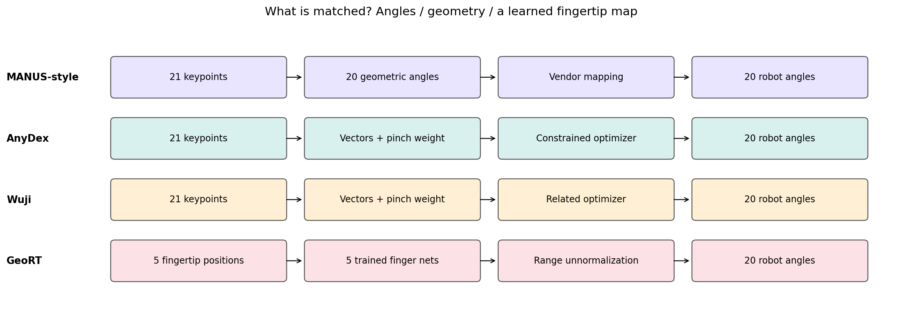

또 하나의 구분은 **목표 자세와 실제 자세**다. 알고리즘이 목표를 잘못 만들었는데 시뮬레이터가 정확히 따라갈 수 있다. 반대로 목표는 적절하지만 공통 속도 제한 때문에 실제 상태가 늦게 도달할 수 있다. 본 보고서는 두 현상을 나눠 기록한다.

<a id="sec04"></a>
## 4. 비교 시스템과 데이터 수집

### 4.1 전체 파이프라인

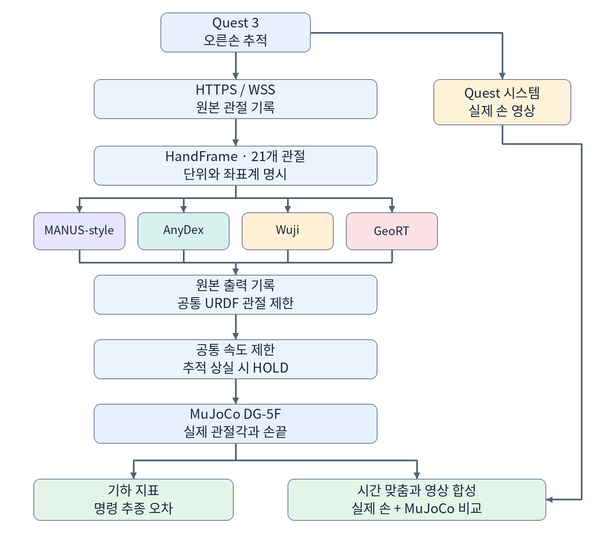

**영상의 픽셀에서 손 pose를 다시 추정하는 파이프라인은 아니다.** Quest 시스템 MP4는 사람이 실제로 어떤 동작을 했는지 확인하는 자료다. 알고리즘 입력은 촬영과 동시에 Quest Browser의 WebXR에서 받은 추정 관절 위치·회전이다. 이를 네이티브 Quest SDK 직접 출력이나 해부학적 정답으로 표기하지 않는다.

### 4.2 로봇 모델과 공통 제어

공식 DG-5F 오른손 URDF의 20개 독립 관절을 사용했다. 손가락 순서는 엄지·검지·중지·약지·새끼이며 각각 4개 관절이다. 손끝은 공식 tip 링크 원점이다. 접촉 패드 표면 중심을 별도로 추정하지 않았다. 원본 URDF의 관절 축·범위를 바꾸지 않고 파생 MuJoCo 모델을 만들었다. [공식 URDF](https://github.com/tesollodelto/tesollo_model/blob/f648627be40f8df2e3df906ccf3c5d62103f3275/dg5f/dg5f_right.urdf)

비교는 고정 base, 중력 보상, 접촉·자기충돌 비활성 상태의 자유 운동이다. 명령은 50 Hz, 물리는 0.002초 timestep으로 실행한다. 따라서 물체를 실제로 잡는 동작이나 손가락 간 충돌에 의해 모양이 제한되는 상황을 평가한 결과는 아니다. 화면에서 손끝이 만나는 것처럼 보여도 힘을 전달하는 접촉을 확인한 것은 아니다.

### 4.3 공통 입력 형식과 좌표계

WebXR 원본의 관절 이름을 공통 21개 점에 대응시킨다. wrist는 0, 엄지는 1~4, 검지는 5~8, 중지는 9~12, 약지는 13~16, 새끼는 17~20이다. 손끝 인덱스는 `[4, 8, 12, 16, 20]`이다. 원본 packet과 변환된 HandFrame을 함께 보존해 변환 전후를 추적할 수 있게 했다.

HandFrame에는 handedness, 좌표계, timestamp의 clock domain, 유효 여부와 provenance를 기록한다. 회전 정보가 없는 공개 데이터에 임의 회전을 생성하지 않고, 21개 점으로 변환할 수 없는 입력을 정상 관측처럼 채워 넣지 않는다. 오른손을 우선 지원하며, 오른손 결과를 왼손 검증으로 확대하지 않는다.

공통 palm 기준은 손목→중지 MCP를 Z, 새끼 MCP→검지 MCP를 보조 Y로 삼는다. GeoRT의 canonical 변환은 보조축에 약지 MCP→검지 MCP를 사용하므로 정의가 다르다. 이것은 숨은 축 보정이 아니라 원본 입력 규약의 차이다. 각 방법의 adapter에서 명시적으로 처리하고, GeoRT의 학습과 추론에는 같은 변환을 적용한다.

### 4.4 촬영과 시간 맞춤

한 take에서 실제 손 MP4와 관절 JSONL, 동작 안내 marker를 동시에 남긴다. 영상에는 브라우저 source clock인 SRC를 표시했다. 이후 영상의 PTS와 SRC 숫자를 일곱 지점에서 읽어 시계 관계를 맞췄다. 시스템 녹화 시작 시각과 PC wall clock이 같다고 가정하지 않았다.

| 항목 | 현재 비교 take |
|---|---|
| 기록 | `recordings/video_benchmark_002` |
| 비교 구간 | 18개 안내 동작 × 6초 = 108초 |
| 원본 영상 | 1920×1080, 약 124.61초, 명목 약 30 FPS |
| 원본 오른손 | valid 5,092개, invalid 1개, source session 1개 |
| 재생 입력·제어 | 새 valid 4,835개, 50 Hz의 5,400 tick |
| 제어 상태 | TRACKING 5,398 tick, 시작 HOLD 2 tick |
| 출력 | 25 FPS, 방법별 2,700 video frame |

영상 anchor 직선 적합의 최대 잔차는 약 0.79 ms였다. 그러나 원본 촬영 간격은 약 33 ms이고 source–receiver clock 적합의 최대 잔차는 26.30 ms다. **0.79 ms를 실제 동기화 정확도나 통신 지연으로 해석하지 않는다.** 이 수치는 수동 anchor들이 한 직선에 얼마나 가까운지를 나타낸다. [원본 anchor](docs/media/video_benchmark_002/alignment.json)

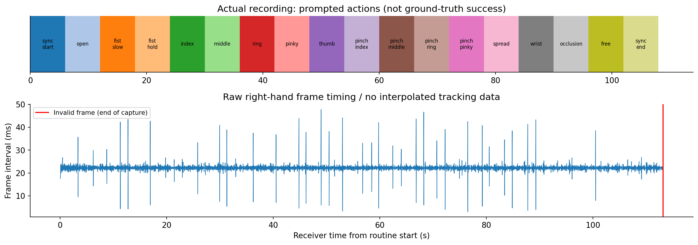

색 구간은 수행하라고 안내한 동작이며 실제 성공 라벨이 아니다. 아래 선은 오른손 frame 수신 간격이다. 가림 안내가 있다고 SDK가 반드시 invalid를 출력한 것은 아니며, 해당 구간을 자동으로 ‘추적 상실 성공 시험’으로 분류하지 않았다.

### 4.5 데이터 용도와 분리

| 용도 | 사용 자료 | 해석 |
|---|---|---|
| 기하 보정 | `geort_train_session_001.jsonl`의 펼친 손 후보 226개 | AnyDex·Wuji 프로파일 작성 |
| 현재 GeoRT 학습 | 개인 Quest session 002의 12,998 frame | 현재 full-range checkpoint의 입력 |
| 공개 데이터 실험 | GeoRT `human_alex.npy`, 공개 예제·Quest 자료 등 | 과거 학습·입력·좌표 진단; 최종 비교 영상과 분리 |
| 현재 비교 demonstration | `video_benchmark_002` | 동일 입력 재생, 학습에 자동 병합하지 않음 |
| 범위 제한 실패 진단 | 과거 평가 기록 2,000 frame | 반복 분석한 자료이며 blind test 아님 |

공개 자료도 출처별로 구분했다. GeoRT `human_alex.npy`는 공식 저장소 예제지만 원래 획득 과정이 frame별 metadata로 명시되어 있지는 않다. AnyDex의 `avp1.pkl`은 Apple Vision Pro 계열 예제로 Quest 관측과 구분한다. 과거 데이터 수 실험의 공개 Quest 자료는 제3자 [OOJU/wild-mani-kitchen](https://huggingface.co/datasets/OOJU/wild-mani-kitchen)이며 Meta 공식 배포물이 아니다. 로컬 audit에서는 79,244행의 오른손 geometry를 검사했고, 그중 선택한 부분집합으로 학습 규모를 비교했다. SDK confidence·원본 timestamp·참가자 정보가 충분하지 않은 한계도 보존했다. 공개 예제의 장치 추정 pose를 실측 해부학적 정답으로 취급하지 않았다.

세션이 다르다고 참가자가 다르다는 뜻은 아니다. 참가자 독립성을 검증할 모집·ID 정보가 없고, 같은 사용자가 보정·학습·촬영했을 수 있다. 과거 평가 자료는 여러 번 보고 설정을 진단했으므로 독립 test로 부르지 않는다. 현재 수치는 단일 참가자 demonstration에 대한 기술 진단으로 한정한다.

<a id="sec05"></a>
## 5. 알고리즘별 원리와 구현

<a id="manus"></a>
### 5.1 MANUS-style — 각도 매핑

#### 먼저 쉽게 이해하기

MANUS-style은 **사람의 굽힘 각도를 로봇 각도로 바꾸는 변환표**에 가깝다. 사람의 검지가 어느 정도 굽었는지 계산하고, 정해진 gain·offset·후처리를 거쳐 로봇 관절각을 만든다. 매 프레임 가장 좋은 자세를 탐색하거나 새로운 모델을 학습하지 않는다.

예를 들어 입력 각도가 40°보다 작으면 출력이 0°이고, 40°를 넘는 부분만 1.3배로 반영하는 관절이 있다. 그래서 작은 움직임에 반응하지 않는 구간이 생길 수 있다. 이것은 계산 오류일 수도 있지만, 원래 장갑 입력을 전제로 한 제조사 보정일 수도 있다. 입력 의미를 확인하지 않고 offset을 지우면 원본과 다른 알고리즘이 된다.

#### 입력과 수학적 계산

두 지골 벡터 $a,b$ 사이 기하 굽힘은 다음처럼 계산한다.

$$
\theta=\cos^{-1}\left(\mathrm{clip}\left(\frac{a\cdot b}{\|a\|\|b\|},-1,1\right)\right).
$$

이 값은 부호 없는 각도라 굽힘과 과신전을 완전히 구분하지 못한다. MCP 방향은 palm 기준의 `atan2`로 계산한다. 이렇게 얻은 20개 degree proxy를 제조사 `_compute_mqd_from_q` 함수에 전달하고 rad 출력을 받는다. 함수 본문은 AST로 읽어 그대로 실행하며 ROS node 전체를 임포트하지 않는다. [제조사 원본 계산](https://github.com/tesollodelto/dg5f_ros2/blob/0cb45ae9474caa92410dfa820346da8ffbae8405/dg5f_driver/script/manus_retarget/manus_retarget.py#L229-L329)

오른손 검지·중지 PIP 출력 예시는 다음과 같다. 공통 URDF 제한 전 값이다.

$$
q_{\mathrm{index,PIP}}=\max(0,1.3(\theta_{\mathrm{index,PIP}}-40^\circ)),\qquad q_{\mathrm{middle,PIP}}=\max(0,1.3(\theta_{\mathrm{middle,PIP}}-30^\circ)).
$$

모든 관절이 같은 선형식은 아니다. 관절별 방향 부호, clamp와 결합식이 있고, 엄지 끝 관절은 두 입력을 함께 사용한다. 이 때문에 관절마다 동작 응답이 달라진다. 아래 왼쪽 그래프의 평평한 구간이 해당 PIP 매핑의 dead zone을 보여준다.

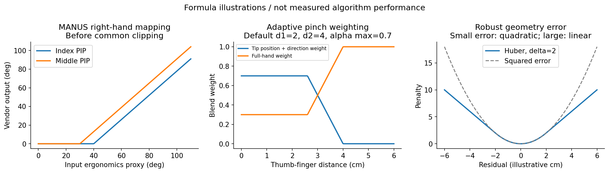

#### 엄지 입력 축 v2와 남은 차이

엄지 1→2 단위 방향을 $u$라 하자. 기존 기하 특징은 $A=\mathrm{atan2}(u_Z,u_Y)$와 $E=\mathrm{atan2}(u_X,\sqrt{u_Y^2+u_Z^2})$였다. v1은 이를 그대로 MANUS spread·stretch 슬롯에 넣었고, 통제한 FK 검사에서 교차축·반대 방향 반응을 확인했다.

현재 v2는 **spread=E**, **stretch=$\mathrm{atan2}(u_Y,u_Z)$**로 전달한다. 현재 관측 범위에서는 stretch=90°−A다. 90°는 각도를 재는 기준축을 Y에서 Z로 바꾸는 좌표 차이이며, 제조사 58.5° offset이나 1.6 gain을 역산해 상쇄한 보정이 아니다. 기하 특징 A·E는 원래 값으로도 로그에 남긴다.

제조사의 오른손 엄지 식은 입력 spread $s$, stretch $t$, 나머지 굽힘 $B,C$에 대해 다음과 같다. 후처리 전 degree 표현이다.

$$
q_1=58.5^\circ-t,\quad q_2=-1.6(s+20^\circ),\quad q_3=1.3B,\quad q_4=0.65(B+C).
$$

따라서 v2에서도 작은 A의 q1 dead zone과 큰 E의 방향 투영 접힘이 남을 수 있다. 실제 손 펴기 구간의 엄지 목표 중앙값은 MANUS `[4.7, −59.8, 11.6, 22.1]°`, AnyDex `[41.3, 0.0, −0.6, −8.2]°`, Wuji `[47.2, 0.0, −3.1, −14.8]°`였다. 같은 로봇의 같은 순서 관절이지만, MANUS는 offset·결합식을 거치고 나머지는 위치·방향을 최적화하므로 다른 자세를 선택한다.

**이 차이를 모두 ‘MANUS 알고리즘의 열세’로 해석할 수는 없다.** 실제 MANUS 센서각의 0점·스케일과 Quest proxy가 같다는 검증이 없기 때문이다. 반대로 AnyDex·Wuji의 자세를 정답이라고 단정할 수도 없다. 이 실험이 비교한 것은 각 구현과 명시된 입력 adapter의 조합이다.

<a id="anydex"></a>
### 5.2 AnyDexRetarget — 기하 최적화

#### 먼저 쉽게 이해하기

AnyDex는 사람 각도를 곧바로 복사하지 않는다. **손목에서 각 마디까지의 위치와 손끝 방향을 닮도록 로봇 자세를 조금씩 바꾸며 해를 찾는다.** 사람과 로봇의 길이가 다르므로 목표 벡터에 회전·길이 보정을 적용한 뒤 비교한다. 현재 사용한 것은 원본의 adaptive analytical optimizer다.

손을 펼칠 때는 손 전체의 위치 관계가 중요하다. 엄지와 다른 손끝이 가까워지면 손끝 위치와 끝마디 방향의 비중을 높인다. 다만 다른 마디의 조건을 완전히 버리지는 않는다. 한 조건을 더 잘 맞추면 다른 조건이 나빠질 수 있으므로 결과는 여러 목표 사이의 절충이다. [원본 optimizer](https://github.com/qqsq12321/AnyDexRetarget/blob/ee68a0234ccdf8a23b98527fd1ee2c6258278cd1/anydexretarget/optimizer/analytical_optimizer.py)

#### 어떤 데이터가 계산에 들어가는가?

HandFrame의 21개 점을 원본이 기대하는 좌표로 변환한다. 손목→PIP/DIP/TIP 벡터, 손목→손끝 벡터와 DIP→TIP 단위 방향을 만든다. 로봇 URDF의 링크 위치와 Jacobian으로 같은 대상을 계산한다. 비교 중에는 내부 위치를 cm로 환산하므로, 단위가 다른 데이터를 그대로 넣으면 손실과 threshold의 의미가 달라진다.

엄지–손끝 거리 $d_i$를 cm로 두면 기본 pinch 가중치는 다음과 같다.

$$
\alpha_i=\mathrm{clip}\left(\frac{4-d_i}{4-2+\epsilon},0,0.7\right),\qquad\alpha_{\mathrm{thumb}}=\max_i\alpha_i.
$$

가까울수록 가중치가 커지지만 최대 0.7이므로 전체 모양 항이 사라지지는 않는다. **엄지–손끝 거리는 가중치 선택에 쓰인다.** 아래 위치 항 자체는 손목→각 손끝 목표를 맞추는 것이며, 모든 손끝 쌍의 거리만 직접 줄이는 식으로 설명하면 부정확하다.

#### 목적함수와 solver

$r_{ij}$는 손목→마디 벡터, $v_i$는 손목→손끝 벡터, $u_i$는 끝마디 단위 방향이다. 모자 기호는 사람 입력에 보정을 적용한 목표다. 원본 구조를 요약하면 다음과 같다.

$$
q^*=\arg\min_{q_{\min}\le q\le q_{\max}}\left\{\sum_i\left[\alpha_i L_{\mathrm{tip},i}(q)+(1-\alpha_i)L_{\mathrm{shape},i}(q)\right]+\lambda\|q-q_{\mathrm{prev}}\|^2\right\}.
$$

손끝 항과 전체 모양 항을 각각 풀어 쓰면 다음과 같다.

$$
L_{\mathrm{tip},i}(q)=w_p\rho(\|v_i(q)-\hat v_i\|)+w_d\rho_d(\|u_i(q)-\hat u_i\|).
$$

$$
L_{\mathrm{shape},i}(q)=\frac{w_f}{3}\sum_{j\in\{\mathrm{PIP,DIP,TIP}\}}\rho(\|r_{ij}(q)-\hat r_{ij}\|).
$$

수식의 첫 부분은 pinch 관련 손끝 위치·방향, 두 번째는 손 전체 벡터, 마지막은 이전 해와의 차이다. 이전 해가 있을 때 정규화 항을 적용한다. Huber 손실 $\rho$는 작은 오차에는 제곱, 큰 오차에는 선형으로 증가한다. 최적화를 돕는 완만한 오차 함수이지 충돌 검사나 성공 판정이 아니다.

| 기본 항목 | 현재 사용 값 |
|---|---:|
| 위치·방향·전체 손 가중치 | 1 / 10 / 1 |
| 이전 해 정규화 계수 | 0.04 |
| 위치 Huber threshold | 2 cm |
| 방향 Huber threshold | 0.5 |
| solver | NLopt SLSQP |
| 기본 LPFilter 계수 | 0.2 |

Analytical은 닫힌 형태의 IK 해라는 뜻이 아니라 **손으로 작성한 gradient를 수치 solver에 전달한다**는 의미다. 이전 해를 초기값으로 재사용하고, 최초에는 관절 범위 중간값을 사용한다. 출력 필터는 현재 해 20%와 이전 필터 출력 80%를 반영한다. 이 원본 필터와 뒤쪽 공통 명령 속도 제한은 다른 단계다. [원본 filter·Huber 함수](https://github.com/qqsq12321/AnyDexRetarget/blob/ee68a0234ccdf8a23b98527fd1ee2c6258278cd1/anydexretarget/optimizer/utils.py)

#### DG-5F 연결에서 적용한 설정

AnyDex는 손목→MCP와 지골 세 구간의 손가락별 길이 비율을 사용한다. 공식 보정 helper를 수정 없이 호출하고 DG-5F 바인딩을 별도 프로파일로 만들었다. 현재 회전 XYZ는 약 `[1.662, 2.724, −3.182]°`, `pinch_scaling`은 1.0844다. pinch target 보간도 원본 경로를 사용하며 접촉 확장 항은 기본 가중치 0이다. [공식 보정 코드](https://github.com/qqsq12321/AnyDexRetarget/tree/ee68a0234ccdf8a23b98527fd1ee2c6258278cd1/example/test)

입력 길이 보정은 알고리즘 손실을 바꾼 것과 구분한다. 다만 보정이 결과에 영향을 주므로 ‘아무 설정 없이 기본값만 실행했다’고 표시하지 않는다. 회전 보정만으로 사람 손목과 로봇 palm의 형태·원점 차이가 사라지지는 않으며, 별도의 위치 offset을 임의로 맞춰 성능을 보정하지 않았다.

<a id="wuji"></a>
### 5.3 Wuji Retargeting — 제조사 최적화 구현

#### 먼저 쉽게 이해하기

Wuji도 **사람과 로봇의 위치·방향 차이를 줄이는 자세를 찾는 방식**이다. 이번 adaptive 경로에서는 AnyDex와 공유하는 구조가 크다. 따라서 비슷한 결과가 나오는 것은 이상하지 않으며, 두 숫자의 차이를 완전히 다른 기술 철학의 차이로 해석하면 안 된다.

선정 당시에는 다른 로봇핸드 제조사가 실제로 어떤 입력 규약과 확장 제약을 제공하는지 살펴보려는 목적이 있었다. 같은 20개 관절이라도 손가락 배치·링크 정의·스케일 보정이 다르기 때문에, DG-5F에는 그 의미에 맞는 연결이 필요했다. 원래 Wuji Hand에서 잘 작동한다는 소개만으로 Tesollo에서도 그대로 작동한다고 가정하지 않았다. [공식 구현 소개](https://github.com/wuji-technology/wuji-retargeting/blob/531f6ed4250b475d2e9231f54e988fc9b1c5b4ea/README.md)

#### 공유 구조와 현재 활성화된 기능

핵심 기하 목적과 solver는 앞의 adaptive 구조로 이해할 수 있다. 손목→마디 벡터, 손끝 위치·방향, pinch 가중치와 이전 해의 영향을 함께 고려한다. 그러나 현재 길이 설정은 손목에서 PIP/DIP/TIP까지의 **도달 벡터**에 손가락별 3개 비율을 적용한다. AnyDex의 손목→MCP·개별 지골 길이 4개 비율과 의미가 달라 숫자를 그대로 복사하지 않았다.

현재는 AnyDex와 같은 회전 보정과 `scaling=1.0844`를 사용하지만, Wuji 필드 의미에 맞춘 프로젝트 기하 adapter로 전달했다. 이것을 공식 Wuji의 Quest 자동 보정 절차라고 부르지 않는다. 원래 포함된 보정 경로에는 전용 장갑·링크 이름에 묶인 부분이 있어 DG-5F에 그대로 실행하지 않았다.

| 원본 기능 | 의미 | 이번 실행 |
|---|---|---|
| Hyperextension penalty | PIP/DIP가 soft minimum 아래로 가면 비용 추가 | `w_hyper=0`, 비활성 |
| DIP–PIP coupling | DIP와 PIP가 일정 비율을 따르도록 비용 추가 | `w_couple=0`, 비활성 |
| Thumb PIP 항 생략 | 엄지 전체 벡터 항 일부 제외 | `thumb_skip_pip=False` |
| 기본 손실·필터 | 기하 최적화와 시간적 완화 | 원본 경로 유지 |

개념적으로 추가 제약은 다음과 같이 쓸 수 있다. $r$은 coupling 비율, $q_{\mathrm{soft}}$는 soft minimum이다.

$$
L_{\mathrm{extra}}=w_h\sum_j\max(0,q_{\mathrm{soft}}-q_j)^2+w_c\sum_i(q_{\mathrm{DIP},i}-r q_{\mathrm{PIP},i})^2.
$$

이는 지원 기능을 설명하는 식이다. 현재 두 가중치가 0이므로 이번 결과를 설명하는 활성 손실은 아니다. **‘Wuji가 더 낮은 숫자를 보인 것은 과신전 penalty 덕분’이라는 결론은 성립하지 않는다.** 기능 추가의 효과를 확인하려면 원본 기본 재현과 구분한 별도 조건 실험이 필요하다. [선택 항의 원본 정의](https://github.com/wuji-technology/wuji-retargeting/blob/531f6ed4250b475d2e9231f54e988fc9b1c5b4ea/wuji_retargeting/opt/adaptive_analytical.py)

#### 이번 비교에서의 의미

Wuji를 통해 확인한 것은 유사한 최적화 구조라도 로봇 설정과 target 생성 규약이 바뀌면 결과가 달라질 수 있다는 점이다. 같은 기하 지표를 사용하더라도 내부에서 최적화한 목표가 완전히 같지는 않다. 원본 저장소 간 역사적 선후관계나 어느 쪽이 모든 점에서 개선판인지까지 이 실험으로 판단하지 않는다.

<a id="geort"></a>
### 5.4 GeoRT — 학습 기반 기하 매핑

#### 먼저 쉽게 이해하기

GeoRT는 **‘사람 손끝이 이 위치에 오면 로봇 관절은 이렇게 움직인다’는 대응을 미리 학습한다.** 실행 중에는 학습된 함수에 손끝을 넣어 관절각을 받는다. AnyDex·Wuji처럼 매 입력마다 반복해서 자세를 탐색하지 않는다는 것이 핵심 차이다.

일반적인 정답 학습과도 구분해야 한다. 이 실험에서는 사람 자세마다 정답 로봇 관절각을 붙여 주지 않았다. 대신 이동 방향, 도달 분포, 매핑의 곡률과 pinch 관계 같은 기하 조건으로 함수를 학습한다. 그러므로 loss가 줄었다고 사람의 모든 중간 마디 자세까지 재현됐다고 결론 내릴 수 없다. [논문의 연구 목적](https://arxiv.org/abs/2503.07541), [저자 프로젝트 설명](https://zhaohengyin.github.io/geort/)

#### 입력·네트워크·로봇 범위

현재 DG-5F에서는 손가락별 신경망이 각각 손끝 위치 3개 값을 받아 관절각 4개 값을 출력한다. 5개 손가락 네트워크가 20개 출력을 만든다. 원본 IK는 두 개의 128차원 hidden layer, LeakyReLU와 BatchNorm, 마지막 Tanh로 구성된다. 이는 전체 사람 관절각을 직접 입력하는 모델이 아니다. [원본 IK·FK 모델](https://github.com/facebookresearch/GeoRT/blob/fb2075e2a3272be372016580c0b6ebd6120228f0/geort/model.py)

정규화 출력 $z_i$에서 실제 관절 범위로 변환한다.

$$
z_i=N_{\theta_i}(h_{\mathrm{tip},i})\in[-1,1]^4,\qquad q_i=q_{\min,i}+\frac{z_i+1}{2}(q_{\max,i}-q_{\min,i}).
$$

DG-5F 관절 순서·범위와 다섯 tip을 별도 설정으로 제공했다. 원래 지원 로봇의 checkpoint를 그대로 사용한 것이 아니다. 학습 입력은 원본 canonical 좌표로 변환하며, 학습 후에 추론 입력만 회전·스케일을 조정해 결과를 맞추지 않았다.

#### 학습의 두 단계

첫째, 로봇 관절 표본에서 손끝 위치를 계산하고 **Neural FK**를 학습한다. 정확 FK를 신경망으로 근사해, 이후 관절각을 거쳐 손끝까지 미분하기 쉽게 만드는 단계다. 둘째, 고정된 Neural FK를 이용해 사람 손끝을 적절한 로봇 관절각으로 보내는 IK 네트워크를 학습한다. Neural FK가 잘 학습됐다는 사실과 사람–로봇 대응이 잘 학습됐다는 사실은 다르다.

이번 기본 모델은 개인 Quest 12,998 frame, 로봇 FK 표본 100k, FK·IK 원본 기본 각 200 epoch, AdamW 학습률 $10^{-4}$, batch 2048 조건을 사용했다. 실제 학습된 checkpoint를 요구하고, 파일이 없을 때 무작위 가중치나 다른 로봇 모델로 대체하지 않는다. [실행한 원본 trainer](https://github.com/facebookresearch/GeoRT/blob/fb2075e2a3272be372016580c0b6ebd6120228f0/geort/trainer.py)

#### 네 가지 손실은 무엇을 학습시키는가?

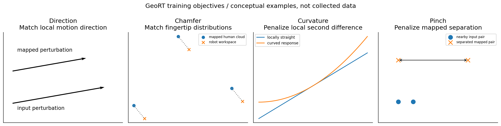

이 그림은 원리 설명용이며 수집 데이터의 성능 그래프가 아니다. Neural FK를 포함한 출력 손끝 함수를 $g(H)$라고 두면, 현재 원본 코드의 활성 손실은 다음과 같다.

$$
L=L_{\mathrm{direction}}+80L_{\mathrm{chamfer}}+0.1L_{\mathrm{curvature}}+L_{\mathrm{pinch}}.
$$

**Direction:** 사람 손끝을 조금 움직였을 때 로봇 손끝도 비슷한 방향으로 움직이도록 한다. 작은 입력 변화 $\Delta h$와 출력 변화의 cosine을 크게 만든다. 절대 위치를 사람 손끝과 정확히 같게 만드는 정답 loss는 아니다.

$$
L_{\mathrm{direction}}=-\mathrm{mean}\left[\cos\left(\Delta h,g(H+\Delta h)-g(H)\right)\right].
$$

**Chamfer:** 변환된 사람 손끝 점 집합과 로봇의 도달 가능한 손끝 점 집합이 가까워지게 한다. 같은 손가락별로 두 분포를 비교하며, 각 점에 가장 가까운 상대 집합의 점까지의 제곱거리를 양방향 평균한다. 사람 frame마다 정답 robot pose를 지정하는 방식이 아니다. [원본 거리 계산](https://github.com/facebookresearch/GeoRT/blob/fb2075e2a3272be372016580c0b6ebd6120228f0/geort/loss.py)

$$
\mathrm{CD}(A,B)=\frac1{|A|}\sum_{a\in A}\min_{b\in B}\|a-b\|^2+\frac1{|B|}\sum_{b\in B}\min_{a\in A}\|b-a\|^2.
$$

**Curvature:** 작은 변화 주변에서 함수가 급격히 휘지 않게 한다. 입력을 양쪽으로 조금 이동한 출력의 중앙 차분을 작게 만드는 항이다. 움직임을 균일하게 만드는 방향의 조건이지만 특정 중간 마디가 해부학적으로 자연스럽다는 보증은 아니다.

$$
L_{\mathrm{curvature}}=\mathrm{mean}\left[\|g(H+\Delta h)+g(H-\Delta h)-2g(H)\|^2\right].
$$

**Pinch:** 사람 손끝 쌍의 거리가 15 mm보다 작은 표본에서 대응 로봇 손끝 쌍의 제곱거리를 줄인다. 확인한 trainer 반복문은 엄지 쌍만이 아니라 모든 손끝 쌍 $i<j$를 순회한다. 손끝의 접근을 유도하지만 접촉력·패드 방향·물체 파지 성공을 직접 학습한 것은 아니다.

논문은 기하학적 원리와 충돌 회피를 포함한 연구 목표를 설명한다. 그러나 사용한 공개 trainer의 collision loss는 **0을 반환하는 placeholder**이고 분류기 연결은 미완성이다. 이번 결과를 논문의 모든 기능을 구현한 것으로 설명하지 않는다. 또한 저자 저장소는 사람과 로봇 손끝의 운동 범위가 닮아 있다는 가정을 설명한다. DG-5F에 이 가정이 충분히 맞는지는 별도 검증 대상이다. [원본 구현 범위](https://github.com/facebookresearch/GeoRT), [학습 코드](https://github.com/facebookresearch/GeoRT/blob/fb2075e2a3272be372016580c0b6ebd6120228f0/geort/trainer.py)

#### 데이터 수가 곧 동작 다양성은 아니다

원본 loader는 손가락별 point cloud를 voxel downsample하고 재표본화한다. 각 손가락 분포를 독립적으로 재구성하므로 원래 frame의 손가락 간 동시 관계가 그대로 유지되지는 않는다. 이 과정을 새로운 21관절 실측 frame이 늘어난 것으로 세지 않았다. [원본 dataset 코드](https://github.com/facebookresearch/GeoRT/blob/fb2075e2a3272be372016580c0b6ebd6120228f0/geort/dataset.py)

비슷한 손 모양을 오랫동안 기록하면 frame 수는 커져도 드문 동작의 공간 범위가 충분히 늘지 않을 수 있다. 또한 손가락별 3D 위치에서 4개 관절을 결정하는 문제에는 여러 해가 존재할 수 있다. 이 점은 뒤의 실패 조사에서 정확 FK 예시로 확인한다.

<a id="implementation"></a>
### 5.5 원본과 프로젝트 구현의 차이

| 대상 | 원본에서 유지한 부분 | 프로젝트에서 연결·기록한 부분 |
|---|---|---|
| MANUS-style | 제조사 함수 본문·gain·offset·결합식 | Quest 기하 proxy와 엄지 입력 축 v2; v1도 재현 가능 |
| AnyDex | adaptive 목적·가중치·solver·기본 필터 | DG-5F joint/link 이름과 공식 helper 기반 기하 프로파일 |
| Wuji | adaptive 목적·기본 활성 설정·필터 | DG-5F 바인딩과 원본 필드 의미에 맞춘 프로젝트 기하 adapter |
| GeoRT | 모델·trainer·손실·export의 원본 경로 | DG-5F 설정·파생 asset·개인 데이터·별도 학습 |
| 공통 제어 | 모든 방법에 같은 물리·명령 정책 | raw·clip 목표·속도 제한 명령·actual을 분리 기록 |

AnyDex·Wuji의 회전 XYZ는 공통이지만 길이 비율 배열의 의미는 다르다. 현재 고정값은 아래와 같다. AnyDex 열은 `[손목→MCP, MCP→PIP, PIP→DIP, DIP→TIP]`의 구간 비율, Wuji 열은 `[손목→PIP, 손목→DIP, 손목→TIP]` 도달 비율이다.

| 손가락 | AnyDex 구간 scaling | Wuji 도달 scaling |
|---|---|---|
| 엄지 | `[0.601, 1.605, 1.149, 1.479]` | `[0.730, 0.828, 0.949]` |
| 검지 | `[0.979, 1.023, 1.597, 1.140]` | `[0.987, 1.076, 1.085]` |
| 중지 | `[1.016, 0.906, 1.412, 1.024]` | `[0.986, 1.058, 1.058]` |
| 약지 | `[1.014, 0.994, 1.461, 1.049]` | `[1.007, 1.083, 1.079]` |
| 새끼 | `[0.860, 1.009, 1.918, 1.656]` | `[0.860, 0.993, 1.076]` |

이 숫자를 손실 가중치처럼 탐색한 것이 아니라 고정 기하 보정의 결과로 사용했다. 두 열의 값 차이를 보정 강도의 우열로 읽지 않는다. 입력 자료와 함수 출처까지 포함한 [고정 프로파일](configs/tesollo_calibrated/profile.json)을 함께 보존한다.

**범위 제한 GeoRT는 기본 비교와 별도 실험이다.** 최종 영상에는 개인 데이터로 학습한 full-range 모델을 사용했다. 제한 모델의 결과가 좋지 않다고 기록을 없애거나 기본 모델 이름으로 바꾸지 않았다. 알고리즘의 원본과 adapter의 변경, 후속 실험을 구분하는 것이 재현 가능한 기술 비교의 기본 조건이다.

<a id="sec06"></a>
## 6. 실험 설계와 평가 방법

### 6.1 비교 질문과 공통 조건

질문은 세 가지다. 첫째, 같은 손동작에 어떤 목표 자세를 만드는가? 둘째, 공통 제어기가 그 목표를 얼마나 잘 따라가는가? 셋째, 적용·보정·학습에 어느 정도 구현 부담이 생기는가? 입력 형식이 다르다는 이유로 네 방법에 각각 다른 동작을 촬영해 주지 않고 동일한 기록을 재생했다.

방법마다 소비한 입력을 hash로 누적해 digest가 같은지 검사했다. 현재 MANUS v2만 다시 계산하고 다른 세 방법은 기존 상태 파일을 byte 단위로 유지했지만, 소비 입력 digest와 제어 조건의 일치는 다시 확인했다. 실시간 창 네 개는 각 process가 최신 입력을 소비하므로, 화면만 보고 정확히 같은 frame을 평가했다고 주장하지 않는다.

### 6.2 raw·목표·명령·actual의 구분

| 기록 단계 | 의미 | 구분해야 하는 이유 |
|---|---|---|
| `q_vendor_raw` | 원본 매핑·optimizer·네트워크 출력 | 원래 어떤 자세를 제안했는지 확인 |
| `retarget_q_target` | 공통 URDF clip 이후 목표 | 공식 범위 초과 처리의 영향 확인 |
| `q_command` | 공통 속도 제한 이후 명령 | 목표에 즉시 도달하지 못하는 이유 확인 |
| `q_actual` | 물리 시뮬레이션의 실제 관절각 | actuator·동역학 추종 확인 |

속도 제한은 50 Hz에서 관절마다 최대 약 3.6°씩 명령이 변하도록 한다. 이전 명령을 $q_{t-1}^{\mathrm{cmd}}$라 하면 다음과 같다.

$$
q_t^{\mathrm{cmd}}=q_{t-1}^{\mathrm{cmd}}+\mathrm{clip}\left(q_t^{\mathrm{target}}-q_{t-1}^{\mathrm{cmd}},-\pi\Delta t,\pi\Delta t\right),\qquad\Delta t=0.02\ \mathrm{s}.
$$

무효 입력 또는 0.25초 timeout이면 마지막 적용 명령을 유지한다. 이 공통 제어는 특정 retargeter의 성능 개선 항이 아니다. 목표–명령 차이를 관절 오차로 기록하되 그 크기를 곧바로 지연 시간 몇 초로 환산하지 않는다.

### 6.3 정규화 목표 손끝 차이

사람 wrist와 로봇 palm을 각각 원점으로 하고 중지 MCP 방향·좌우 palm 방향으로 정렬한다. 사람은 wrist→중지 MCP 길이, 로봇은 중립 palm→중지 MCP 링크 길이로 나눈다. 정렬·정규화된 손끝을 각각 $\tilde h_i,\tilde x_i$라 하면:

$$
E_{\mathrm{tip}}=\frac15\sum_{i=1}^{5}\|\tilde x_i(q^{\mathrm{target}})-\tilde h_i\|_2.
$$

같은 기하 기준으로 비교하기 위한 지표다. mm 단위 정확도나 정답 robot pose와의 차이가 아니며, 형상·원점·정렬 가정의 영향을 포함한다. 유효 50 Hz 제어 tick에서 평균하므로 새 관측만 균등 가중한 평균과 다를 수 있다. 이 지표 하나로 엄지 자세의 자연스러움이나 작업 성공을 모두 설명할 수 없다.

### 6.4 추종·핀치·계산 시간

명령–실제 관절 RMSE는 전체 제어 tick과 20개 관절을 대상으로 계산한다.

$$
\mathrm{RMSE}_{\mathrm{cmd,actual}}=\sqrt{\frac1{20T}\sum_{t,j}(q_{tj}^{\mathrm{cmd}}-q_{tj}^{\mathrm{actual}})^2}.
$$

값이 작으면 로봇이 적용 명령을 잘 따라간다는 의미다. 목표가 사람에게 적절하다는 의미는 아니다. 핀치 그래프는 actual의 엄지–손끝 거리이며 각 손의 기준 길이로 정규화한다. 가까워지는 경향을 볼 수 있지만 패드 접촉·힘·물체 유지 성공을 판정하지 않는다.

계산 시간은 새 valid 입력 4,835개에서 adapter 전처리·원본 계산·기본 필터까지 포함하고, 시뮬레이션·렌더링·로그를 제외한다. 현재 MANUS는 단독 재실행, 나머지는 이전 동시 worker 실행 값이므로 독립적인 속도 순위를 만들지 않는다. 모든 방법의 실시간 안정성을 검증하려면 같은 하드웨어에서 단독 실행하고 전체 지연·주기 누락까지 추가 측정해야 한다.

### 6.5 검증 범위

현재 검증은 입력 전달, 20관절 출력, 로봇 FK, 공통 제어, 동일 입력 재생과 영상 생성이다. 독립적인 정답 관절각, 여러 사용자 통계, 접촉 성공률, 실제 로봇의 파지·장기 안정성은 검증하지 않았다. 그래서 본문의 ‘낮다’와 ‘높다’는 관측 지표에 대한 표현이지, 산업 작업 전체의 우수성을 뜻하지 않는다.

<a id="sec07"></a>
## 7. 동작별 비교 영상과 관찰 결과

### 7.1 전체 비교와 보는 방법

[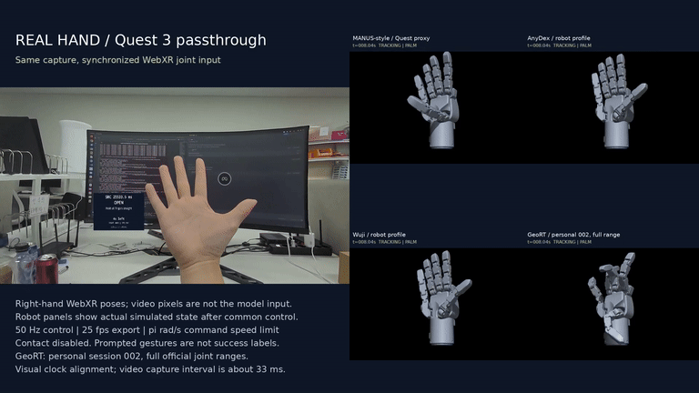](docs/media/video_benchmark_002/comparison_all.mp4)

**[전체 비교 MP4 · 108초](docs/media/video_benchmark_002/comparison_all.mp4)** · [정지 화면](docs/media/video_benchmark_002/comparison_preview.png)

왼쪽에는 실제 손 전체 영상과 중앙 확대, 오른쪽에는 위 MANUS-style·AnyDex, 아래 Wuji·GeoRT가 배치된다. 합성은 2560×1440, 각 로봇 화면은 960×720이다. 카메라는 방위각 215°·고도 +20°의 손바닥 방향이며, 네 방법에 같은 시점을 사용했다. GIF를 누르면 해당 MP4를 열 수 있다.

**먼저 볼 것은 손의 모양이고, 다음은 움직이는 방향과 반응 과정이다.** 로봇 화면은 target FK만 그린 것이 아니라 공통 제어를 거친 actual 상태다. 손목 이동 자체를 로봇 base 이동으로 재현하는 실험이 아니므로, 손목 구간에서는 정렬 변화에 대한 상대 손 모양을 본다. 아래 동작명은 촬영 안내이며 성공 판정 라벨이 아니다.

### 7.2 손 펴기·주먹

이 구간에서는 중립 자세와 굽힘 방향을 본다. 손을 펼쳤을 때 엄지와 손가락에 굽힘이 남는지, 주먹으로 이동할 때 중간 마디가 역방향으로 움직이는지 확인한다. MANUS 엄지의 차이는 원본 offset과 proxy 기준 차이를 포함하고, GeoRT의 open/fist 불일치는 뒤의 실패 분석과 연결된다. 한 frame의 인상만으로 전체 구간을 성공·실패로 분류하지 않는다.

| 동작별 비교 — GIF 클릭으로 MP4 열기 |
|---|
| **손 펴기**<br>[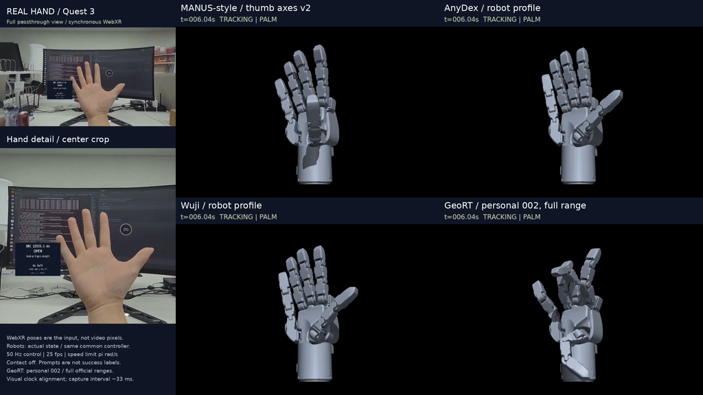](docs/media/video_benchmark_002/gestures/open.mp4) |
| **천천히 주먹 쥐기·펴기**<br>[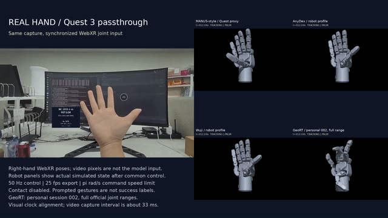](docs/media/video_benchmark_002/gestures/fist_slow.mp4) |
| **주먹 유지**<br>[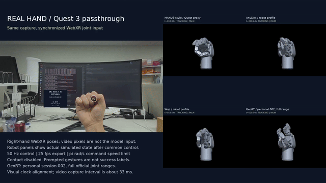](docs/media/video_benchmark_002/gestures/fist_hold.mp4) |

### 7.3 손가락 개별 움직임

이 구간의 질문은 지정한 손가락이 사람과 같은 방향으로 움직이는지, 나머지 손가락이 얼마나 유지되는지다. 모든 인간 관절과 로봇 관절을 일대일로 보정한 것은 아니므로, 단순 각도 크기보다 운동 방향과 단계별 굽힘을 함께 본다. 엄지에는 뿌리 두 축과 끝 관절의 결합이 있어 다른 손가락과 동일한 기준으로만 판단하기 어렵다.

| 동작별 비교 — GIF 클릭으로 MP4 열기 |
|---|
| **엄지**<br>[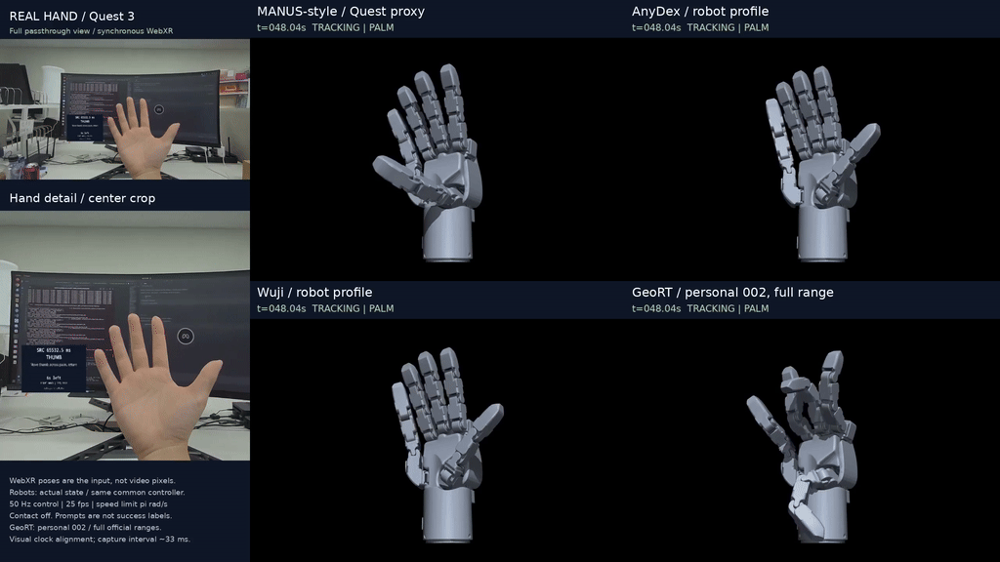](docs/media/video_benchmark_002/gestures/thumb.mp4) |
| **검지**<br>[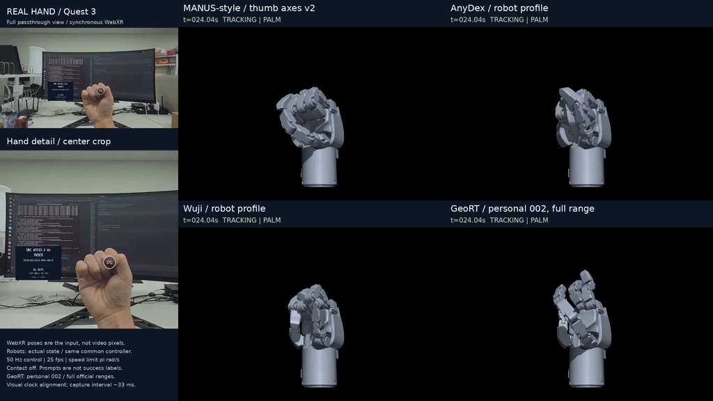](docs/media/video_benchmark_002/gestures/index.mp4) |
| **중지**<br>[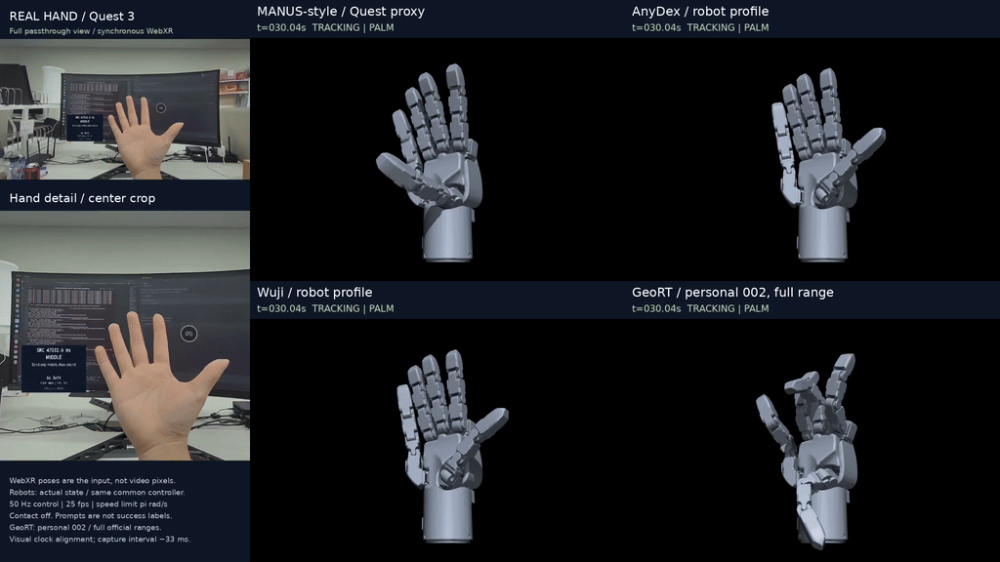](docs/media/video_benchmark_002/gestures/middle.mp4) |
| **약지**<br>[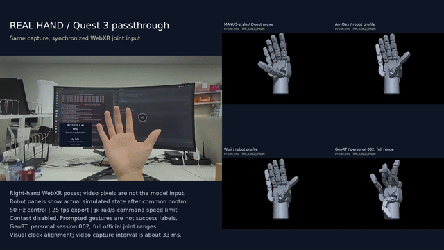](docs/media/video_benchmark_002/gestures/ring.mp4) |
| **새끼**<br>[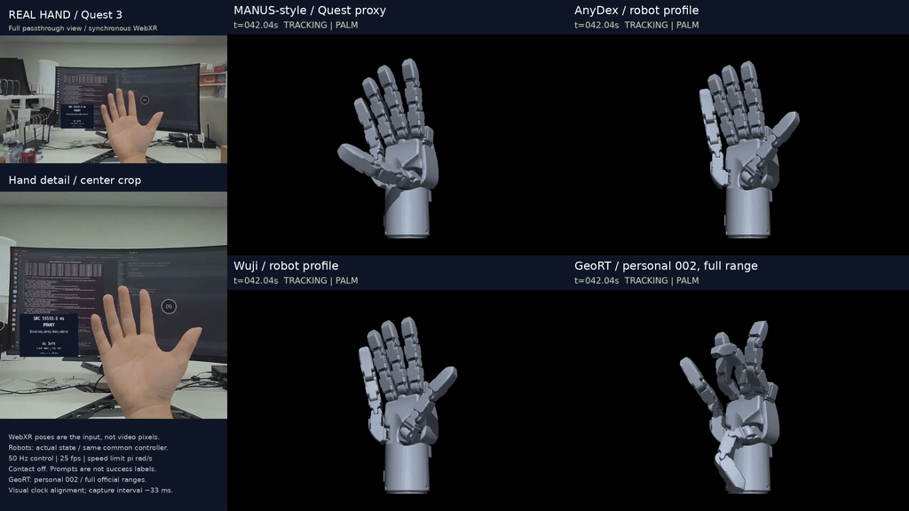](docs/media/video_benchmark_002/gestures/pinky.mp4) |

### 7.4 엄지와 각 손가락의 핀치

여기서는 손끝이 서로 접근하는지, 가까운 상태가 유지되는지와 다른 마디의 자세를 함께 본다. 실제 손이 붙어 있어도 로봇의 길이·배치가 달라 같은 모양이 불가능할 수 있다. 반대로 로봇 tip 원점이 가까워도 패드 방향이 맞지 않거나 물체를 잡지 못할 수 있다. 현재 영상만으로 접촉 성공률을 계산하지 않는다.

| 동작별 비교 — GIF 클릭으로 MP4 열기 |
|---|
| **엄지–검지**<br>[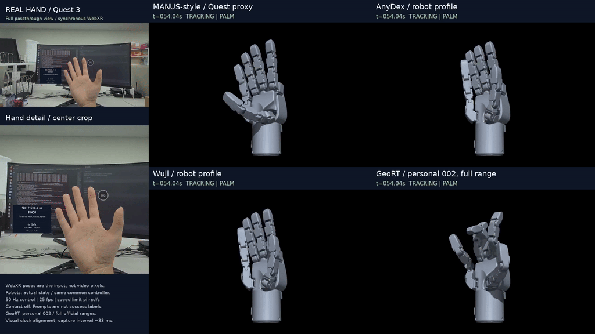](docs/media/video_benchmark_002/gestures/pinch_index.mp4) |
| **엄지–중지**<br>[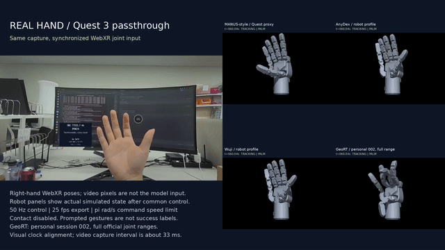](docs/media/video_benchmark_002/gestures/pinch_middle.mp4) |
| **엄지–약지**<br>[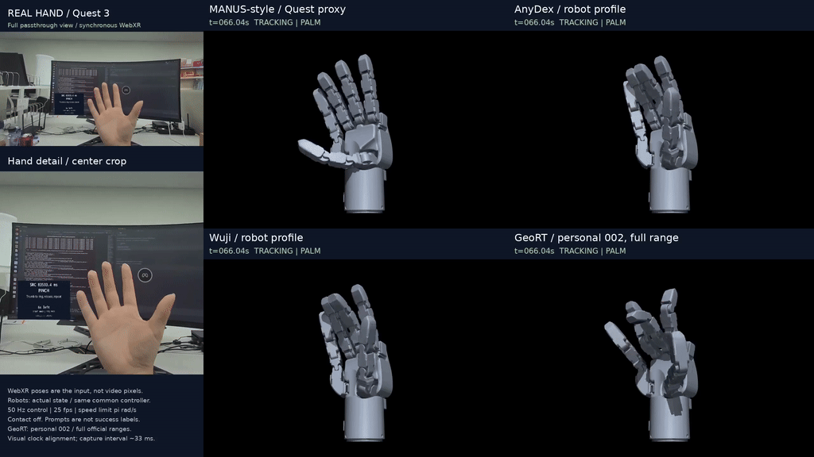](docs/media/video_benchmark_002/gestures/pinch_ring.mp4) |
| **엄지–새끼**<br>[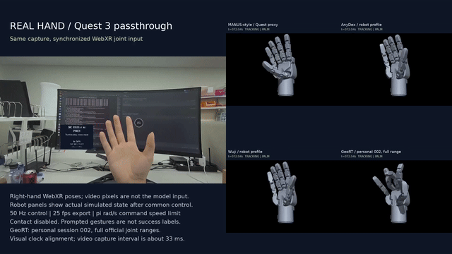](docs/media/video_benchmark_002/gestures/pinch_pinky.mp4) |

### 7.5 벌림·손목·가림 안내·자유 동작

벌림에서는 손가락 사이 방향 관계, 손목에서는 상대 palm 좌표의 일관성, 자유 동작에서는 전환 구간의 목표 변화를 본다. 가림 안내 구간에 실제 invalid packet이 얼마나 있었는지는 raw 기록으로 판단해야 한다. 화면이 잠시 어색하다는 관찰만으로 tracking loss나 통신 지연을 원인으로 확정하지 않는다.

| 동작별 비교 — GIF 클릭으로 MP4 열기 |
|---|
| **벌리기·모으기**<br>[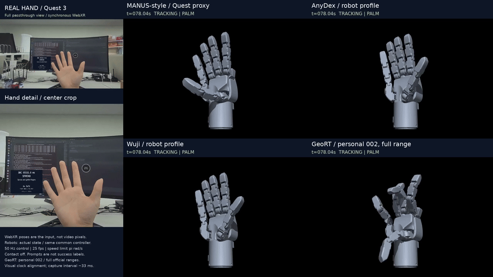](docs/media/video_benchmark_002/gestures/spread.mp4) |
| **손목 회전**<br>[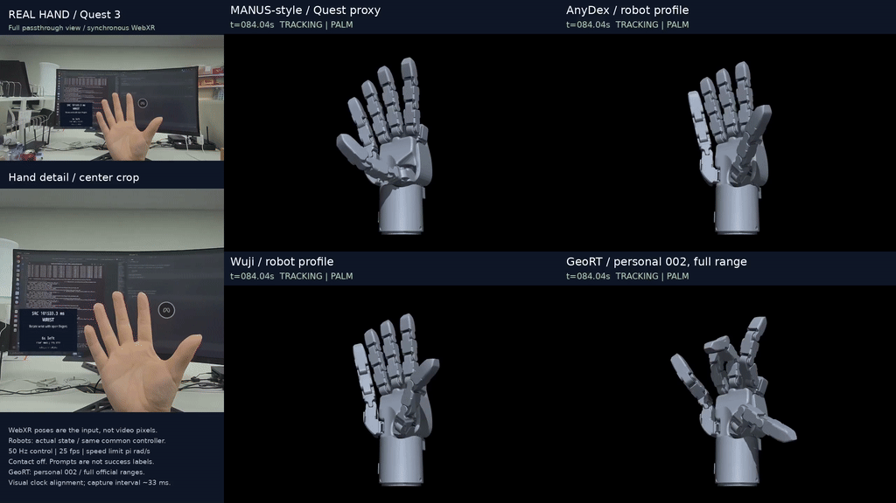](docs/media/video_benchmark_002/gestures/wrist.mp4) |
| **손 가림 안내**<br>[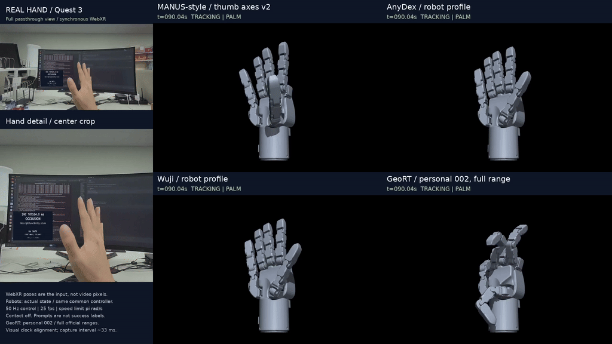](docs/media/video_benchmark_002/gestures/occlusion.mp4) |
| **자유 동작**<br>[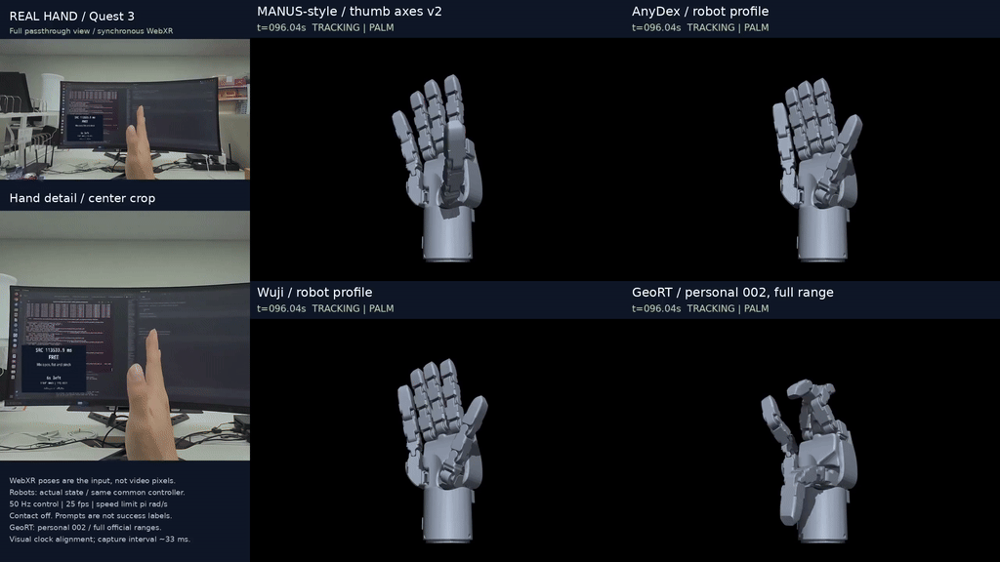](docs/media/video_benchmark_002/gestures/free.mp4) |

### 7.6 크게 볼 수 있는 개별·그룹 영상

| 실제 손 + 개별 방법, 각 108초 | 동작 그룹 |
|---|---|
| [MANUS-style 엄지 v2](docs/media/video_benchmark_002/comparison_manus.mp4) | [손 펴기·주먹, 18초](docs/media/video_benchmark_002/clip_open_fist.mp4) |
| [AnyDex](docs/media/video_benchmark_002/comparison_anydex.mp4) | [개별 손가락, 24초](docs/media/video_benchmark_002/clip_individual_fingers.mp4) |
| [Wuji](docs/media/video_benchmark_002/comparison_wuji.mp4) | [네 핀치, 24초](docs/media/video_benchmark_002/clip_pinches.mp4) |
| [GeoRT](docs/media/video_benchmark_002/comparison_geort.mp4) | [손목·가림 안내, 12초](docs/media/video_benchmark_002/clip_wrist_occlusion.mp4) |

개별 영상의 로봇 화면은 1920×1440이다. 전체 영상에는 SYNC 시작·종료를 포함한 18구간이 있고, 개별 GIF는 SYNC를 제외한 16개 동작을 각각 6초씩 보여준다. 실제 손 중앙 crop은 확대용이며 전체 영상도 함께 표시해 원래 시야를 보존했다.

<a id="sec08"></a>
## 8. 정량 결과와 그래프 분석

### 8.1 전체 요약

| 방법 | 정규화 목표 손끝 차이 ↓ | 명령–실제 RMSE ↓ | 목표–명령 RMSE | adapter 중앙 시간 / P95 |
|---|---:|---:|---:|---:|
| MANUS-style · 엄지 v2 | 0.3494 | 0.222° | 1.977° | 0.172 / 0.229 ms |
| AnyDex | 0.2169 | 0.205° | 1.311° | 4.137 / 14.119 ms |
| Wuji | 0.2028 | 0.209° | 1.682° | 2.482 / 8.632 ms |
| GeoRT | 0.6756 | 0.389° | 10.239° | 1.029 / 2.079 ms |

숫자는 [현재 summaries](docs/media/video_benchmark_002/summaries.json)와 [CSV](docs/media/video_benchmark_002/metrics.csv)에서 확인할 수 있다. 모든 방법의 입력 digest는 일치한다. 그러나 같은 사람 자료를 넣었다는 사실만으로 입력 adapter·보정의 차이까지 없어지는 것은 아니다. 표는 그 차이를 포함한 현재 구현 조합의 결과다.

### 8.2 목표 차이·추종·계산 시간

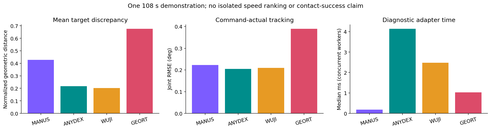

**그래프의 의미:** 왼쪽은 정규화 목표 손끝 차이, 가운데는 명령–실제 관절 RMSE, 오른쪽은 진단용 adapter 중앙 시간이다. 왼쪽과 가운데는 서로 다른 질문에 답한다. 손 모양의 기하 차이가 크지만 명령 추종은 좋은 경우가 가능하다.

**관측:** Wuji와 AnyDex의 기하 지표가 현재 다른 두 방법보다 낮았다. 네 방법 모두 명령–실제 오차는 1°보다 작았으며 GeoRT도 약 0.389°였다. 반면 GeoRT 목표의 기하 차이는 컸다. 따라서 ‘시뮬레이터가 모든 명령을 못 따라가서 GeoRT 모양이 나쁘다’는 설명으로는 충분하지 않다.

**해석의 한계:** 참가자 반복이나 신뢰구간이 없으므로 Wuji 0.2028과 AnyDex 0.2169의 차이를 일반적인 우위로 확정하지 않는다. 시간 역시 실행 조건이 섞인 값이며 FPS·end-to-end 지연이 아니다. 논문이나 저장소에서 소개한 속도와 직접 비교해 재현 성공·실패를 판정하지 않는다.

### 8.3 시간에 따른 차이와 공통 제어

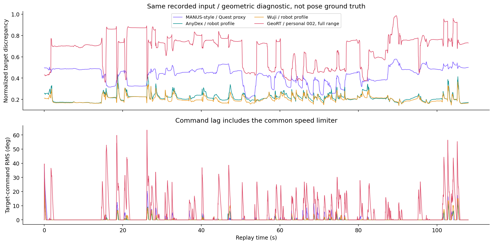

**그래프의 의미:** 위는 시간별 목표 손끝 차이, 아래는 목표–명령 관절 RMS 차이다. 전체 평균에 가려진 전환 구간을 찾고, 영상의 동작 시각과 연결하기 위한 그림이다. 아래 차이에는 공통 속도 제한이 포함된다.

**관측:** GeoRT의 목표–명령 RMSE는 약 10.239°로 다른 방법보다 컸다. 빠른 목표 변화 때문에 제한된 명령이 목표를 즉시 따라가지 못하는 영향이 있다. 하지만 위 그래프의 목표 자체에 있는 차이는 그 과정과 별개다. 속도 제한을 없애는 것으로 잘못된 목표가 올바른 자세로 바뀌는 것은 아니다.

**알 수 없는 것:** 이 관절 차이를 시간 지연 몇 초로 환산할 수 없다. 실제 반응 지연에는 입력 추정·네트워크 전송·계산·제어·표시가 함께 들어가므로 별도 clock 기반 측정이 필요하다. 큰 목표 차이를 통신 지연 하나로 설명하지 않는다.

### 8.4 사람의 굽힘과 로봇 목표각

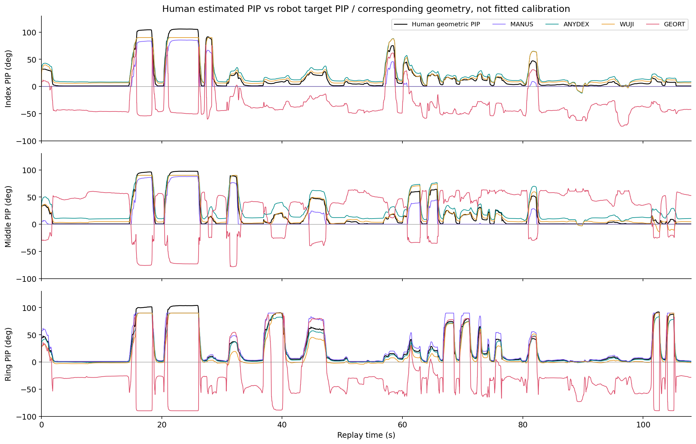

**그래프의 의미:** 검정색은 Quest 위치에서 계산한 사람 PIP 기하 각도, 색 선은 검지·중지·약지의 로봇 목표 PIP다. 평균 위치 차이뿐 아니라 굽힘의 방향과 유지 상태를 확인한다. 해당 로봇 축의 역할은 FK로 대조했지만, 사람의 해부학적 encoder 정답을 확보한 것은 아니다.

**해석:** 사람 각도가 증가할 때 로봇 굽힘이 반대로 가거나, 손을 편 상태에서 큰 굽힘이 유지된다면 자세 대응을 추가 조사해야 한다. MANUS의 작은 입력에서 flat한 출력은 원본 offset·clamp로도 발생한다. GeoRT의 open/fist 문제는 이 방향 관계와 영상 관찰을 함께 근거로 진단했다.

**주의:** 같은 각도가 가장 좋은 retargeting이라는 뜻은 아니다. 손가락 길이가 달라 적절한 관절각도 다를 수 있다. 따라서 그래프는 움직임 방향·지속적인 역굽힘을 검사하는 자료로 사용하고, 절대 각도 차이를 곧바로 작업 실패율로 바꾸지 않는다.

### 8.5 핀치 구간의 손끝 거리

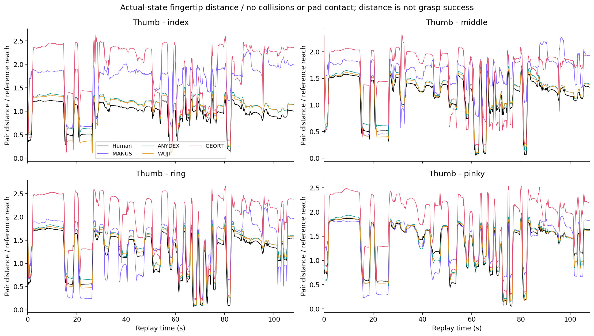

**그래프의 의미:** 사람과 로봇 각각의 기준 길이로 나눈 엄지–검지·중지·약지·새끼 tip 거리다. 로봇은 actual 상태로 계산하므로 명령 추종 영향까지 포함한다. 영상의 pinch 안내 구간과 함께 보면 어느 손가락 조합이 접근하는지 확인할 수 있다.

**해석:** 사람이 가까워지는 시점에 로봇도 가까워지는지, 접근 뒤 유지가 되는지, 다른 손가락의 움직임에서 불필요하게 가까워지는지 살펴본다. 여기서는 임의 성공 threshold를 만든 뒤 ‘핀치 성공률’을 발표하지 않았다. 링크 원점과 실제 패드 중심이 다르고 접촉도 꺼져 있기 때문이다.

실제 도입 판단에는 이 그래프 다음 단계가 필요하다. 접촉 위치·패드 방향·물체 크기를 정하고, 집기·유지·놓기 성공을 반복 측정해야 한다. 거리의 개선과 작업의 개선을 분리해서 확인하는 것이 목적이다.

### 8.6 관절 clipping

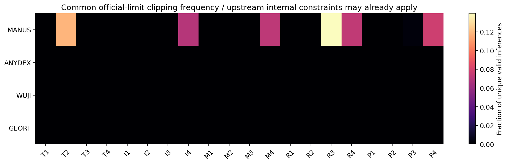

**그래프의 의미:** 새 valid 입력에서 원본 출력이 공통 URDF 제한에 의해 잘린 빈도다. MANUS v2 엄지의 두 번째 관절 clip은 이전 11.83%에서 0%가 됐다. AnyDex·Wuji·GeoRT의 공통 clip은 현재 기록에서 0이다.

**해석:** clip 감소는 경계 포화가 줄었다는 의미다. 원본 optimizer나 Tanh 출력이 이미 내부 범위를 지키면 공통 clip은 처음부터 발생하지 않을 수 있다. 넓은 허용 범위 안에서 역굽힘이 생겨도 clip은 0이다. 따라서 이 지표는 정상 자세의 점수가 아니라 경계 처리의 진단이다.

### 8.7 MANUS 엄지 v1·v2 비교


위 두 그래프는 엄지 뿌리 관절의 목표각, 아래는 같은 입력의 정규화 목표 손끝 차이다. v2는 입력 축 규약만 바꾸고 제조사 파라미터와 다른 입력을 유지했다. 기하 차이는 **0.4283→0.3494**, q2 raw 중앙값은 **−104.57°→−69.45°**로 변했다.

수정 효과와 남은 문제를 구분해야 한다. 비포화 통제 좌표에서는 A·E 증가에 대응 로봇 방향이 같은 방향으로 변하는지 확인했다. 하지만 현재 raw q2가 −90°보다 작은 입력은 여전히 1,555/4,835개다. 이 값은 공식 범위 위반률이 아니라 방향 투영이 접힐 수 있는 영역의 빈도다. 입력 축 수정이 실제 MANUS 0점 보정을 완성한 것은 아니다.

다른 두 엄지 관절과 나머지 손가락의 raw·target·command는 유지했다. MANUS 다른 손가락 actual의 차이는 최대 약 $4.44\times10^{-16}$ rad의 반올림 수준이었다. 다른 세 방법의 상태·수치는 byte 단위로 유지했다. [변경 대조 기록](docs/media/video_benchmark_002/revision_verification.json)

### 8.8 정량 결과의 종합 해석

이번 자료가 지지하는 결론은 세 가지다. **기하 최적화 두 방법이 우선 검토 후보이며, 공통 명령 추종은 목표 자세 실패와 구분해야 하고, 입력 proxy와 보정의 영향을 숨기면 안 된다.** 반면 수치 하나로 실제 파지 성능, 여러 사용자 일반화나 새로운 로봇 전체에 대한 우위를 확정할 근거는 없다.

구현 부담도 현재 작업의 관찰로 해석한다. MANUS는 계산이 단순하지만 입력 의미 대응이 중요했고, 최적화 방식은 로봇 링크·스케일·좌표 설정이 필요했다. GeoRT는 여기에 별도 runtime, 학습·checkpoint·FK 검증이 추가됐다. 개발 시간이나 유지보수 비용을 정량 측정한 것은 아니므로 ‘구현 난이도 점수’를 임의로 만들지 않았다.

<a id="sec09"></a>
## 9. GeoRT 적용 실패와 원인 조사

### 9.1 실패를 어떻게 정의했는가?

실제 Quest 동작에 대해 일부 pinch는 반응했지만, 손을 펴도 큰 굽힘이 남거나 주먹을 쥘 때 중간 마디가 뒤로 꺾이는 동작이 관찰됐다. 처음에는 데이터 부족, 공개 데이터와 Quest의 좌표 차이, 로봇 관절 순서 또는 MuJoCo 모델 변환을 의심했다. 하나를 원인으로 단정하지 않고 각 단계를 분리해 대조했다.

현재 비교 영상은 개인 Quest 데이터로 학습한 full-range 모델이다. 실패한 범위 제한 모델을 선택적으로 제외해 성공 사례만 제시한 것이 아니며, 반대로 실패 모델을 현재 baseline의 이름으로 섞어 보여주지도 않는다. 과거 실험과 현재 108초 demonstration의 수치는 구분한다.

### 9.2 시도 순서와 결과

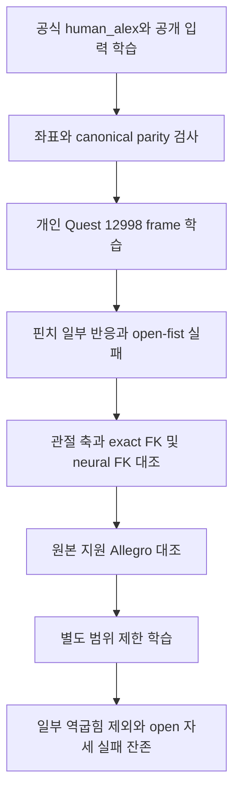

| 단계 | 시도 | 확인된 사실 |
|---|---|---|
| 공식·공개 데이터 | `human_alex.npy` 3,498개, 공개 Quest 1k·3,498·10k 비교 | 개수 증가만으로 대응 문제가 해결되지 않음 |
| 좌표 정합 | reflection·축·canonical 변환 경로 대조 | 좌표 문제는 따로 처리했으나 자세 실패가 남음 |
| 개인 데이터 | 유효 오른손 12,998 frame full-range 학습 | 공개 데이터 출처만의 문제로 설명하기 어려움 |
| 계산 계층 | 관절 순서·축·SAPIEN·MuJoCo·Neural FK·추종 검사 | 아래의 정확 FK 및 제어 대조 결과 확보 |
| 다른 로봇 | 같은 개인 입력의 Allegro 대조 | 주요 굽힘 대응이 DG-5F보다 나았지만 정답 비교는 아님 |
| 범위 제한 | distal 8개 제한, 이후 검증된 6개 축의 관측 상한 적용 | 일부 역굽힘은 금지했지만 손 펴기 자세가 해결되지 않음 |

공개 10k 데이터에는 엄지–약지 거리 15 mm 미만 후보가 5개, 엄지–새끼 후보는 0개였다. 이는 정답 pinch 라벨이 아니라 기하 후보다. 그럼에도 ‘10k면 충분히 다양한 동작이 있다’고 볼 수 없음을 보여준다. 개인 데이터에서도 실패가 남았으므로 공개 데이터 대신 직접 수집하면 반드시 해결된다고도 말할 수 없다.

### 9.3 MuJoCo에 손을 잘못 올린 것인가?

| 과거 진단의 대조 | 관측값 | 해석 |
|---|---:|---|
| SAPIEN exact FK ↔ MuJoCo FK | 1,045개 자세, 손끝 최대 약 0.001585 mm | 검사한 기구학 경로는 사실상 일치 |
| Neural FK ↔ exact FK | 무작위 1,024개 자세, 평균 약 2.15 mm | 근사 오차는 있으나 큰 자세 차이 전체를 설명하기 어려움 |
| 명령 ↔ actual 손끝 | 동적 진단 평균 약 0.678 mm | 시뮬레이터가 적용 명령을 대체로 추종 |
| 목표 ↔ actual 손끝 | 같은 진단 평균 약 13.06 mm | 공통 속도 제한 등의 추종 과정이 포함됨 |

이 표는 현재 108초 영상과 다른 과거 진단 자료다. 각 수치는 대상·표본·단위가 달라 서로 빼서 한 원인의 기여율을 계산하지 않는다. 정확 FK가 같다는 것은 주어진 관절각에서 같은 위치를 계산한다는 의미다. 그 관절각이 사람 손에 적합한지는 이 검사로 알 수 없다.

### 9.4 같은 손끝을 만드는 다른 자세

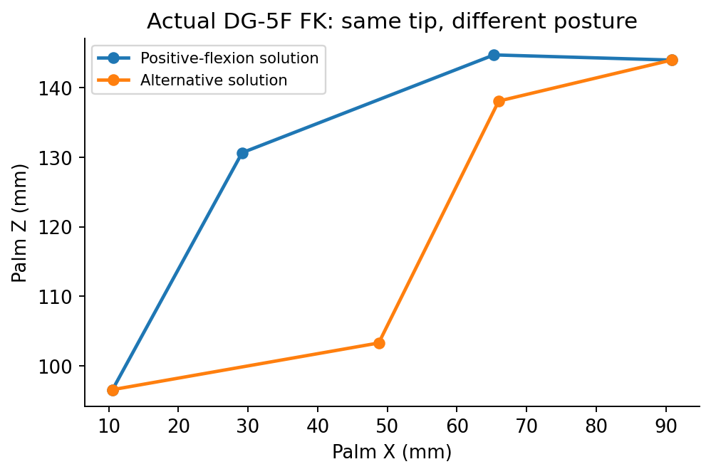

같은 중지 손끝을 만드는 두 굽힘 조합을 정확 FK에서 찾았다. 조합 A는 약 `[28.65, 40.11, 22.92]°`, B는 `[80.04, −53.68, 50.29]°`다. 손끝 차이는 수치 계산상 약 $2.3\times10^{-9}$ mm지만 중간 마디 모양은 다르다. [예시 원자료](docs/media/video_benchmark_002/ik_ambiguity.json)

이 사례는 **손끝이 같아도 자세가 유일하지 않다**는 증거다. 하지만 두 전체 매핑의 Direction·Curvature loss가 모두 같다는 증명은 아니다. GeoRT 실패의 유일한 원인으로 제시하지 않고, 손끝 기반 학습이 중간 자세를 충분히 결정하는지 검토할 필요가 있다는 근거로 사용한다.

### 9.5 관절 범위를 줄이면 해결됐는가?

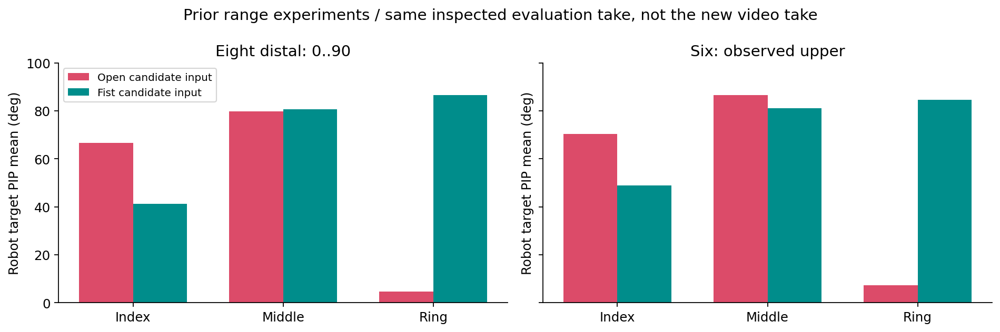

이 그림은 현재 영상이 아니라 반복 진단한 과거 2,000 frame 평가 기록이다. Open·fist는 기하 조건으로 고른 후보이며 정답 동작 라벨이 아니다. 별도 학습 결과는 다음과 같다.

| 제한 조건 | Open 후보 PIP: 검지 / 중지 / 약지 | Fist 후보 PIP: 검지 / 중지 / 약지 |
|---|---|---|
| 비엄지 distal 8개, 0~90° | 66.75° / 79.87° / 4.70° | 41.21° / 80.66° / 86.59° |
| 검증된 6개 PIP/DIP, 관측 상한 | 70.36° / 86.56° / 7.29° | 48.90° / 81.19° / 84.71° |

후자의 DIP 상한은 검지·중지·약지 각각 71.29°·68.46°·74.63°, PIP 상한은 90°였다. **하한 0°는 실험 제약이며 측정한 해부학적 하한이 아니다.** 엄지·MCP·새끼까지 사람 각도를 정확히 대응시켰다고 주장하지 않는다.

관측 상한 실험은 동일 초기 가중치·seed 20261018·공유 FK 조건에서 각각 200 epoch를 수행했다. 기존 Neural FK 정규화와 제한 범위는 별도 affine adapter로 연결했다. 그런데 open 869후보에서도 검지·중지가 크게 굽혔고, fist 433후보에서도 자연스러운 대응을 확보하지 못했다. 역굽힘을 허용하지 않는 것과 올바른 자세를 선택하도록 학습하는 것은 다른 문제였다.

### 9.6 확인된 사실과 남은 원인 가설

확인된 사실은 현재 DG-5F 학습·입력 조건에서 open/fist 대응이 부족했고, 개인 데이터와 범위 제한만으로 해결되지 않았다는 것이다. 단순한 exact FK 불일치나 공통 명령 추종 불량을 주원인으로 지목할 증거도 약해졌다.

남은 가설에는 사람·로봇의 작업공간 형태 차이, 학습 표본 분포, 해의 비유일성, 초기화와 손실 간 상호작용이 있다. 저자 저장소의 운동 범위 유사성 가정은 이 조사와 관련되지만, 그 가정 위반을 수치로 완전히 검증한 것은 아니다. 데이터 부족이나 학습 시간만을 단일 원인으로 확정하지 않는다.

**현재 판단:** 이번 조건에서는 GeoRT를 DG-5F의 신뢰할 수 있는 기본 모델로 채택할 근거가 부족하다. 다만 이 결과를 모든 GeoRT 적용이나 모든 Tesollo 설정의 실패로 일반화하지 않는다. 다음 연구를 진행한다면 데이터 커버리지와 원본 지원 로봇에서의 재현 조건부터 다시 고정해야 한다.

<a id="sec10"></a>
## 10. 부서 적용을 위한 비교 판단

### 10.1 현재 사용할 수 있는 가장 좋은 방식은 무엇인가?

현재 자료에서 **우선 검토 후보는 AnyDex와 Wuji**다. 기하 지표만 보면 Wuji가 가장 낮았다. 그러나 접촉 없는 한 번의 demonstration에서 얻은 차이만으로 실제 작업의 최종 승자를 정할 수는 없다. 실무 도입에서는 입력 연결·보정·유지보수·실패 대응을 함께 판단해야 한다.

| 목적 | 현재 판단 | 아직 필요한 증거 |
|---|---|---|
| 기존 MANUS 시스템과 비교 | 제조사 매핑을 기준 경로로 유지 | 실제 장갑 입력·실제 로봇과의 비교 |
| Quest 기반 초기 통합 | AnyDex를 통합 출발점으로, Wuji를 동등 비교 후보로 검토 | 실제 작업·여러 사용자·단독 지연 측정 |
| 동일 기하 기준의 낮은 목표 차이 | 현재 Wuji 수치가 가장 낮음 | 반복·독립 평가에서의 차이 유지 여부 |
| 학습 기반 연구 도입 | GeoRT는 별도 탐색 과제로 분리 | 원본 조건 재현과 DG-5F 자세 대응 확보 |

AnyDex를 초기 통합 출발점으로 제안하는 것은 **공개 입력·로봇 설정 구조와 이번 연결 경험을 고려한 엔지니어링 제안**이다. Wuji보다 정확하다는 수치 결론은 아니다. 기존 MANUS 시스템을 즉시 폐기하거나 GeoRT 연구를 중단하라는 의미도 아니다. 비교 경로를 유지한 채 작업 중심으로 의사결정을 좁히자는 제안이다.

### 10.2 유지보수와 연구 주장도 도입 판단에 포함한다

2026-10-18 확인 시 [Wuji 원본 저장소](https://github.com/wuji-technology/wuji-retargeting)는 소유자가 2026-08-31 archive한 읽기 전용 상태였다. 고정 commit의 비교 가치는 유지되지만 향후 업데이트와 이슈 대응을 기대하는 장기 제품 통합에서는 별도로 검토해야 한다. archive가 현재 계산 결과의 오류를 뜻하는 것은 아니다.

GeoRT 논문의 고속성·일반성 주장은 저자들의 실험 조건에 대한 연구 결과다. 이번 DG-5F 구현은 입력·로봇·학습 조건과 공개 코드의 활성 기능이 다르므로 같은 성능을 당연히 기대하거나, 반대로 이번 실패로 논문 전체를 부정하지 않는다. 논문·저장소 설명·현재 실행 결과를 구분하는 것이 기술 조사와 재현 실험의 차이다.

### 10.3 최종 선정 기준

부서가 사용할 방식은 ‘가장 비슷한 GIF’가 아니라 **정의한 작업을 안정적으로 수행하는 방식**이어야 한다. 집기·유지·놓기 성공률, 원하지 않는 손가락 간섭, 목표 추종, 입력 중단 복구와 사용자 보정 시간을 함께 측정해야 한다. 현재 지표는 그 후보를 좁히는 자료이며 최종 작업 평가를 대신하지 않는다.

<a id="sec11"></a>
## 11. 추가 구현 및 검증 계획

### 11.1 보정과 입력 대응을 먼저 고정한다

사용자별 펼친 손·중립 자세를 같은 절차로 수집하고, 입력 종류에 따라 필요한 좌표·길이·각도 대응을 문서화한다. MANUS-style은 실제 장갑 ergonomics와 Quest proxy의 0점·부호·스케일 차이를 구분해야 한다. AnyDex·Wuji는 보정 자료를 평가 자료와 분리하고 추적 중 자동으로 다른 프로파일을 섞지 않도록 한다.

완료 기준은 특정 화면이 좋아 보이는 것이 아니라, 보정 반복 시 결과의 재현성과 전환 입력의 방향이 유지되는 것이다. 이후 새로운 보정이나 soft constraint를 도입한다면 현재 원본 재현 baseline과 별도 버전으로 기록한다. 원본 손실을 바꾼 결과를 동일한 알고리즘 기본값으로 비교하지 않는다.

### 11.2 독립 평가와 실제 작업을 설계한다

여러 사용자·여러 세션에 대해 손 펴기, 주먹, 네 핀치와 부서 작업을 같은 순서로 반복한다. 참가자·시퀀스 ID를 남기고 학습·보정·평가의 중복을 검사한다. 동작 안내 label과 실제 성공 label을 분리하고, 확인된 성공 기준과 제외 조건을 실행 전에 정한다.

실제 작업 예시는 작은 물체 pinch, 손 전체 grasp, 물체 유지와 의도적 놓기다. 접촉 pad 위치, 충돌 geometry와 물체 조건을 먼저 정한 뒤 마찰·접촉을 포함한 simulation을 구성한다. 현재 자유 운동 결과와 새 접촉 실험 결과를 같은 지표처럼 합치지 않는다.

### 11.3 실물 DG-5F와 전체 지연을 검증한다

실물이 확보되면 같은 joint order와 제한 설정으로 하드웨어 연결을 검증하고, 실제 encoder·손끝 또는 작업 성공을 측정한다. 시뮬레이션의 작은 명령–actual 차이가 실제 로봇에서도 유지된다고 가정하지 않는다. actuator·접촉·네트워크와 입력 장치의 영향이 추가되기 때문이다.

각 방법을 같은 하드웨어에서 단독 실행해 중앙값·P95 계산 시간과 제어 주기 누락을 측정한다. 입력 capture부터 명령 적용·화면 표시까지의 전체 지연은 별도 clock 또는 외부 관측으로 평가한다. timeout HOLD, 재연결, 추적 복구 후 전환도 반복 확인한다.

| 단계 | 산출물 | 다음 단계로 넘어갈 기준 |
|---|---|---|
| 입력·보정 고정 | 버전과 source가 명확한 프로파일 | 반복 방향 검사·기하 검증 통과 |
| 독립 재생 비교 | 참가자·세션 분리 결과 | 주요 동작별 분포·실패 조건 설명 가능 |
| 접촉 작업 | 정해진 조건의 성공·실패 기록 | 성공 기준에 따른 반복 결과 확보 |
| 실물 검증 | 추종·지연·복구·작업 성능 | 부서 요구 수준 충족 여부 판단 |

‘완벽하게 사용’할 수 있다는 단일 보증 대신, 업무 요구에 맞는 완료 기준을 정하는 것이 현실적이다. 이 보고서가 제시하는 다음 개발은 알고리즘을 임의 개선하는 작업이 아니라, 입력·보정·평가·운영 경계를 명확히 하는 작업부터 시작한다.

<a id="sec12"></a>
## 12. 최종 결론

이번 조사는 Tesollo DG-5F에 연결 가능한 각도 매핑, 기하 최적화와 학습 기반 retargeting을 공개 코드에 근거해 구현하고, 같은 Quest 기록으로 비교했다. 방법의 차이뿐 아니라 로봇 구조와 입력 의미, 보정·학습 조건이 결과를 크게 바꾼다는 점을 확인했다.

**현재 AnyDex·Wuji를 우선 검토 후보로 선정한다.** Wuji가 현재 기하 지표에서 가장 낮았지만, 실제 작업 우위를 확정한 것은 아니다. 초기 Quest 통합에는 AnyDex의 범용 구조를 출발점으로 검토하고, Wuji 고정 버전과 같은 작업에서 계속 비교하는 방향을 제안한다. 최종 선택은 물체 조작·사용자 반복·실물 결과로 결정한다.

MANUS-style은 기존 업무와 연결되는 중요한 기준이지만 이번 Quest proxy 결과를 실제 MANUS 시스템의 성능으로 간주하지 않는다. 엄지 v2는 입력 축 대응을 수정했을 뿐 실제 장갑 보정을 완성하지 않았다. 실제 MANUS 입력과 DG-5F를 연결한 baseline 검증은 별도로 남아 있다.

GeoRT는 이번 DG-5F 조건에서 open/fist 자세 대응을 확보하지 못했다. 개인 데이터와 범위 제한만으로 해결되지 않았으며, 단순 exact FK 오류나 공통 추종 문제만으로 설명할 근거도 부족했다. 따라서 현재 운영 기본 모델로 채택하지 않고, 작업공간·학습 조건·비유일성 검증을 위한 별도 연구 대상으로 분리한다.

> **최종 메시지:** 공개 구현 비교로 AnyDex·Wuji를 도입 후보로 좁혔다. 다음 단계는 실제 MANUS 입력과 여러 사용자, 접촉 작업 및 실물 DG-5F에서 검증하는 것이다. 부서의 선택 기준은 손 모양의 유사도와 실제 작업 수행 능력을 함께 만족하는가이다.

<a id="appendix-a"></a>
## 부록 A. 설치·실행·재현 방법

### A.1 환경과 데이터 전제

모든 명령은 프로젝트 루트에서 실행한다. 검증 환경은 Ubuntu 22.04, Python 3.10, MuJoCo 3.16.0이다. 기본 환경은 NumPy 2.2.6이고, GeoRT는 SAPIEN 2.2.2·NumPy 1.26.4·PyTorch 2.7.1+cu128의 `.venv-geort`로 분리했다. 학습 시 RTX 5080 GPU 환경을 사용했다. ROS는 현재 MuJoCo 비교 경로의 필수 의존성이 아니다.

**개인 원본·학습 checkpoint는 Git에 자동 포함되지 않는다.** 새 clone만으로 현재 개인 모델을 실행했다고 주장할 수 없다. 공개 MP4·GIF·그래프·요약은 `docs/media`에 있고, 재실행에는 해당 원본·모델과 GPU/렌더링 환경이 필요하다. 가상환경이나 TLS 개인 키를 Git에 올리지 않는다.

```bash
# 원본 Git revision과 기본·최적화 환경
python3 scripts/fetch_external.py
uv sync --locked --python 3.10
uv pip install --python .venv/bin/python -r requirements/phase3.txt
uv pip install --python .venv/bin/python -r requirements/phase6.txt
.venv/bin/python -m benchmark build
.venv/bin/python -m benchmark inspect

# 기존 환경이 없을 때만 GeoRT 분리 환경 생성
uv venv .venv-geort --python 3.10
uv pip install --python .venv-geort/bin/python -r requirements/phase7-torch.txt
uv pip install --python .venv-geort/bin/python -r requirements/phase7.txt
uv pip install --python .venv-geort/bin/python -r requirements/figures.txt
uv pip check --python .venv-geort/bin/python
```

파이프라인 도식 재생성에는 Noto Sans CJK 한글 글꼴이 필요하다. Ubuntu 패키지 이름은 `fonts-noto-cjk`이며, 해당 도식만 만들려면 `.venv-geort/bin/python scripts/build_explanation_figures.py --pipeline-only`를 실행한다.

### A.2 실시간 연결과 새 촬영

처음 연결할 때 `YOUR_PC_IP`를 실제 PC 주소로 바꿔 TLS를 만든다. Quest와 PC를 같은 네트워크에 두고 출력된 HTTPS 주소를 Quest Browser에서 연다. 기존 서버가 사용하는 포트에 중복 서버를 띄우지 않는다. 종료는 Ctrl+C다. Viewer는 그래픽 데스크톱이 필요하다.

```bash
.venv/bin/python scripts/setup_quest_tls.py --host-ip YOUR_PC_IP
MUJOCO_GL=glfw .venv/bin/python scripts/run_calibrated_retargeting.py --port 8026

# 녹화는 다른 실행과 분리하고 새 폴더를 사용한다.
.venv/bin/python scripts/record_comparison_take.py \
  --port 8036 --routine preflight --stage-seconds 3 \
  --output recordings/video_preflight_new

.venv/bin/python scripts/record_comparison_take.py \
  --port 8036 --routine benchmark --stage-seconds 6 \
  --output recordings/video_benchmark_new
```

Quest 시스템 녹화를 먼저 시작하고 손 추적을 시작한다. 예비 영상에서 실제 손·SRC·SYNC 표시가 보이는지 확인한 뒤 본 촬영을 한다. 종료 후 MP4를 take의 `human.mp4`로 복사한다. `inspect_comparison_take.py`로 정상 종료·session·valid 수를 확인하고, 새 영상의 SRC anchor를 직접 읽어 alignment를 만든다. 기존 anchor를 새 촬영에 재사용하지 않는다.

### A.3 현재 기록의 offline 재현

아래 출력 폴더는 새 경로여야 한다. 기본 MANUS는 엄지 v2이고 GeoRT는 현재 개인 full-range checkpoint다. 제한 모델은 일반 full-range adapter에 대체하지 않는다. 전체 재현에서는 네 방법을 다시 실행하므로 이전 timing과 완전히 일치하지 않을 수 있다.

```bash
MUJOCO_GL=egl .venv/bin/python scripts/export_take_retargeting.py \
  --take recordings/video_benchmark_002 --output results/report_reproduction

MUJOCO_GL=egl .venv/bin/python scripts/rerender_take_camera.py \
  --source results/report_reproduction --output results/report_reproduction_palm

.venv-geort/bin/python scripts/publish_take_media.py \
  --take recordings/video_benchmark_002 --replay results/report_reproduction_palm \
  --alignment results/video_benchmark_002/alignment.json \
  --output results/report_reproduction_media

.venv-geort/bin/python scripts/build_explanation_figures.py
```

재추론 없이 현재 actual을 다시 렌더링하려면 source를 `results/video_benchmark_002/manus_thumb_v2/replay`로 지정한다. v1 원본은 `results/video_benchmark_002/replay_full`이다. 현재 GeoRT 모델은 아래 위치에 있다.

```text
results/geort_dg5f_workspace/training-f9nel4wo/checkpoint/
  dg5f_right_geort_2026-10-18_03-29-30/last.pth
  dg5f_right_geort_2026-10-18_03-29-30/config.json
```

### A.4 GeoRT 재학습과 구현 검증

기존 모델의 재생에는 재학습이 필요 없다. 재학습을 별도 실험으로 수행할 때는 새 workspace를 준비하고 manifest와 입력을 명시한다. 다음 train 명령은 계획만 출력하며 `--execute`를 추가할 때 학습이 시작된다.

```bash
.venv-geort/bin/python scripts/run_geort.py prepare --workspace results/geort_report_new
.venv-geort/bin/python scripts/run_geort.py train \
  --workspace results/geort_report_new \
  --human-data data/geort/quest_train_session_002/human.npy \
  --manifest data/geort/quest_train_session_002/manifest.json

.venv/bin/python scripts/verify_sources.py
MUJOCO_GL=egl .venv/bin/python -m pytest -q
.venv/bin/ruff check benchmark scripts tests
```

현재 구현의 회귀 기록은 96 passed·1 skipped이며, 분리 GeoRT 환경의 FK·구조 검사는 별도로 수행한 기록이 있다. 현재 출판물은 MP4 25개·GIF 17개의 해상도·프레임 수·중간 frame 디코딩을 검사했다. 소프트웨어 검사 통과를 실제 Quest 추적 정확도나 로봇 파지 성공의 검증과 혼동하지 않는다. 이 보고서 재구성 작업에서는 모델을 다시 학습하지 않았다.

<a id="appendix-b"></a>
## 부록 B. 구현 구조와 산출물

### B.1 모듈 구성

```text
README.md                       조사 배경·원리·실험·영상·분석·결론을 담은 단일 보고서
benchmark/tracking/             HandFrame·WebXR 수신·녹화·좌표 변환
benchmark/retargeting/          원본 알고리즘과 별도 입력·로봇 adapter
benchmark/geort_support/       원본 GeoRT asset·입력 export·학습·runtime 연결
benchmark/simulation/          URDF 파생 모델·FK·Jacobian·공통 제어·렌더링
benchmark/experiments/         동일 입력 비교와 로그
configs/                       DG-5F 설정과 고정 보정 프로파일
scripts/                       연결·촬영·학습·재생·영상·그래프 생성 진입점
docs/media/video_benchmark_002/ 현재 공개 영상·수치·hash·입력 audit
docs/figures/                  원리 설명 그림·정확 FK 예시·엄지 변경 비교
external/                      원본 고정 checkout, Git 제외
recordings/                    원본 Quest·실제 손 영상, Git 제외
data/geort/                    현재 학습 export와 manifest, Git 제외
results/                       checkpoint·상태·실행 로그·TLS, Git 제외
```

추후 Quest 외의 입력은 HandFrame adapter, 로봇 추가는 joint/link·좌표·단위 설정에서 처리하는 구조다. 원본 Git 코드는 수정하지 않고, 변경이 필요하면 이유와 범위를 별도로 검토한다. 특히 외부 함수의 계산식과 입력 adapter를 분리해야 ‘원본 재현’과 ‘개선 실험’을 구분할 수 있다.

### B.2 현재 결과와 이전 자료

이전 단계 문서·공개 데이터 크기 실험·범위 제한 모델·중복 렌더 등은 `../Hand_teleoperation_other/archive_20261018/`에 보존했다. 현재 MANUS v1 공개 영상은 그 아래 `manus_thumb_v1_publication/`에 있다. 기존 자료를 삭제해 실패 이력을 지우지 않았으며, 핵심 조사 내용은 이 보고서에 포함했다.

재현성 자료는 [입력 audit](docs/media/video_benchmark_002/input_audit.json), [실행 설정](docs/media/video_benchmark_002/run.json), [metric CSV](docs/media/video_benchmark_002/metrics.csv), [변경 대조](docs/media/video_benchmark_002/revision_verification.json), [파일 manifest](docs/media/video_benchmark_002/manifest.json)에 있다. 그림의 원리 예시는 개념도라고 표시하고, 측정 그림에는 입력과 조건을 구분했다.

| 주요 산출물 | SHA256 |
|---|---|
| 현재 GeoRT checkpoint | `7a0324c7d3ae7351d9852a83b9ea509b22c8f6d6549bdf8529781e859d63816e` |
| 기하 보정 프로파일 | `6ecd6f3edda0d9e0bb028636d26c58eac4eedc43e91bec02165233d3fe6936a9` |
| 원본 Quest 입력 | `6f7a48b02135ba95e6c347f54cc83831fc4c2ee340f54f53d826decb19849fa7` |
| 원본 실제 손 영상 | `08b05e6114bb33e3001e49ccaa51770e8eda634dbfa67777dce61d0eb3f9082c` |

<a id="appendix-c"></a>
## 부록 C. 근거 자료·논문·원본 저장소

### C.1 출처를 읽는 기준

본문의 알고리즘 설명은 논문·저자 페이지와 고정된 원본 코드를 함께 읽어 작성했다. **연구 주장의 범위는 논문, 실제 활성 설정은 코드, 현재 성능은 로컬 실험 기록**을 근거로 한다. 원본 README의 시연·성능 소개를 이번 DG-5F의 측정값으로 가져오지 않았다. 웹 자료는 2026-10-18 확인 기준이며 코드 링크는 가능하면 고정 commit을 사용했다.

MANUS 매핑과 AnyDex·Wuji는 이번 조사에서 해당 공개 코드·software citation을 직접 근거로 삼았다. 별도 검증하지 않은 전용 논문이 존재한다고 만들지 않았다. GeoRT는 저자 논문과 코드가 모두 있는 연구다. DexPilot과 dex-retargeting은 관련 기하 retargeting 계보를 이해하기 위한 참고이며, 이번 adaptive 실행이 해당 논문을 그대로 완전 재현했다는 뜻은 아니다.

### C.2 고정 저장소와 라이선스

| 구성 | 고정 commit 앞 12자리 | 라이선스 | 근거 |
|---|---|---|---|
| DG-5F URDF | `f648627be40f` | BSD-3-Clause | [Tesollo 모델](https://github.com/tesollodelto/tesollo_model/tree/f648627be40f8df2e3df906ccf3c5d62103f3275/dg5f) |
| MANUS 매핑 | `0cb45ae9474c` | BSD-3-Clause | [Tesollo 매핑 코드](https://github.com/tesollodelto/dg5f_ros2/tree/0cb45ae9474caa92410dfa820346da8ffbae8405/dg5f_driver/script/manus_retarget) |
| AnyDexRetarget | `ee68a0234ccd` | MIT | [AnyDex 고정 소스](https://github.com/qqsq12321/AnyDexRetarget/tree/ee68a0234ccdf8a23b98527fd1ee2c6258278cd1) |
| Wuji Retargeting | `531f6ed4250b` | MIT | [Wuji 고정 소스](https://github.com/wuji-technology/wuji-retargeting/tree/531f6ed4250b475d2e9231f54e988fc9b1c5b4ea) |
| GeoRT | `fb2075e2a327` | CC-BY-NC-4.0 | [GeoRT 고정 소스](https://github.com/facebookresearch/GeoRT/tree/fb2075e2a3272be372016580c0b6ebd6120228f0) |

전체 revision·URL·sparse 범위는 [외부 저장소 lock](external_repositories.lock.json)에 기록했다. 원본 라이선스·attribution을 유지한다. 데이터의 출처·추적 방식·라이선스는 각 입력 manifest와 구분하며, 소프트웨어 라이선스가 모든 데이터에도 자동 적용된다고 가정하지 않는다.

### C.3 알고리즘별 직접 근거

| 자료 | 이 보고서에서 확인한 내용 |
|---|---|
| [Tesollo MANUS retarget 코드](https://github.com/tesollodelto/dg5f_ros2/blob/0cb45ae9474caa92410dfa820346da8ffbae8405/dg5f_driver/script/manus_retarget/manus_retarget.py) | ergonomics 슬롯, 관절 순서, direction·gain·offset·후처리 |
| [AnyDex 공식 README](https://github.com/qqsq12321/AnyDexRetarget/blob/ee68a0234ccdf8a23b98527fd1ee2c6258278cd1/README.md) | 입력·로봇·optimizer 제공 범위와 software citation |
| [AnyDex analytical optimizer](https://github.com/qqsq12321/AnyDexRetarget/blob/ee68a0234ccdf8a23b98527fd1ee2c6258278cd1/anydexretarget/optimizer/analytical_optimizer.py) | adaptive 가중치·목표 벡터·손실·gradient |
| [AnyDex filter·Huber 코드](https://github.com/qqsq12321/AnyDexRetarget/blob/ee68a0234ccdf8a23b98527fd1ee2c6258278cd1/anydexretarget/optimizer/utils.py) | 위치 단위, Huber 정의, LPFilter 갱신 |
| [AnyDex 보정 helper](https://github.com/qqsq12321/AnyDexRetarget/tree/ee68a0234ccdf8a23b98527fd1ee2c6258278cd1/example/test) | 회전·분절 길이·pinch scaling 함수 |
| [Wuji 공식 README](https://github.com/wuji-technology/wuji-retargeting/blob/531f6ed4250b475d2e9231f54e988fc9b1c5b4ea/README.md) | 제조사 공개 구현·입력·관련 프로젝트 |
| [Wuji adaptive 코드](https://github.com/wuji-technology/wuji-retargeting/blob/531f6ed4250b475d2e9231f54e988fc9b1c5b4ea/wuji_retargeting/opt/adaptive_analytical.py) | scaling 규약·공유 목적·선택 제약과 비활성 기본값 |
| [Wuji 입력 확장 문서](https://github.com/wuji-technology/wuji-retargeting/blob/531f6ed4250b475d2e9231f54e988fc9b1c5b4ea/docs/new-device-integration.md) | 원본 입력 규약·새 입력 연결 관련 참고 |
| [GeoRT 연구 논문](https://arxiv.org/abs/2503.07541) | 기하학적 학습 접근과 연구에서 평가한 범위 |
| [GeoRT 저자 프로젝트](https://zhaohengyin.github.io/geort/) | 연구 소개·저자 소속·프로젝트 연결 |
| [GeoRT 공개 저장소](https://github.com/facebookresearch/GeoRT) | 설치·학습 연결과 손끝 운동 범위에 관한 가정 |
| [GeoRT trainer](https://github.com/facebookresearch/GeoRT/blob/fb2075e2a3272be372016580c0b6ebd6120228f0/geort/trainer.py) | 활성 loss·가중치·학습 순서·pinch 쌍·collision placeholder |
| [GeoRT model](https://github.com/facebookresearch/GeoRT/blob/fb2075e2a3272be372016580c0b6ebd6120228f0/geort/model.py) | 손가락별 IK·FK 네트워크 구조 |
| [GeoRT dataset](https://github.com/facebookresearch/GeoRT/blob/fb2075e2a3272be372016580c0b6ebd6120228f0/geort/dataset.py) | 손가락별 point cloud 재표본화 |
| [GeoRT Chamfer 계산](https://github.com/facebookresearch/GeoRT/blob/fb2075e2a3272be372016580c0b6ebd6120228f0/geort/loss.py) | 양방향 최근접 제곱거리 정의 |

### C.4 논문·software 인용 정보

- **GeoRT:** Zhao-Heng Yin, Changhao Wang, Luis Pineda, Krishna Bodduluri, Tingfan Wu, Pieter Abbeel, Mustafa Mukadam. *Geometric Retargeting: A Principled, Ultrafast Neural Hand Retargeting Algorithm*. arXiv:2503.07541, 2025. [논문 원문](https://arxiv.org/html/2503.07541v1)
- **AnyDexRetarget:** Shiquan Qiu. *AnyDexRetarget*. Software, 2025. 저자·연도는 저장소의 software citation 기준이다. [공식 인용 정보](https://github.com/qqsq12321/AnyDexRetarget/blob/ee68a0234ccdf8a23b98527fd1ee2c6258278cd1/README.md#citation)
- **WujiHand Retargeting:** Guanqi He, Wentao Zhang. *WujiHand Retargeting*. Software, 2026. 별도의 논문 실험 결과로 인용하지 않는다. [공식 인용 정보](https://github.com/wuji-technology/wuji-retargeting/blob/531f6ed4250b475d2e9231f54e988fc9b1c5b4ea/README.md#citation)
- **관련 배경:** *DexPilot: Vision Based Teleoperation of Dexterous Robotic Hand-Arm System*, arXiv:1910.03135. [연구 논문](https://arxiv.org/abs/1910.03135), [dex-retargeting 공개 프로젝트](https://github.com/dexsuite/dex-retargeting). 이번 adaptive optimizer와 동일한 평가 대상으로 세지 않는다.
