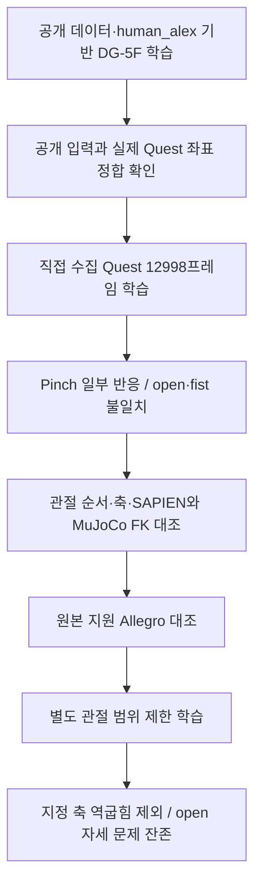
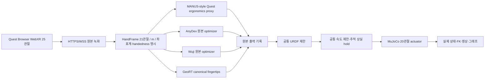

# Quest–Tesollo DG-5F Retargeting Benchmark

Meta Quest 3의 손 추적을 **공식 Tesollo DG-5F 오른손 URDF, 20개 관절, 다섯 손끝**에 연결해 MANUS-style · AnyDexRetarget · Wuji · GeoRT의 기존 구현을 재현하고 비교한다. 알고리즘의 loss·gain·offset·기본 필터를 개선 목적으로 변경하지 않고, 입력 변환·로봇 설정·공통 제어·실험적 범위 변경을 구분한다.

**현재 결과:** 네 방법의 동일 입력 재생과 MuJoCo 비교 영상까지 실행했다. 이번 DG-5F/데이터/학습 조건에서 GeoRT는 손을 펴거나 주먹을 쥘 때 잘못된 자세를 출력했다. 개인 데이터와 관절 범위 제한만으로 해결되지 않았다. 모든 GeoRT 모델이나 Tesollo 설정에 대한 일반적 결론은 아니다.

## 실제 손과 네 알고리즘 비교

[](docs/media/video_benchmark_002/comparison_all.mp4)

**[전체 비교 영상 · 108초](docs/media/video_benchmark_002/comparison_all.mp4)** · [정지 화면](docs/media/video_benchmark_002/comparison_preview.png)

왼쪽은 실제 Quest passthrough 영상이고, 오른쪽 위는 MANUS-style / AnyDex, 아래는 Wuji / GeoRT다. 로봇은 모델 목표를 바로 그린 것이 아니라 **공통 제어기를 거친 MuJoCo 실제 상태**다. 카메라는 기존 손등 방향의 정확한 반대편인 **방위각 215°·고도 +20°**에서 손바닥을 본다. GIF를 누르면 MP4 파일로 이동한다. 로컬에서는 MP4를 영상 플레이어로 연다.

| 실제 손과 개별 방법 · 각각 108초 | 동작별 짧은 비교 |
|---|---|
| [MANUS-style](docs/media/video_benchmark_002/comparison_manus.mp4) | [손 펴기·주먹 · 18초](docs/media/video_benchmark_002/clip_open_fist.mp4) |
| [AnyDex](docs/media/video_benchmark_002/comparison_anydex.mp4) | [손가락별 움직임 · 24초](docs/media/video_benchmark_002/clip_individual_fingers.mp4) |
| [Wuji](docs/media/video_benchmark_002/comparison_wuji.mp4) | [네 가지 핀치 · 24초](docs/media/video_benchmark_002/clip_pinches.mp4) |
| [GeoRT](docs/media/video_benchmark_002/comparison_geort.mp4) | [손목·가림 안내 구간 · 12초](docs/media/video_benchmark_002/clip_wrist_occlusion.mp4) |

### 동작별 6초 영상

아래 미리보기는 각각 독립된 **6초 구간**이다. GIF를 누르면 같은 구간의 **1920×1080 MP4**를 볼 수 있다. 모든 구간은 실제 손과 네 알고리즘의 **손바닥 방향**을 함께 보여준다. 분할 기준은 촬영 안내 시각이며, 실제 동작을 성공 판정한 라벨은 아니다.

| 동작 | 동작 |
|---|---|
| **손 펴기**<br>[](docs/media/video_benchmark_002/gestures/open.mp4) | **천천히 주먹 쥐기·펴기**<br>[](docs/media/video_benchmark_002/gestures/fist_slow.mp4) |
| **주먹 유지**<br>[](docs/media/video_benchmark_002/gestures/fist_hold.mp4) | **엄지 움직임**<br>[](docs/media/video_benchmark_002/gestures/thumb.mp4) |
| **검지 단독**<br>[](docs/media/video_benchmark_002/gestures/index.mp4) | **중지 단독**<br>[](docs/media/video_benchmark_002/gestures/middle.mp4) |
| **약지 단독**<br>[](docs/media/video_benchmark_002/gestures/ring.mp4) | **새끼 단독**<br>[](docs/media/video_benchmark_002/gestures/pinky.mp4) |
| **엄지–검지 핀치**<br>[](docs/media/video_benchmark_002/gestures/pinch_index.mp4) | **엄지–중지 핀치**<br>[](docs/media/video_benchmark_002/gestures/pinch_middle.mp4) |
| **엄지–약지 핀치**<br>[](docs/media/video_benchmark_002/gestures/pinch_ring.mp4) | **엄지–새끼 핀치**<br>[](docs/media/video_benchmark_002/gestures/pinch_pinky.mp4) |
| **손가락 벌리기·모으기**<br>[](docs/media/video_benchmark_002/gestures/spread.mp4) | **손목 회전**<br>[](docs/media/video_benchmark_002/gestures/wrist.mp4) |
| **손 가림 안내 구간**<br>[](docs/media/video_benchmark_002/gestures/occlusion.mp4) | **자유 동작**<br>[](docs/media/video_benchmark_002/gestures/free.mp4) |

**영상에서 손 pose를 다시 추정하지 않는다.** 촬영과 동시에 Quest가 출력한 WebXR 위치·회전이 공통 입력이다. 동작명은 촬영 안내이며 실제 수행을 판정한 성공 라벨은 아니다.

## 촬영·재생 조건

| 항목 | 실제 사용 값 |
|---|---|
| 입력 | `recordings/video_benchmark_002`, 2026-10-18 KST |
| 원본 영상 | 1920×1080, 약 124.61초, HEVC, 명목 약 30 FPS |
| 추적 기록 전체 | 오른손 valid 5,092개, invalid 1개, source session 1개 |
| 비교 구간 | SYNC START부터 108초, 18개 안내 동작 |
| 공통 입력 | 수신 시각 기준 50 Hz 재표본화, 네 방법의 소비 입력 SHA256 일치 |
| 새 valid 입력 / 제어 | 방법별 4,835개 / 5,400 tick |
| 상태 | TRACKING 5,398 tick, 시작 구간 HOLD 2 tick |
| 출력 영상 | 방법별 2,700프레임, 25 FPS; 손바닥 카메라 215° / +20° |
| 공통 제어 | 물리 timestep 0.002초, 50 Hz 명령, 명령 속도 제한 π rad/s |
| 모델 | 공식 오른손 DG-5F 범위, 고정 base, 중력 보상, 접촉 비활성 |
| AnyDex/Wuji | 기존 `configs/tesollo_calibrated/profile.json` 적용 |
| GeoRT | 개인 Quest session 002의 12,998 train frame으로 학습한 기존 full-range 모델 |

GeoRT checkpoint SHA256: `7a0324c7d3ae7351d9852a83b9ea509b22c8f6d6549bdf8529781e859d63816e`.
로봇 프로파일 SHA256: `6ecd6f3edda0d9e0bb028636d26c58eac4eedc43e91bec02165233d3fe6936a9`.
최근 6관절 제한 실험을 기본 GeoRT로 대체하지 않았다. AnyDex·Wuji에는 별도 geometry/scale 설정이 포함되므로 모든 방법을 보정 없는 기본 설정이라고 표시하지 않는다.

일곱 영상 프레임에서 SRC를 직접 읽어 source clock과 video PTS를 맞췄다. Anchor 적합 최대 잔차는 **0.79 ms**, source/receiver 시계 직선 적합 최대 잔차는 **26.30 ms**다. 원본 촬영 간격이 약 33 ms이므로 **서브프레임 동기화나 실제 통신 지연 측정이 아니다.** 단일 참가자 demonstration이며 학습·보정 데이터와 참가자 독립성을 주장하지 않는다. 가림 안내가 있어도 SDK invalid가 발생했다고 볼 수는 없다.

## 관측 수치와 그래프


| 방법 | 정규화 목표 손끝 차이 ↓ | 명령–실제 관절 RMSE ↓ | adapter 중앙 시간 |
|---|---:|---:|---:|
| MANUS-style | 0.4283 | 0.223° | 0.185 ms |
| AnyDex | 0.2169 | 0.205° | 4.137 ms |
| Wuji | 0.2028 | 0.209° | 2.482 ms |
| GeoRT | 0.6756 | 0.389° | 1.029 ms |

목표 차이는 사람 wrist/로봇 palm을 각각 원점으로 하고 각 손의 중지 MCP까지 기준 길이로 정규화한 **무차원 기하 지표**다. 독립적으로 측정한 정답 로봇 pose 오차나 성공률은 아니다. 표는 50 Hz 유효 제어 tick 평균이다. 손의 길이 차이·중립 기준·정렬 가정이 남는다.

시간은 새 valid 입력 4,835개에 대해 전처리·원본 solve/추론·기본 필터를 포함하고 시뮬레이션·렌더링·로그는 제외한다. Worker를 동시에 실행했으므로 **독립적인 속도 순위나 실시간 FPS**로 해석하지 않는다. AnyDex와 Wuji는 공유 구조가 있어 완전히 독립적인 네 알고리즘으로 취급하지 않는다.

### 시간 변화와 공통 제어


목표–명령 관절 RMS 차이는 MANUS 2.35°, AnyDex 1.31°, Wuji 1.68°, GeoRT 10.24°다. 이 값을 시간 지연 초 단위로 바꿀 수 없다. **잘못된 목표 자세와 속도 제한으로 목표를 따라가는 과정은 별개**다. MuJoCo가 명령을 잘 따라도 모델의 자세 대응은 틀릴 수 있다.

### 사람의 굽힘과 로봇 목표


검정색은 Quest 위치로 계산한 사람 PIP 기하 각도, 색 선은 로봇 목표각이다. 검지·중지·약지 3번 관절의 역할·축·0°는 FK로 확인했다. 모든 관절에 사람–encoder 보정이 성립한다는 뜻은 아니다. GeoRT에서는 손을 편 구간에도 음의 굽힘이나 큰 양의 굽힘이 남는다.

### 핀치와 제한


각 손의 기준 길이로 정규화한 엄지–각 손끝 거리다. 로봇은 **실제 상태** 기준이다. 접촉·자기충돌·물체 파지가 비활성이고 손끝은 링크 원점이므로 접촉 패드의 성공적인 pinch/grasp를 보증하지 않는다.


공통 clip 빈도가 낮거나 0이어도 올바른 손 모양은 아니다. 원본 optimizer/네트워크가 내부 범위를 이미 지키거나 넓은 공식 범위 안에서 역굽힘을 만들 수 있다.

## GeoRT 진단과 범위 제한 실험



| 검사 | 관측과 해석 |
|---|---|
| SAPIEN ↔ MuJoCo FK | 1,045개 자세에서 손끝 최대 약 0.001585 mm. 기구학 불일치가 주원인이라는 증거 없음 |
| Neural FK | 정확 FK 대비 평균 약 2 mm 근사 오차. 수십 mm 자세 차이 전체를 설명하지 못함 |
| GeoRT IK 입력 | 실제 네트워크에는 다섯 손끝만 전달. 손가락별 3D 위치 → 4관절 |
| 학습 목적 | Direction / Chamfer / Curvature / Pinch. 인간 전체 관절 자세의 supervised 정답 loss가 아님 |
| 역기구학 비유일성 | 동일 손끝 위치를 만드는 다른 중간 관절 자세가 DG-5F에서 실제 존재 |
| 개인 녹화 학습 | 학습 데이터와 비슷한 입력에도 실패가 남아 데이터 수 부족만으로 설명 불가 |
| Allegro 대조 | 같은 개인 데이터에서 주요 굽힘 대응이 DG-5F보다 나았으나 완벽한 정답 모델은 아님 |
| 범위 제한 | 역굽힘을 막는 것과 올바른 자세 대응을 학습하는 것은 별개 |


이 그림은 이번 영상이 아니라 **이전에 진단한 2,000프레임 평가 녹화** 결과다. 8개 distal을 0~90°로 제한한 실험과 검증된 6개 PIP/DIP에 관측 상한을 적용한 실험을 구분한다. 후자는 DIP 상한 71.29°·68.46°·74.63°, PIP 90°이며 하한 0°는 실험 제약이다. 측정한 해부학적 하한이나 공식 보정값이 아니다. 두 실험 모두 200 epoch를 마쳤지만 open 후보에서 검지·중지가 크게 굽혀지는 문제가 남았다.

현재 조건에서는 GeoRT를 DG-5F의 신뢰할 수 있는 기본 모델로 채택할 근거가 부족하다. 다만 범위·초기화·workspace·손끝 기반 학습 특성을 한 원인으로 확정하지 않는다.
[전체 진단](docs/GEORT_STACK_DIAGNOSIS.md) · [실패 분석](docs/GEORT_FAILURE_DIAGNOSIS.md) · [좌표 parity](docs/GEORT_PARITY_RESULT.md)

## 구현 방식



- **MANUS-style:** 제조사 `_compute_mqd_from_q` AST를 그대로 재사용한다. Quest proxy는 실제 MANUS glove ergonomics와 구분하고 공식 offset을 임의 취소하지 않는다.
- **AnyDex:** 원본 AdaptiveOptimizerAnalytical·기본 LPFilter를 유지한다. DG-5F 이름으로 관절·링크를 매핑하고 로봇별 scale은 별도 프로파일에 고정한다.
- **Wuji:** 원본 Retargeter/AdaptiveOptimizerAnalytical을 사용한다. AnyDex와 공유하는 loss·optimizer 구조와 기본 선택 항을 유지한다. 임의 coupling이나 신전 penalty를 추가하지 않는다.
- **GeoRT:** 원본 trainer/IK/FK/export를 사용한다. SAPIEN/Torch 환경을 분리하며 범위 실험에서는 FK 정규화 affine adapter를 명시한다.

`q_vendor_raw` → `retarget_q_target` → `q_command` → `q_actual`을 로그에 구분한다. **외부 Git 소스와 공식 URDF 원본은 수정하지 않았다.** 각 단계 문서는 완료 당시 기록이며 현재 진행 상태는 이 README를 기준으로 한다.

## 설치와 재현

기본 환경은 Ubuntu 22.04 / Python 3.10 / MuJoCo 3.16.0이고 ROS는 필요 없다. GeoRT는 별도 CUDA 환경이 필요하다. 모든 명령은 프로젝트 루트에서 실행한다.

```bash
python3 scripts/fetch_external.py
uv sync --locked --python 3.10
.venv/bin/python -m benchmark build
.venv/bin/python -m benchmark inspect
uv pip install --python .venv/bin/python -r requirements/phase3.txt
uv pip install --python .venv/bin/python -r requirements/phase6.txt
```

[기본 시뮬레이터·Python API](README_SIMULATION.md) · [Quest 연결](README_PHASE3.md) · [AnyDex](README_PHASE5.md) · [Wuji](README_PHASE6.md) · [GeoRT 환경·학습](README_PHASE7.md) · [로봇 설정](README_TESOLLO_CALIBRATION.md) · [실시간 비교](README_LIVE_RETARGETING.md) · [영상 촬영](README_VIDEO_CAPTURE.md)

이번 원본 녹화와 개인 checkpoint는 로컬 파일이며 새 clone에 자동 포함되지 않는다. 영상·그래프·요약은 `docs/media`에 포함하고 전체 JSONL/NPZ는 로컬에 보존했다.

```bash
# 새 경로를 사용해 녹화 검사
.venv/bin/python scripts/inspect_comparison_take.py recordings/video_benchmark_002 \
  --output results/video_take_reproduction_audit.json

# 동일 입력·공통 제어로 네 방법의 영상/상태 생성
.venv/bin/python scripts/export_take_retargeting.py \
  --take recordings/video_benchmark_002 --output results/video_take_reproduction

# 기존 실제 상태를 재사용해 반대편 손바닥 카메라로 렌더링 (재추론·재학습 없음)
.venv/bin/python scripts/rerender_take_camera.py \
  --source results/video_take_reproduction --output results/video_take_reproduction_palm

# 원본 영상에서 읽은 anchor가 저장된 alignment.json으로 합성·그래프 생성
.venv-geort/bin/python scripts/publish_take_media.py \
  --take recordings/video_benchmark_002 --replay results/video_take_reproduction_palm \
  --alignment results/video_benchmark_002/alignment.json \
  --output results/video_take_reproduction_media

# 원본 upstream과 관련 검사
.venv/bin/python scripts/verify_sources.py
.venv/bin/python -m pytest -q tests/test_video_capture.py \
  tests/test_quest_observed_ranges.py tests/test_geort_range_experiment.py \
  tests/test_geort_reference_ranges.py
.venv/bin/python scripts/test_capture_browser.py
```

손바닥 영상은 기존 actual qpos와 수치 결과를 byte 단위로 보존하고 카메라만 변경했다. 기존 손등 방향 영상과 원본 로그는 `results/video_benchmark_002/`에 남아 있다.

Export 기본 checkpoint는 이번 개인 full-range 모델이다. 다른 모델은 `--checkpoint`와 그 모델의 `--config`를 함께 지정한다. 제한 모델은 일반 full-range adapter로 불러오지 않는다. 학습 범위와 재학습 명령은 [진단 문서](docs/GEORT_STACK_DIAGNOSIS.md)에 있다.

## 산출물과 Git 준비

```text
README.md                             현재 결과·영상·그래프·재현
README_SIMULATION.md                  초기 시뮬레이터 안내 원본 보존
README_VIDEO_CAPTURE.md               실제 손 + 추적 촬영 절차
scripts/export_take_retargeting.py     동일 입력·방법별 MuJoCo 렌더링
scripts/publish_take_media.py          영상 시간 맞춤·동작별 분할·GIF·그래프
scripts/rerender_take_camera.py        저장된 실제 상태의 손바닥 카메라 렌더링
scripts/record_comparison_take.py      촬영 수신 진입점
docs/media/video_benchmark_002/        비교 MP4 25개, 동작별 GIF 16개와 전체 GIF, PNG, 요약·hash
recordings/video_benchmark_002/        원본 데이터, Git 제외
results/video_benchmark_002/           JSONL·NPZ·console·대조 결과, Git 제외
```

공개용 MP4는 H.264/yuv420p로 인코딩했다. 영상·그래프를 파일로 준비했으며 **git add/commit/push는 실행하지 않았다.** 사용자가 준비한 index/staged 항목도 변경하지 않았다. 가상환경·원본 녹화·학습 checkpoint를 포함하는 전체 폴더 일괄 추가 대신 필요한 코드·README·`docs/media`를 선택해 추가할 수 있다.

기존 Phase 7 snapshot은 README도 동결 대상으로 포함한다. 이번 요청에 따른 README 변경은 해당 snapshot과 다르며 초기 원본을 `README_SIMULATION.md`에 보존했다. 검증값을 덮어써서 통과시키지 않았다. 원본 upstream 검사는 `verify_sources.py`를 사용한다.

## 원본 저장소와 출처

정확한 commit·sparse 범위·라이선스는 [외부 저장소 lock](external_repositories.lock.json), [저장소 조사](docs/REPOSITORY_AUDIT.md)에 기록했다.

| 구성 | 원본 | 고정 commit 앞 12자리 | 라이선스 |
|---|---|---|---|
| DG-5F URDF | [tesollo_model](https://github.com/tesollodelto/tesollo_model) | `f648627be40f` | BSD-3-Clause |
| MANUS 매핑 | [dg5f_ros2](https://github.com/tesollodelto/dg5f_ros2) | `0cb45ae9474c` | BSD-3-Clause |
| AnyDex | [AnyDexRetarget](https://github.com/qqsq12321/AnyDexRetarget) | `ee68a0234ccd` | MIT |
| Wuji | [wuji-retargeting](https://github.com/wuji-technology/wuji-retargeting) | `531f6ed4250b` | MIT |
| GeoRT | [GeoRT](https://github.com/facebookresearch/GeoRT) | `fb2075e2a327` | CC-BY-NC-4.0 |

원본 license와 attribution을 유지한다. 공개 데이터 출처·관절 정의·좌표계·라이선스·분할 제약은 각 manifest와 진단 문서에 기록했다. 이번 실제 손 영상과 추적은 사용자가 직접 촬영한 demonstration이다.
