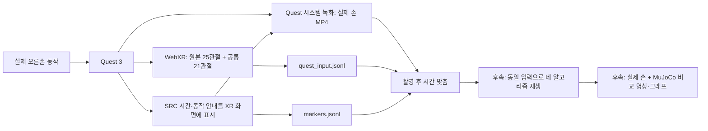

# Quest 실제 손 + Retargeting 비교 영상 촬영

현재 단계는 **실제 손 영상과 같은 순간의 Quest 관절 데이터를 남기는 녹화 준비**다.
이 입력을 고정해 MANUS-style / AnyDex / Wuji / GeoRT의 MuJoCo 결과를 나란히 비교한다.
이번 도구가 생성하는 것은 관절 기록·동작 안내·동기화 표식이며,
실제 손 MP4는 Quest 자체 카메라 녹화로 별도 저장한다.
실제 장치에서 passthrough와 시간 표시가 영상에 함께 담기는지는 예비 촬영으로 확인해야 한다.



**입력의 의미:** 영상에서 손 포즈를 다시 추정하는 파이프라인은 아니다.
영상 촬영과 동시에 Quest가 추적한 위치·회전을 알고리즘 입력으로 사용한다.
영상은 실제 동작을 확인하기 위한 시각 자료다. 추적 상실과 잘못된 자세도 삭제하지 않는다.

## 1. 먼저 9초 예비 촬영

PC 터미널:

```bash
cd /home/cocelo-server01/stkim_ws/Hand_teleoperation
.venv/bin/python scripts/record_comparison_take.py \
  --port 8036 --routine preflight --stage-seconds 3 \
  --output recordings/video_preflight_001
```

1. Quest와 PC를 같은 네트워크에 연결한다. 다른 손 추적 페이지의 XR 세션은 끝낸다.
2. Quest Browser에서 **https://192.168.100.136:8036/** 에 접속한다.
   IP가 다르면 터미널에 출력된 주소를 사용한다. 기존 HTTPS 인증서를 사용한다.
3. Quest 시스템의 **카메라 → 영상 녹화**를 먼저 시작하고 브라우저로 돌아온다.
4. 페이지의 **손 추적 시작**을 누른다. 컨트롤러를 내려놓고 오른손을 머리 앞에 둔다.
5. 머리를 천천히 움직이며 화면 정중앙의 좁은 안내판을 따른다.
   SRC·동작 이름·줄바꿈한 설명·남은 시간을 세로로 표시한다. `DONE`이 나오면 손 추적을 끝낸다.
6. Quest 시스템 영상 녹화를 끝낸다. PC 터미널에서 **Ctrl+C**를 누른다.
7. Quest 녹화 영상을 재생해 **실제 손, SRC 숫자, SYNC START/END 표시**가 모두 보이는지 확인한다.
   검은 배경과 표식만 보이면 본 촬영을 진행하지 않는다. 시스템 녹화의 passthrough 포함 여부부터 확인한다.

카메라 앱으로 MR/VR 영상을 녹화하고 `Oculus/Videoshots`에서 파일을 옮기는 방식은
[Meta 공식 촬영 안내](https://developers.meta.com/vr/resources/video-capture-mr-vr/)를 따른다.
가로 1920×1080을 권장한다. 실제 프레임률은 가변일 수 있으므로
촬영 시작 시각이나 nominal FPS만으로 동기화하지 않는다.
원본 passthrough 픽셀을 이 WebXR 서버에서 직접 받아오는 기능은 구현하지 않았다.

서버는 영상 녹화 버튼을 원격으로 누르지 않는다. 현재 PC에서 USB Quest는 감지되지 않았다.
ADB 개발자 연결이 필요한 기능을 사용하지 않고도 위 촬영과 수동 파일 복사를 할 수 있다.

## 2. 본 촬영: 108초, 같은 조건으로 3회 권장

예비 영상이 정상인 경우:

```bash
.venv/bin/python scripts/record_comparison_take.py \
  --port 8036 --routine benchmark --stage-seconds 6 \
  --output recordings/video_benchmark_001
```

Quest 시스템 녹화를 먼저 시작한 뒤 손 추적을 시작하는 순서는 동일하다.
한 take에 XR 세션을 한 번만 시작한다. 재시작이 필요하면 새 출력 폴더와 새 영상으로 촬영한다.
재촬영은 `video_benchmark_002`, `video_benchmark_003`처럼 경로를 바꾼다.
기존 폴더는 덮어쓰지 않는다. 기본 `--output` 생략 시 UTC 기반 고유 폴더를 생성한다.

| 순서 | 화면 안내 | 수행할 동작 |
|---|---|---|
| 1 | SYNC START | 손을 편 상태 유지, 영상 시작 시간 표식 |
| 2 | OPEN | 모든 손가락을 편 상태 유지 |
| 3 | FIST SLOW | 천천히 펴기 → 주먹 → 펴기 |
| 4 | FIST HOLD | 편안한 주먹 유지 |
| 5~8 | INDEX / MIDDLE / RING / PINKY | 지정 손가락을 가능한 만큼 단독 굽힘·펴기 |
| 9 | THUMB | 엄지를 손바닥 쪽으로 움직였다가 복귀 |
| 10~13 | PINCH | 엄지와 검지·중지·약지·새끼를 순서대로 붙였다 떼기 |
| 14 | SPREAD | 손가락 벌리기·모으기 |
| 15 | WRIST | 손을 편 채 손목 회전 |
| 16 | OCCLUSION | 오른손을 잠시 가렸다가 다시 보여주기 |
| 17 | FREE | 펴기·주먹·핀치를 자유롭게 혼합 |
| 18 | SYNC END | 손을 편 상태 유지, 영상 끝 시간 표식 |

구간당 6초이며 전체 108초다. 안내는 **행동 지시 라벨**이며 실제 수행을 확인한 정답 라벨이 아니다.
조명을 일정하게 하고 손목과 모든 손끝을 촬영 범위 안에 둔다.
비교를 위해 같은 입력을 나중에 모든 알고리즘에 재생하므로 방법마다 다시 촬영할 필요는 없다.
녹화 중에는 리타게팅·학습·MuJoCo 렌더링을 동시에 실행하지 않는다.
촬영 데이터는 기본적으로 demonstration 용도이며 학습 데이터로 자동 합치지 않는다.

## 3. 저장 파일 확인

```text
recordings/video_benchmark_001/
  take.json           # 동작 계획, 수신 수, 파일 hash, 종료 상태
  quest_input.jsonl   # 원본 패킷·양손 HandFrame·추적 상실
  markers.jsonl       # 브라우저 clock, 동작 전환, 수신 시각, source session ID
  human.mp4           # 사용자가 Quest에서 복사할 실제 손 영상
```

Quest에서 MP4를 PC로 복사해 해당 take 폴더의 `human.mp4`로 둔다.
USB 파일 전송에서 `Oculus/Videoshots`를 찾거나 기존 사용 중인 전송 방식을 사용한다.
원본 영상은 편집·가속·프레임률 강제 변환 전에 보존한다.
영상·원본 녹화·`results/`는 기존 `.gitignore`에 의해 Git에서 제외된다.
Git에는 코드·README를 올리고, 이후 공개할 짧은 비교 MP4는 별도 배포/첨부 링크를 사용할 수 있다.
이번 작업에서는 add/commit/push를 실행하지 않는다.

관절 기록 검사:

```bash
.venv/bin/python scripts/inspect_comparison_take.py recordings/video_benchmark_001 \
  --output results/video_benchmark_001_audit.json
```

오른손 valid 수, 추적 상실 수, source session 수, 동작 표식, 정상 종료와 hash를 확인한다.
0개 입력이거나 여러 XR 세션이 섞이면 한 개의 정상 take로 취급하지 않는다.
`routine_end_observed=false`이면 안내가 끝나기 전에 종료했거나 표식 연결이 끊겼다.

## 4. 촬영 후 영상과 데이터를 연결

영상의 시작 근처와 끝 근처에서 **SRC 숫자가 선명한 프레임 두 개 이상**을 고른다.
각 프레임의 영상 재생 시각(초)과 화면에 보이는 SRC 숫자(ms)를 기록한다.
SRC는 브라우저 단조 시계이며 영상 길이나 PC wall clock이 아니다.
SYNC START/END는 해당 지점을 찾기 위한 표식이고, 연결 자동 검출은 구현하지 않았다.

아래 숫자는 설명용 예시이므로 **본인 영상에서 읽은 값으로 반드시 바꾼다**:

```bash
.venv-geort/bin/python scripts/inspect_comparison_take.py recordings/video_benchmark_001 \
  --video recordings/video_benchmark_001/human.mp4 \
  --anchor 5.20:13020.0 --anchor 105.20:113020.0 \
  --output results/video_benchmark_001_alignment.json
```

`.venv-geort`의 기존 `imageio_ffmpeg`로 MP4를 열어 duration과 anchor 범위를 검사한다.
두 점 이상으로 `source_ms = scale × video_pts_s + offset`을 구해 시계 차이를 기록한다.
두 점의 residual이 0이어도 실제 동기화 오차가 0이라는 뜻은 아니다.
수동 판독·표시 프레임과 촬영 프레임 차이·가변 프레임률은 남는다.
처음과 끝 이외에 중간 anchor를 하나 더 사용해 맞춤 상태를 확인하는 것이 좋다.
관절마다 존재하는 수신 시각과 source 시각을 혼동해 실제 통신 지연을 주장하지 않는다.

## 촬영 후 결과 구성

`video_benchmark_002`의 실제 촬영을 사용해 손바닥 방향 비교 MP4 25개와 분석 그래프를 생성했다.
16개 동작별 6초 영상에는 각각 움직이는 GIF 미리보기를 제공한다.
[현재 결과 README](README.md)에서 영상·수치·제한 사항을 확인할 수 있다.
`export_take_retargeting.py`는 동일 입력·공통 제어·카메라로 네 방법의 실제 MuJoCo 상태를
렌더링하고, `publish_take_media.py`는 수동 anchor 정합을 사용해 실제 손과 합성한다.
새 촬영도 먼저 위의 기록 검사와 anchor 추출을 수행한 뒤 이 별도 도구로 처리한다.
촬영 서버 자체는 원본 녹화와 동기화 표식만 기록한다.
영상 픽셀 기반 손 포즈 재추정은 구현하지 않았다.

GeoRT는 현재 DG-5F 설정·데이터·학습 조건에서 자세 대응 실패가 관측됐다.
범위 제한 모델도 개선이 확인되지 않았으므로 성공 사례로 표시하지 않는다.
모든 Tesollo 설정이나 모든 GeoRT 학습에 대한 일반적 성능 결론으로 확대하지 않는다.
기존 결과는 [DG-5F 진단 문서](docs/GEORT_STACK_DIAGNOSIS.md)를 참조한다.

## 소프트웨어 검증

```bash
.venv/bin/python -m pytest -q tests/test_video_capture.py
.venv/bin/python scripts/test_capture_browser.py
.venv/bin/python scripts/verify_phase7_sources.py
```

수신 side channel이 원본 추적을 바꾸지 않는지, 입력 검증, 수동 시계 맞춤 계산을 검사했다.
headless Chrome에서 실제 기존 client JS와 새 capture JS를 함께 실행해 WebGL 표식·시작·종료
마커를 확인했다. 이 검사는 WebXR를 mock한 소프트웨어 검사이며 실제 Quest 촬영 검증이 아니다.
실제 TLS HTTPS에서 페이지·스크립트·설정·상태 경로 HTTP 200과 종료 후 manifest 저장을 확인했다.
원본 upstream 저장소와 기존 추적 client/protocol은 수정하지 않았다.
