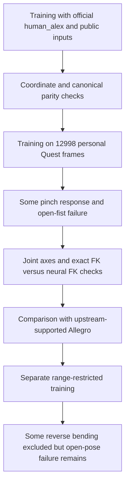

# Tesollo DG-5F Hand Retargeting: Methodology Review and Comparative Analysis

## Table of Contents

1. [Report Summary](#sec01)
2. [Background and Reasons for Selecting the Algorithms](#sec02)
3. [Fundamentals of Hand Retargeting](#sec03)
4. [Comparison System and Data Collection](#sec04)
5. [Principles and Implementation of Each Algorithm](#sec05)
   - [MANUS-style — Angle Mapping](#manus)
   - [AnyDexRetarget — Geometric Optimization](#anydex)
   - [Wuji Retargeting — A Manufacturer's Optimization Implementation](#wuji)
   - [GeoRT — Learning-Based Geometric Mapping](#geort)
   - [Differences Between Upstream and Project Implementations](#implementation)
6. [Experimental Design and Evaluation Methods](#sec06)
7. [Gesture Comparison Videos and Observations](#sec07)
8. [Quantitative Results and Graph Analysis](#sec08)
9. [GeoRT Application Failures and Cause Investigation](#sec09)
10. [Comparative Assessment for Departmental Adoption](#sec10)
11. [Further Implementation and Validation Plan](#sec11)
12. [Final Conclusions](#sec12)
- [Appendix A. Installation, Execution, and Reproduction](#appendix-a)
- [Appendix B. Implementation Structure and Artifacts](#appendix-b)
- [Appendix C. Evidence, Papers, and Upstream Repositories](#appendix-c)

<a id="sec01"></a>
## 1. Report Summary

**This report reviews retargeting methods that could be applied to the department's Tesollo Hand teleoperation system and examines their implementation characteristics and failure conditions before actual adoption.** It covers MANUS-style manufacturer-provided angle mapping, the open optimization framework AnyDexRetarget, the manufacturer's open implementation Wuji Retargeting, and the learning-based research method GeoRT. This is not a study developing a new algorithm or improving performance by modifying upstream losses.

The department's reference environment uses a Tesollo Hand and a MANUS Data Glove for teleoperation. However, **a physical Tesollo Hand was not available for these experiments.** Input and training pipelines were prepared using Meta Quest 3 and public data, and 20 joints and five fingertips were evaluated in a MuJoCo model derived from the official right-hand DG-5F URDF. The final comparison videos in this report use Quest input recorded directly by the user, rather than playback of public data.

The main results are as follows. With the same 108-second input, the normalized target fingertip discrepancy was 0.2028 for Wuji, 0.2169 for AnyDex, 0.3494 for MANUS-style thumb v2, and 0.6756 for GeoRT. This is a **dimensionless geometric metric** after alignment and length normalization, not an error against a ground-truth robot pose or a grasp success rate. The current evidence supports prioritizing AnyDex and Wuji for further review, but does not establish a final ranking of real task performance.

MANUS-style used geometric angles derived from Quest instead of an actual glove, with v2 correcting the thumb input axes. Its results therefore do not represent the performance of an actual MANUS system. GeoRT underwent training with public and personal data, FK cross-checks, and range restriction, but stable open-hand/fist correspondence was not achieved under these DG-5F conditions. The failure process itself is retained as evidence for adoption decisions.

**Reading guide:** The report is designed for approximately **20–30 minutes** of reading, including explanations, equations, figures, and representative videos. Accessible explanations precede technical details, and execution commands and detailed references are included in this file. This estimate excludes repeatedly watching every GIF or reading external papers. The reference date for the review and experiments is **2026-10-18**.

<a id="sec02"></a>
## 2. Background and Reasons for Selecting the Algorithms

### 2.1 Background

The department is reviewing robotic-hand control technologies against a teleoperation environment using a Tesollo Hand and a MANUS Data Glove. Transferring human hand motions is more than copying sensor data directly to motors: human and robotic hands differ in joint structure, finger length, range of motion, thumb placement, and neutral pose.

For example, bending the robot joint with the same name by the same angle as a human index finger may not bring the fingertips to the same position. When bringing the thumb and index finger together, fingertip distance may matter more than angle similarity. Conversely, matching only the fingertips can produce unnaturally bent intermediate joints. The choice of what to preserve and what to compromise therefore affects reproduction accuracy, motion stability, and computational cost.

Accordingly, this review covers public optimization implementations and learning-based research alongside the existing manufacturer's technology. At this stage, without physical hardware, the experiments first validate input conversion and the robot model, then replay the same recording to examine differences between methods. What this stage establishes is **simulation applicability and further validation requirements**, not a guarantee of hardware performance.

### 2.2 Reasons for Selecting the Algorithms

| Algorithm | Selection background | Comparison objective |
|---|---|---|
| MANUS-style | Tesollo's MANUS-based retargeting implementation | Establish a comparison baseline connected to the existing system |
| AnyDexRetarget | Open optimization framework providing Quest input and multiple robotic-hand configurations | Examine geometric reproduction, pinch behavior, and computational cost of general-purpose optimization |
| Wuji Retargeting | Open implementation from a manufacturer of a 5-finger, 20-DoF robotic hand | Analyze manufacturer-specific configurations and extensions within a similar optimization structure |
| GeoRT | Neural-network-based geometric retargeting research from UC Berkeley and Meta researchers | Explore extending a learning-based approach, distinct from optimization, to DG-5F |

Selection did not assume popularity or independent performance superiority. The criteria were relevance to existing work, availability of public implementations, methodological differences, and feasibility of connecting them to DG-5F. In particular, AnyDex and Wuji share substantial structure, so this is not overstated as validation of two independent algorithm families. Supporting information comes from the [official AnyDex repository](https://github.com/qqsq12321/AnyDexRetarget), [official Wuji repository](https://github.com/wuji-technology/wuji-retargeting), and [GeoRT authors' project](https://zhaohengyin.github.io/geort/).

### 2.3 Detailed Rationale for Each Algorithm

**① MANUS-style — Connection to the existing system.** Tesollo's public ROS 2 implementation contains calculations converting MANUS ergonomics input into DG-5F joint angles. It was selected as a reference directly connected to glove-based control used in existing work. However, this report's baseline is a Quest proxy experiment reusing those calculations. It does not claim to reproduce the actual MANUS glove, physical robot, and manufacturer's complete operating environment. [Manufacturer's input structure and mapping code](https://github.com/tesollodelto/dg5f_ros2/blob/0cb45ae9474caa92410dfa820346da8ffbae8405/dg5f_driver/script/manus_retarget/manus_retarget.py)

**② AnyDexRetarget — General-purpose optimization technology.** Its open framework separates the input device from the robot model. The aim was to examine whether its support for multiple inputs and robot configurations helps future device changes, and how hand-shape and pinch behavior differ from direct angle mapping. This experiment used the **adaptive analytical** path among its available optimizers. The results are not generalized to all other optimizers. [Official usage and configuration guide](https://github.com/qqsq12321/AnyDexRetarget/blob/ee68a0234ccdf8a23b98527fd1ee2c6258278cd1/README.md)

**③ Wuji Retargeting — Benchmarking another manufacturer's technology.** This public implementation targets a robotic hand with five fingers and 20 degrees of freedom, like DG-5F. Alongside an optimization structure similar to AnyDex, it offers optional terms such as a hyperextension penalty and DIP–PIP coupling. However, **both terms had zero weight in this run**. The selection aimed to examine differences in manufacturer extensions and configurations; these results do not demonstrate the effects of those additional constraints. [Upstream extension terms and defaults](https://github.com/wuji-technology/wuji-retargeting/blob/531f6ed4250b475d2e9231f54e988fc9b1c5b4ea/wuji_retargeting/opt/adaptive_analytical.py)

**④ GeoRT — Exploring a learning-based research approach.** GeoRT is geometric learning-based research released in 2025. Instead of solving numerical optimization every frame, it learns a transformation from human fingertips to robot joint angles in advance. It was selected to observe how the model, training data, and workspace assumptions affect application to a new robot. Here, “new technology” refers to a research approach contrasted with existing mapping and optimization methods in this review; it does not mean that every current study was surveyed and superiority established. DG-5F required separate training for its five-finger, 20-DoF configuration. [GeoRT paper](https://arxiv.org/abs/2503.07541)

### 2.4 Differences Between MANUS Data Glove and Meta Quest 3 Input

| Category | Existing system's reference environment | This comparison experiment |
|---|---|---|
| Input device | MANUS Data Glove | Meta Quest 3; public data also used for separate training and diagnostics |
| Input data | MANUS ergonomics joint angles, etc. | WebXR-estimated 3D keypoints and available rotations |
| MANUS-style application | Official MANUS fields passed to the mapping | Geometric angles extracted from Quest positions and passed as a proxy |
| Robot | Operation targeting a physical Tesollo Hand | Official right-hand DG-5F model in MuJoCo |
| Evaluation purpose | Physical teleoperation | Comparison of algorithms, adapters, and calibration conditions before adoption |

Glove angles and a vision-estimated skeleton differ in measurement characteristics and angle definitions. Similarly named MCP or spread values are not guaranteed to share reference axes, zero points, or signs. Consequently, these results are not interpreted as equivalent to an actual MANUS environment. Other methods are also affected by calibration matching human hand size to the robot, so the results describe **the complete specified integration conditions**, beyond algorithm equations alone.

### 2.5 Overall Purpose of the Review and Experiments

The goal is not simply to choose the method with the lowest number. It is to run existing technology, public implementations, and research methods under conditions as common as possible, and identify the implementation work and remaining uncertainties required for adoption. Motion reproduction, pinch-related geometry, tracking stability, computation time, and implementation effort are examined without inventing unmeasured grasp success rates or long-term operational reliability.

> **Key presentation message:** Using existing Tesollo–MANUS mapping as the reference, compare general-purpose public optimization technology, a manufacturer's open implementation, and learning-based research to identify adoption directions and further validation tasks for dexterous-hand teleoperation.

<a id="sec03"></a>
## 3. Fundamentals of Hand Retargeting

### 3.1 Why Reproducing the Same Hand Shape Is Not Simple

Retargeting transfers the meaning of an intended human motion to a hand with a different structure. “Making it the same” can involve different criteria. One must first decide whether to match joint angles, approximate fingertip positions, or preserve finger directions and thumb contact. If all conditions cannot be satisfied simultaneously, the algorithm chooses which to prioritize.

Consider two hands with different finger lengths. Bending them by identical angles moves the longer fingers farther. Conversely, placing the fingertips at the same positions requires different joint angles. A robot's thumb also has a different mounting position from a human thumb, making simultaneous copying of angles and positions harder. **An angle difference alone does not establish failure, and nearby fingertips alone do not establish success.**

### 3.2 Three Approaches

| Approach | Simple explanation | Methods examined |
|---|---|---|
| Direct mapping | Pass human angles through a predefined conversion table | MANUS-style |
| Geometric optimization | Find a robot pose that reduces hand-shape differences each time | AnyDex and Wuji |
| Learning-based | Learn fingertip-space correspondence in advance to generate joint angles quickly | GeoRT |

Direct mapping is easy to trace computationally, but matching input semantics is crucial. Optimization handles multiple positional conditions together, but is affected by loss trade-offs, initialization, and filters. Learning-based methods can reduce runtime computation, but require checking whether the training distribution, robot structure, and losses sufficiently determine the desired pose. No family is assumed superior for every gesture.

### 3.3 Common Notation and Units

The human hand input is $H=(h_0,\ldots,h_{20})\in\mathbb{R}^{21\times3}$, and the robot output is $q\in\mathbb{R}^{20}$. Positions use meters and joint angles use radians by default. The function $F(q)$ that computes fingertip positions from robot joint angles is **forward kinematics (FK)**. Optimization and learning use this robot kinematics directly or through an approximation.

MCP refers to the base joint of a human finger, PIP to the middle joint, and DIP to the distal joint. Using corresponding names in this report does not mean that the axes and zero points of human joints and robot encoders are fully calibrated. The thumb's roles in particular require separate checks.


Another distinction is **target pose versus actual pose**. An algorithm can generate a poor target that the simulator follows accurately. Conversely, a suitable target may be reached late because of the common rate limit. This report records these phenomena separately.

<a id="sec04"></a>
## 4. Comparison System and Data Collection

### 4.1 Overall Pipeline


**This pipeline does not re-estimate hand pose from video pixels.** The Quest system MP4 is evidence of what the person actually did. Algorithm input consists of estimated joint positions and rotations obtained from WebXR in Quest Browser during recording. These are not labeled as direct native Quest SDK output or anatomical ground truth.

### 4.2 Robot Model and Common Control

The 20 independent joints of the official right-hand DG-5F URDF were used. Finger order is thumb, index, middle, ring, and little finger, with four joints each. Fingertips are the official tip-link origins; contact-pad surface centers were not separately estimated. A derived MuJoCo model was created without changing the original URDF's joint axes or limits. [Official URDF](https://github.com/tesollodelto/tesollo_model/blob/f648627be40f8df2e3df906ccf3c5d62103f3275/dg5f/dg5f_right.urdf)

The comparison uses free motion with a fixed base, gravity compensation, and contact and self-collision disabled. Commands run at 50 Hz and physics at a 0.002-second timestep. Thus, it does not evaluate actual object grasping or configurations constrained by finger collisions. Fingertips appearing to meet on screen does not demonstrate force-transmitting contact.

### 4.3 Common Input Format and Coordinate Systems

Original WebXR joint names are mapped to a common set of 21 points. The wrist is 0; thumb 1–4; index 5–8; middle 9–12; ring 13–16; little finger 17–20. Fingertip indices are `[4, 8, 12, 16, 20]`. Original packets and converted HandFrames are retained together to trace conversions.

HandFrame records handedness, coordinate system, timestamp clock domain, validity, and provenance. Arbitrary rotations are not generated for public data lacking rotation information, and inputs that cannot be converted to 21 points are not filled in as if they were valid observations. Right-hand support is prioritized; right-hand results are not extended to claims of left-hand validation.

The common palm frame uses wrist→middle MCP as Z and little MCP→index MCP as an auxiliary Y direction. GeoRT's canonical transformation instead uses ring MCP→index MCP as its auxiliary axis. This is a difference in upstream input conventions, not a hidden axis correction. Each method's adapter handles it explicitly, and GeoRT uses the same transformation in training and inference.

### 4.4 Recording and Time Alignment

Each take records the actual-hand MP4, joint JSONL, and gesture-instruction markers together. The browser source clock, SRC, is shown in the video. Video PTS and SRC values were then read at seven points to fit the relationship between clocks. System recording start time was not assumed equal to PC wall-clock time.

| Item | Current comparison take |
|---|---|
| Recording | `recordings/video_benchmark_002` |
| Comparison interval | 18 instructed gestures × 6 seconds = 108 seconds |
| Original video | 1920×1080, approximately 124.61 seconds, nominally about 30 FPS |
| Original right-hand data | 5,092 valid, 1 invalid, 1 source session |
| Replay input and control | 4,835 new valid inputs, 5,400 ticks at 50 Hz |
| Control states | 5,398 TRACKING ticks, 2 initial HOLD ticks |
| Output | 25 FPS, 2,700 video frames per method |

The maximum residual of the video-anchor linear fit was approximately 0.79 ms. However, original recording intervals were about 33 ms, and the maximum source–receiver clock-fit residual was 26.30 ms. **The 0.79 ms value is not interpreted as actual synchronization accuracy or communication latency.** It indicates how closely the manually read anchors fit a straight line. [Original anchors](docs/media/video_benchmark_002/alignment.json)


Colored intervals indicate instructed gestures, not actual success labels. The lower line shows right-hand frame reception intervals. An occlusion instruction does not guarantee the SDK emitted invalid data, and that interval was not automatically classified as a successful tracking-loss test.

### 4.5 Data Purposes and Separation

| Purpose | Data used | Interpretation |
|---|---|---|
| Geometric calibration | 226 open-hand candidates from `geort_train_session_001.jsonl` | Creation of AnyDex and Wuji profiles |
| Current GeoRT training | 12,998 frames from personal Quest session 002 | Input for the current full-range checkpoint |
| Public-data experiments | GeoRT `human_alex.npy`, public examples and Quest data, etc. | Earlier training, input, and coordinate diagnostics; separate from the final comparison videos |
| Current comparison demonstration | `video_benchmark_002` | Same-input replay; not automatically merged into training |
| Range-restriction failure diagnostics | 2,000 frames from an earlier evaluation recording | Repeatedly analyzed data, not a blind test |

Public resources were also distinguished by source. GeoRT's `human_alex.npy` is an official repository example, but its original acquisition process is not specified in per-frame metadata. AnyDex's `avp1.pkl` is an Apple Vision Pro example, distinct from Quest observations. Public Quest data used in earlier dataset-size experiments came from the third-party [OOJU/wild-mani-kitchen](https://huggingface.co/datasets/OOJU/wild-mani-kitchen), not an official Meta release. The local audit checked 79,244 rows of right-hand geometry, and selected subsets were used to compare training sizes. Limitations in SDK confidence, original timestamps, and participant information were retained. Device-estimated poses in public examples were not treated as measured anatomical ground truth.

Different sessions do not necessarily mean different participants. Recruitment and identity information sufficient to verify participant independence was unavailable, and the same user may have performed calibration, training collection, and recording. Earlier evaluation data was repeatedly inspected to diagnose configurations, so it is not called an independent test. Current numbers are limited to technical diagnostics of a single-participant demonstration.

<a id="sec05"></a>
## 5. Principles and Implementation of Each Algorithm

<a id="manus"></a>
### 5.1 MANUS-style — Angle Mapping

#### Intuitive Explanation

MANUS-style is essentially **a conversion table from human bending angles to robot angles**. It computes how far a human index finger is bent, then applies predefined gains, offsets, and postprocessing to generate robot joint angles. It does not search for the best pose each frame or train a new model.

For example, one joint outputs 0° when the input is below 40°, and scales only the portion above 40° by 1.3. This can create a region unresponsive to small movements. It could indicate a calculation issue, but may also be manufacturer calibration designed for the original glove input. Removing the offset without checking input semantics changes the upstream algorithm.

#### Input and Mathematical Computation

The geometric bend between two phalanx vectors $a,b$ is computed as:

```math
\theta=\cos^{-1}\left(\mathrm{clip}\left(\frac{a\cdot b}{\lVert a \rVert\lVert b \rVert},-1,1\right)\right).
```

This unsigned angle cannot fully distinguish flexion from hyperextension. MCP direction is computed using `atan2` in the palm frame. The resulting 20 degree-valued proxies are passed to the manufacturer's `_compute_mqd_from_q` function, which returns radians. The function body is read through the AST and executed unchanged, without importing the entire ROS node. [Manufacturer's original calculation](https://github.com/tesollodelto/dg5f_ros2/blob/0cb45ae9474caa92410dfa820346da8ffbae8405/dg5f_driver/script/manus_retarget/manus_retarget.py#L229-L329)

Examples of right index and middle PIP outputs, before common URDF limits, are:

```math
q_{\mathrm{index,PIP}}=\max(0,1.3(\theta_{\mathrm{index,PIP}}-40^\circ)),\qquad q_{\mathrm{middle,PIP}}=\max(0,1.3(\theta_{\mathrm{middle,PIP}}-30^\circ)).
```

Not all joints use the same linear equation. There are joint-specific direction signs, clamps, and coupling equations, and the distal thumb joint uses two inputs together. Each joint therefore responds differently. The flat regions in the left plot below show the dead zones of these PIP mappings.


#### Thumb Input Axes v2 and Remaining Differences

Let $u$ be the unit direction from thumb point 1 to 2. The existing geometric features were $A=\mathrm{atan2}(u_Z,u_Y)$ and $E=\mathrm{atan2}(u_X,\sqrt{u_Y^2+u_Z^2})$. v1 passed these directly into the MANUS spread and stretch slots; controlled FK checks revealed cross-axis and opposite-direction responses.

Current v2 passes **spread** and **stretch** as:

```math
s=E,\qquad t=\mathrm{atan2}(u_Y,u_Z).
```

Here $s$ is spread and $t$ is stretch. Within the currently observed range, stretch=90°−A. The 90° is the coordinate difference from changing the angle reference axis from Y to Z; it does not reverse-engineer and cancel the manufacturer's 58.5° offset or 1.6 gain. The original geometric features A and E are also retained in logs.

The manufacturer's right-thumb equations for input spread $s$, stretch $t$, and remaining bends $B,C$ are shown below in degrees before postprocessing.

```math
q_1=58.5^\circ-t,\quad q_2=-1.6(s+20^\circ),\quad q_3=1.3B,\quad q_4=0.65(B+C).
```

Thus, v2 can still exhibit a q1 dead zone at small A and a fold in the directional projection at large E. Median thumb targets during the actual open-hand interval were MANUS `[4.7, −59.8, 11.6, 22.1]°`, AnyDex `[41.3, 0.0, −0.6, −8.2]°`, and Wuji `[47.2, 0.0, −3.1, −14.8]°`. These are joints of the same robot in the same order, but MANUS uses offsets and coupling equations while the others optimize position and direction, leading to different poses.

**These differences cannot all be interpreted as inferiority of the MANUS algorithm.** The zero points and scales of actual MANUS sensor angles have not been verified as equivalent to the Quest proxy. Nor can AnyDex or Wuji poses simply be declared ground truth. This experiment compares each implementation together with its specified input adapter.

<a id="anydex"></a>
### 5.2 AnyDexRetarget — Geometric Optimization

#### Intuitive Explanation

AnyDex does not directly copy human angles. **It searches for a solution by gradually changing the robot pose to resemble wrist-to-joint positions and fingertip directions.** Since human and robot lengths differ, target vectors are corrected for rotation and length before comparison. The upstream adaptive analytical optimizer is used here.

When the hand is open, spatial relationships across the whole hand matter. As the thumb and another fingertip approach each other, fingertip position and distal-phalanx direction receive greater weight. Conditions on other joints are not discarded entirely. Improving one condition can worsen another, so the result is a compromise among multiple objectives. [Upstream optimizer](https://github.com/qqsq12321/AnyDexRetarget/blob/ee68a0234ccdf8a23b98527fd1ee2c6258278cd1/anydexretarget/optimizer/analytical_optimizer.py)

#### What Data Enters the Computation?

HandFrame's 21 points are transformed into the coordinates expected upstream. Wrist→PIP/DIP/TIP vectors, wrist→fingertip vectors, and DIP→TIP unit directions are constructed. Corresponding robot quantities are computed from URDF link positions and Jacobians. Internal positions are converted to centimeters during comparison; passing data with different units unchanged would alter the meaning of losses and thresholds.

For thumb-to-fingertip distance $d_i$ in centimeters, the default pinch weight is:

```math
\alpha_i=\mathrm{clip}\left(\frac{4-d_i}{4-2+\epsilon},0,0.7\right),\qquad\alpha_{\mathrm{thumb}}=\max_i\alpha_i.
```

The weight increases as the tips approach, but its maximum is 0.7, so the whole-shape term remains. **Thumb-to-fingertip distance selects the weights.** The position term below matches wrist→fingertip targets; describing it as directly minimizing only distances between every fingertip pair would be inaccurate.

#### Objective Function and Solver

$r_{ij}$ denotes a wrist→joint vector, $v_i$ a wrist→fingertip vector, and $u_i$ a distal-phalanx unit direction. Hats denote targets obtained by calibrating the human input. The upstream structure can be summarized as:

```math
q^{\ast}=\arg\min_{q_{\min}\le q\le q_{\max}}\left(\sum_i\left[\alpha_i L_{\mathrm{tip},i}(q)+(1-\alpha_i)L_{\mathrm{shape},i}(q)\right]+\lambda\lVert q-q_{\mathrm{prev}} \rVert^2\right).
```

The fingertip and whole-shape terms expand as:

```math
L_{\mathrm{tip},i}(q)=w_p\rho(\lVert v_i(q)-\hat v_i \rVert)+w_d\rho_d(\lVert u_i(q)-\hat u_i \rVert).
```

```math
L_{\mathrm{shape},i}(q)=\frac{w_f}{3}\sum_{j\in\{\mathrm{PIP,DIP,TIP}\}}\rho(\lVert r_{ij}(q)-\hat r_{ij} \rVert).
```

The first part addresses pinch-related fingertip position and direction, the second whole-hand vectors, and the last deviation from the previous solution. Regularization applies when a previous solution exists. The Huber loss $\rho$ grows quadratically for small errors and linearly for large ones. It is a smooth error function supporting optimization, not collision checking or a success criterion.

| Default item | Value used |
|---|---:|
| Position / direction / whole-hand weights | 1 / 10 / 1 |
| Previous-solution regularization coefficient | 0.04 |
| Position Huber threshold | 2 cm |
| Direction Huber threshold | 0.5 |
| Solver | NLopt SLSQP |
| Default LPFilter coefficient | 0.2 |

“Analytical” means **a manually derived gradient is supplied to a numerical solver**, not a closed-form IK solution. The previous solution initializes the next solve; initially, joint-range midpoints are used. The output filter combines 20% of the current solution with 80% of the previous filtered output. This upstream filter and the downstream common command rate limit are different stages. [Upstream filter and Huber functions](https://github.com/qqsq12321/AnyDexRetarget/blob/ee68a0234ccdf8a23b98527fd1ee2c6258278cd1/anydexretarget/optimizer/utils.py)

#### Configuration Applied for DG-5F Integration

AnyDex uses finger-specific length ratios for wrist→MCP and the three phalanx segments. The official calibration helper was called unchanged, and DG-5F bindings were created as a separate profile. Current XYZ rotation is approximately `[1.662, 2.724, −3.182]°`, and `pinch_scaling` is 1.0844. Pinch-target interpolation also follows the upstream path; the contact extension term has its default weight of 0. [Official calibration code](https://github.com/qqsq12321/AnyDexRetarget/tree/ee68a0234ccdf8a23b98527fd1ee2c6258278cd1/example/test)

Input length calibration is distinguished from changing algorithm losses. However, calibration affects results, so this is not described as running only defaults without configuration. Rotation correction alone does not eliminate human-wrist versus robot-palm differences in shape and origin, and no arbitrary positional offset was fitted to improve performance.

<a id="wuji"></a>
### 5.3 Wuji Retargeting — A Manufacturer's Optimization Implementation

#### Intuitive Explanation

Wuji likewise **finds a pose that reduces positional and directional differences between human and robot hands**. The adaptive path used here shares substantial structure with AnyDex. Similar results are therefore unsurprising, and numerical differences should not be interpreted as differences between entirely distinct technological philosophies.

The original selection aimed to examine the input conventions and additional constraints offered by another robotic-hand manufacturer. Even with the same 20 joints, finger arrangement, link definitions, and scale calibration differ, requiring integration appropriate to DG-5F. Claims that it works well on the original Wuji Hand were not assumed to guarantee unchanged operation on Tesollo. [Official implementation overview](https://github.com/wuji-technology/wuji-retargeting/blob/531f6ed4250b475d2e9231f54e988fc9b1c5b4ea/README.md)

#### Shared Structure and Currently Active Features

The core geometric objective and solver follow the adaptive structure described above, considering wrist→joint vectors, fingertip position and direction, pinch weights, and the previous solution. However, current length settings apply three finger-specific ratios to **reach vectors** from wrist to PIP/DIP/TIP. Their meaning differs from AnyDex's four ratios for wrist→MCP and individual phalanx lengths, so the numbers were not simply copied.

The same rotation correction as AnyDex and `scaling=1.0844` are currently used, passed through a project geometric adapter respecting Wuji's field semantics. This is not called an official Wuji automatic Quest calibration procedure. Parts of the provided calibration path depend on a specific glove and link names, so it was not run unchanged on DG-5F.

| Upstream feature | Meaning | This run |
|---|---|---|
| Hyperextension penalty | Adds cost when PIP/DIP falls below a soft minimum | `w_hyper=0`, disabled |
| DIP–PIP coupling | Adds cost to encourage a fixed DIP/PIP ratio | `w_couple=0`, disabled |
| Skip thumb PIP term | Excludes part of the thumb whole-vector term | `thumb_skip_pip=False` |
| Default loss and filter | Geometric optimization and temporal smoothing | Upstream path retained |

Conceptually, the additional constraints can be written as follows, with coupling ratio $r$ and soft minimum $q_{\mathrm{soft}}$:

```math
L_{\mathrm{extra}}=w_h\sum_j\max(0,q_{\mathrm{soft}}-q_j)^2+w_c\sum_i(q_{\mathrm{DIP},i}-r q_{\mathrm{PIP},i})^2.
```

This equation describes supported features. Both weights are currently zero, so these are not active losses explaining these results. **The conclusion “Wuji obtained a lower value because of its hyperextension penalty” is unsupported.** Testing those additions requires a separate experimental condition distinguished from reproduction of upstream defaults. [Upstream optional-term definitions](https://github.com/wuji-technology/wuji-retargeting/blob/531f6ed4250b475d2e9231f54e988fc9b1c5b4ea/wuji_retargeting/opt/adaptive_analytical.py)

#### Meaning Within This Comparison

Wuji demonstrates that changing robot configuration and target-generation conventions can change results even within similar optimization structures. Although the same geometric evaluation metric is used, the internally optimized targets are not identical. This experiment does not determine the historical lineage of the repositories or establish either as an improved version in every respect.

<a id="geort"></a>
### 5.4 GeoRT — Learning-Based Geometric Mapping

#### Intuitive Explanation

GeoRT **learns in advance how robot joints should move when human fingertips occupy particular positions**. At runtime, fingertips are passed to the learned function to obtain joint angles. Its key difference from AnyDex and Wuji is that it does not repeatedly search for a pose for each input.

It must also be distinguished from conventional supervised learning. This experiment did not attach ground-truth robot joint angles to each human pose. Instead, the function is trained using geometric conditions such as movement direction, reach distributions, mapping curvature, and pinch relationships. A decrease in loss therefore does not establish that every intermediate human joint pose is reproduced. [Paper's research objective](https://arxiv.org/abs/2503.07541), [Authors' project description](https://zhaohengyin.github.io/geort/)

#### Input, Networks, and Robot Ranges

For the current DG-5F configuration, each finger-specific network receives three fingertip-position values and outputs four joint angles. Five finger networks produce 20 outputs. The upstream IK network has two 128-dimensional hidden layers, LeakyReLU and BatchNorm, and a final Tanh. It does not directly take the full set of human joint angles as input. [Upstream IK and FK models](https://github.com/facebookresearch/GeoRT/blob/fb2075e2a3272be372016580c0b6ebd6120228f0/geort/model.py)

Normalized output $z_i$ is converted to the actual joint range:

```math
z_i=N_{\theta_i}(h_{\mathrm{tip},i})\in[-1,1]^4,\qquad q_i=q_{\min,i}+\frac{z_i+1}{2}(q_{\max,i}-q_{\min,i}).
```

DG-5F joint order, ranges, and five tips were supplied in separate configuration. A checkpoint for an originally supported robot was not reused unchanged. Training input is converted to upstream canonical coordinates; inference input was not subsequently rotated or rescaled to fit the results.

#### Two Training Stages

First, fingertip positions are computed from sampled robot joints, and **Neural FK** is trained. This approximates exact FK with a neural network to facilitate differentiation through joint angles to fingertips. Second, the fixed Neural FK is used to train an IK network mapping human fingertips to suitable robot joint angles. Successful Neural FK training and successful human–robot correspondence learning are distinct facts.

The current default model used 12,998 personal Quest frames, 100k robot FK samples, the upstream defaults of 200 epochs each for FK and IK, AdamW with learning rate $10^{-4}$, and batch size 2048. An actually trained checkpoint is required; missing files are not replaced with random weights or a model for another robot. [Upstream trainer used](https://github.com/facebookresearch/GeoRT/blob/fb2075e2a3272be372016580c0b6ebd6120228f0/geort/trainer.py)

#### What Do the Four Losses Teach?


This figure explains the principles; it is not a performance plot of collected data. Let $g(H)$ be the output fingertip function including Neural FK. The currently active upstream losses are:

```math
L=L_{\mathrm{direction}}+80L_{\mathrm{chamfer}}+0.1L_{\mathrm{curvature}}+L_{\mathrm{pinch}}.
```

**Direction:** Encourages robot fingertips to move in similar directions when human fingertips move slightly. It increases the cosine between a small input change $\Delta h$ and the output change. It is not a supervised loss matching absolute positions exactly to human fingertips.

```math
L_{\mathrm{direction}}=-\mathrm{mean}\left[\cos\left(\Delta h,g(H+\Delta h)-g(H)\right)\right].
```

**Chamfer:** Brings transformed human fingertip point sets closer to the robot's reachable fingertip point sets. It compares distributions separately for corresponding fingers and averages squared nearest-neighbor distances in both directions. It does not assign a ground-truth robot pose to each human frame. [Upstream distance calculation](https://github.com/facebookresearch/GeoRT/blob/fb2075e2a3272be372016580c0b6ebd6120228f0/geort/loss.py)

```math
\mathrm{CD}(A,B)=\frac1{|A|}\sum_{a\in A}\min_{b\in B}\lVert a-b \rVert^2+\frac1{|B|}\sum_{b\in B}\min_{a\in A}\lVert b-a \rVert^2.
```

**Curvature:** Discourages sharp bending of the function around small changes. It penalizes the central difference of outputs from small input displacements in opposite directions. This encourages smoother changes, but does not guarantee anatomically natural intermediate-joint configurations.

```math
L_{\mathrm{curvature}}=\mathrm{mean}\left[\lVert g(H+\Delta h)+g(H-\Delta h)-2g(H) \rVert^2\right].
```

**Pinch:** For samples where a human fingertip pair is less than 15 mm apart, it reduces the squared distance between the corresponding robot fingertips. The inspected trainer loop iterates over all fingertip pairs $i<j$, not only thumb pairs. It encourages fingertip proximity, but does not directly learn contact force, pad orientation, or object-grasp success.

The paper describes research objectives including geometric principles and collision avoidance. However, the public trainer used here implements collision loss as a **placeholder returning 0**, and classifier integration is unfinished. These results are not presented as implementing every feature of the paper. The authors' repository also states an assumption that human and robot fingertip motion ranges are similar. Whether DG-5F sufficiently satisfies this assumption requires separate validation. [Upstream implementation scope](https://github.com/facebookresearch/GeoRT), [Training code](https://github.com/facebookresearch/GeoRT/blob/fb2075e2a3272be372016580c0b6ebd6120228f0/geort/trainer.py)

#### Data Count Does Not Equal Motion Diversity

The upstream loader voxel-downsamples and resamples point clouds for each finger. Because finger distributions are reconstructed independently, simultaneous cross-finger relationships from the original frames are not preserved unchanged. This process was not counted as additional measured 21-joint frames. [Upstream dataset code](https://github.com/facebookresearch/GeoRT/blob/fb2075e2a3272be372016580c0b6ebd6120228f0/geort/dataset.py)

Recording similar hand shapes for a long time can increase frame count without sufficiently expanding spatial coverage of rare gestures. Moreover, determining four joints from a finger's 3D position can admit multiple solutions. The later failure investigation demonstrates this with an exact-FK example.

<a id="implementation"></a>
### 5.5 Differences Between Upstream and Project Implementations

| Target | Retained from upstream | Project integration and records |
|---|---|---|
| MANUS-style | Manufacturer function body, gains, offsets, and coupling equations | Quest geometric proxy and thumb input axes v2; v1 remains reproducible |
| AnyDex | Adaptive objective, weights, solver, and default filter | DG-5F joint/link names and geometric profile based on official helpers |
| Wuji | Adaptive objective, default active configuration, and filter | DG-5F bindings and project geometric adapter respecting upstream field semantics |
| GeoRT | Upstream model, trainer, losses, and export paths | DG-5F configuration, derived assets, personal data, and separate training |
| Common control | Same physics and command policy for all methods | Separate logging of raw output, clipped target, rate-limited command, and actual state |

AnyDex and Wuji share XYZ rotation values, but their length-ratio arrays have different meanings. Current fixed values are below. The AnyDex column contains segment ratios `[wrist→MCP, MCP→PIP, PIP→DIP, DIP→TIP]`; Wuji contains reach ratios `[wrist→PIP, wrist→DIP, wrist→TIP]`.

| Finger | AnyDex segment scaling | Wuji reach scaling |
|---|---|---|
| Thumb | `[0.601, 1.605, 1.149, 1.479]` | `[0.730, 0.828, 0.949]` |
| Index | `[0.979, 1.023, 1.597, 1.140]` | `[0.987, 1.076, 1.085]` |
| Middle | `[1.016, 0.906, 1.412, 1.024]` | `[0.986, 1.058, 1.058]` |
| Ring | `[1.014, 0.994, 1.461, 1.049]` | `[1.007, 1.083, 1.079]` |
| Little | `[0.860, 1.009, 1.918, 1.656]` | `[0.860, 0.993, 1.076]` |

These numbers were used as fixed geometric calibration results, not searched like loss weights. Differences between the columns do not indicate stronger or weaker calibration. The [fixed profile](configs/tesollo_calibrated/profile.json), including input data and function sources, is preserved.

**Range-restricted GeoRT is a separate experiment from the default comparison.** The final videos use the full-range model trained on personal data. Poor restricted-model results were not removed or renamed as the default model. Distinguishing the original algorithm, adapter changes, and follow-up experiments is fundamental to reproducible technical comparison.

<a id="sec06"></a>
## 6. Experimental Design and Evaluation Methods

### 6.1 Comparison Questions and Common Conditions

There are three questions. First, what target pose does each method generate for the same hand motion? Second, how well does the common controller follow it? Third, how much implementation work is required for integration, calibration, and training? Rather than recording different gestures for each method because input formats differ, the same recording was replayed.

Consumed inputs were accumulated into hashes for each method and checked for matching digests. Although only current MANUS v2 was recomputed and the other three methods' existing state files were preserved byte for byte, agreement of input digests and control conditions was rechecked. In four live windows, each process consumes the latest input, so the displays alone do not establish evaluation of exactly identical frames.

### 6.2 Distinguishing Raw Output, Target, Command, and Actual State

| Logging stage | Meaning | Why distinguish it? |
|---|---|---|
| `q_vendor_raw` | Original mapping, optimizer, or network output | Identify the pose originally proposed |
| `retarget_q_target` | Target after common URDF clipping | Examine effects of handling official range violations |
| `q_command` | Command after the common rate limit | Explain why a target cannot be reached immediately |
| `q_actual` | Actual joint angles in physics simulation | Check actuator and dynamic tracking |

At 50 Hz, the rate limit permits command changes of approximately 3.6° per joint per tick. With previous command $q_{t-1}^{\mathrm{cmd}}$:

```math
q_t^{\mathrm{cmd}}=q_{t-1}^{\mathrm{cmd}}+\mathrm{clip}\left(q_t^{\mathrm{target}}-q_{t-1}^{\mathrm{cmd}},-\pi\Delta t,\pi\Delta t\right),\qquad\Delta t=0.02\ \mathrm{s}.
```

Invalid input or a 0.25-second timeout holds the last applied command. This common control is not a performance-enhancing term of any particular retargeter. Target–command differences are recorded as joint errors, but their magnitudes are not directly converted into seconds of latency.

### 6.3 Normalized Target Fingertip Discrepancy

Human wrist and robot palm are each used as the origin, aligned by the middle-MCP direction and lateral palm direction. Human positions are divided by wrist→middle MCP length; robot positions by neutral palm→middle MCP link length. For aligned, normalized fingertips $\tilde h_i,\tilde x_i$:

```math
E_{\mathrm{tip}}=\frac15\sum_{i=1}^{5}\lVert \tilde x_i(q^{\mathrm{target}})-\tilde h_i \rVert_2.
```

This metric enables comparison using a common geometric reference. It is neither millimeter accuracy nor error against a ground-truth robot pose, and includes effects of shape, origin, and alignment assumptions. It is averaged over valid 50 Hz control ticks and may differ from an average equally weighting only new observations. It cannot alone explain natural thumb posture or task success.

### 6.4 Tracking, Pinch, and Computation Time

Command–actual joint RMSE is computed across all control ticks and 20 joints:

```math
\mathrm{RMSE}_{\mathrm{cmd,actual}}=\sqrt{\frac1{20T}\sum_{t,j}(q_{tj}^{\mathrm{cmd}}-q_{tj}^{\mathrm{actual}})^2}.
```

A small value means the robot follows applied commands well, not that the target suitably represents the human hand. Pinch graphs show actual-state thumb-to-fingertip distances normalized by each hand's reference length. They reveal approach tendencies, but do not establish pad contact, force, or successful object retention.

Computation time covers adapter preprocessing, upstream computation, and default filtering for 4,835 new valid inputs, excluding simulation, rendering, and logging. Current MANUS was rerun alone; the others use earlier concurrent-worker timings, so no independent speed ranking is established. Validating real-time stability requires isolated runs on the same hardware and additional measurement of total latency and missed control cycles.

### 6.5 Validation Scope

Current validation covers input transmission, 20-joint output, robot FK, common control, identical-input replay, and video generation. Independent ground-truth joint angles, multi-user statistics, contact success rates, and physical-robot grasping and long-term stability were not validated. Accordingly, “lower” and “higher” in this report refer to observed metrics, not overall superiority in industrial tasks.

<a id="sec07"></a>
## 7. Gesture Comparison Videos and Observations

### 7.1 Overall Comparison and Viewing Guide

[](docs/media/video_benchmark_002/comparison_all.mp4)

**[Full comparison MP4 · 108 seconds](docs/media/video_benchmark_002/comparison_all.mp4)** · [Still image](docs/media/video_benchmark_002/comparison_preview.png)

The actual-hand full view and center enlargement appear on the left. On the right, MANUS-style and AnyDex occupy the upper row, with Wuji and GeoRT below. The composite is 2560×1440, with each robot view at 960×720. The camera faces the palm at azimuth 215° and elevation +20°, with the same viewpoint for all four methods. Clicking a GIF opens its MP4.

**First examine hand shape, then movement direction and response.** The robot views show actual states after common control, not just target FK. This experiment does not reproduce wrist translation as robot-base movement; wrist intervals should therefore be read as relative hand shape under alignment changes. Gesture names below are recording instructions, not success labels.

### 7.2 Open Hand and Fist

These intervals examine neutral pose and flexion direction. Check whether bending remains in the thumb or fingers when the human hand is open, and whether intermediate joints move backward during fist formation. MANUS thumb differences include upstream offsets and proxy-reference differences; GeoRT open/fist mismatches connect to the later failure analysis. A single frame's impression is not used to classify an entire interval as success or failure.

| Gesture comparison — click a GIF to open the MP4 |
|---|
| **Open hand**<br>[](docs/media/video_benchmark_002/gestures/open.mp4) |
| **Slowly close and open fist**<br>[](docs/media/video_benchmark_002/gestures/fist_slow.mp4) |
| **Hold fist**<br>[](docs/media/video_benchmark_002/gestures/fist_hold.mp4) |

### 7.3 Individual Finger Movements

The questions here are whether the designated finger moves in the same direction as the human finger, and how well the others remain in place. Human and robot joints were not all calibrated one to one, so movement direction and staged bending are considered alongside angle magnitude. The thumb has two base axes and coupled distal joints, making evaluation by exactly the same criteria as other fingers difficult.

| Gesture comparison — click a GIF to open the MP4 |
|---|
| **Thumb**<br>[](docs/media/video_benchmark_002/gestures/thumb.mp4) |
| **Index finger**<br>[](docs/media/video_benchmark_002/gestures/index.mp4) |
| **Middle finger**<br>[](docs/media/video_benchmark_002/gestures/middle.mp4) |
| **Ring finger**<br>[](docs/media/video_benchmark_002/gestures/ring.mp4) |
| **Little finger**<br>[](docs/media/video_benchmark_002/gestures/pinky.mp4) |

### 7.4 Pinches Between the Thumb and Each Finger

Here, examine fingertip approach, maintenance of proximity, and the configurations of other joints together. Even when human fingertips touch, robot lengths and arrangements may prevent the same shape. Conversely, nearby robot tip origins do not guarantee aligned pads or successful object grasping. Contact success rates are not computed from these videos alone.

| Gesture comparison — click a GIF to open the MP4 |
|---|
| **Thumb–index**<br>[](docs/media/video_benchmark_002/gestures/pinch_index.mp4) |
| **Thumb–middle**<br>[](docs/media/video_benchmark_002/gestures/pinch_middle.mp4) |
| **Thumb–ring**<br>[](docs/media/video_benchmark_002/gestures/pinch_ring.mp4) |
| **Thumb–little**<br>[](docs/media/video_benchmark_002/gestures/pinch_pinky.mp4) |

### 7.5 Spreading, Wrist Motion, Occlusion Instructions, and Free Motion

Spreading examines directional relationships between fingers; wrist motion examines consistency of relative palm coordinates; free motion examines target changes during transitions. How many invalid packets actually occurred during the instructed occlusion interval must be determined from raw records. A briefly awkward display alone does not establish tracking loss or communication latency as the cause.

| Gesture comparison — click a GIF to open the MP4 |
|---|
| **Spread and close fingers**<br>[](docs/media/video_benchmark_002/gestures/spread.mp4) |
| **Wrist rotation**<br>[](docs/media/video_benchmark_002/gestures/wrist.mp4) |
| **Instructed hand occlusion**<br>[](docs/media/video_benchmark_002/gestures/occlusion.mp4) |
| **Free motion**<br>[](docs/media/video_benchmark_002/gestures/free.mp4) |

### 7.6 Larger Individual and Group Videos

| Actual hand + individual method, 108 seconds each | Gesture groups |
|---|---|
| [MANUS-style thumb v2](docs/media/video_benchmark_002/comparison_manus.mp4) | [Open hand and fist, 18 seconds](docs/media/video_benchmark_002/clip_open_fist.mp4) |
| [AnyDex](docs/media/video_benchmark_002/comparison_anydex.mp4) | [Individual fingers, 24 seconds](docs/media/video_benchmark_002/clip_individual_fingers.mp4) |
| [Wuji](docs/media/video_benchmark_002/comparison_wuji.mp4) | [Four pinches, 24 seconds](docs/media/video_benchmark_002/clip_pinches.mp4) |
| [GeoRT](docs/media/video_benchmark_002/comparison_geort.mp4) | [Wrist and occlusion instructions, 12 seconds](docs/media/video_benchmark_002/clip_wrist_occlusion.mp4) |

Individual videos show robot views at 1920×1440. The full video contains 18 intervals including SYNC start and end, while individual GIFs show 16 gestures excluding SYNC, six seconds each. The actual-hand center crop provides enlargement, while the full view is also shown to preserve the original field of view.

<a id="sec08"></a>
## 8. Quantitative Results and Graph Analysis

### 8.1 Overall Summary

| Method | Normalized target fingertip discrepancy ↓ | Command–actual RMSE ↓ | Target–command RMSE | Adapter median / P95 time |
|---|---:|---:|---:|---:|
| MANUS-style · thumb v2 | 0.3494 | 0.222° | 1.977° | 0.172 / 0.229 ms |
| AnyDex | 0.2169 | 0.205° | 1.311° | 4.137 / 14.119 ms |
| Wuji | 0.2028 | 0.209° | 1.682° | 2.482 / 8.632 ms |
| GeoRT | 0.6756 | 0.389° | 10.239° | 1.029 / 2.079 ms |

Values are available in the [current summaries](docs/media/video_benchmark_002/summaries.json) and [CSV](docs/media/video_benchmark_002/metrics.csv). All methods have matching input digests. However, supplying the same human data does not remove differences in input adapters and calibration. The table reports current implementation combinations including those differences.

### 8.2 Target Discrepancy, Tracking, and Computation Time


**What the plots show:** Left: normalized target fingertip discrepancy. Center: command–actual joint RMSE. Right: diagnostic adapter median time. The left and center answer different questions: a method can have a large geometric hand-shape discrepancy while tracking commands well.

**Observation:** Wuji and AnyDex had lower geometric metrics than the other two methods here. All four had command–actual errors below 1°, including GeoRT at approximately 0.389°. GeoRT's target geometric discrepancy was nevertheless large. Thus, “the simulator cannot follow any commands, causing GeoRT's poor shape” is an insufficient explanation.

**Interpretation limits:** Without participant repetitions or confidence intervals, the difference between Wuji's 0.2028 and AnyDex's 0.2169 does not establish general superiority. Timing also mixes execution conditions and is neither FPS nor end-to-end latency. It is not directly compared with speeds reported in papers or repositories to judge reproduction success or failure.

### 8.3 Differences Over Time and Common Control


**What the plots show:** Top: target fingertip discrepancy over time. Bottom: target–command joint RMS difference. These reveal transitions hidden by overall averages and relate them to gesture times in the videos. The lower difference includes the common rate limit.

**Observation:** GeoRT's target–command RMSE was approximately 10.239°, larger than the others. Rapid target changes cause rate-limited commands to lag behind. However, discrepancies in the targets themselves in the upper plot are separate from that process. Removing the rate limit does not transform an incorrect target into a correct pose.

**What remains unknown:** This joint difference cannot be converted into a particular number of seconds of latency. Actual response delay combines input estimation, network transmission, computation, control, and display, requiring separate clock-based measurement. Large target discrepancies are not explained by communication latency alone.

### 8.4 Human Flexion and Robot Target Angles


**What the plots show:** Black indicates human PIP geometric angles computed from Quest positions; colored lines show robot target PIP angles for the index, middle, and ring fingers. These examine bending direction and sustained posture, beyond mean positional differences. The roles of the robot axes were cross-checked through FK, but anatomical human encoder ground truth was unavailable.

**Interpretation:** If robot flexion reverses as the human angle increases, or large bending persists with the human hand open, pose correspondence requires investigation. MANUS's flat response to small inputs can arise from upstream offsets and clamps. GeoRT's open/fist problem was diagnosed using both these directional relationships and video observations.

**Caution:** Equal angles do not necessarily give the best retargeting. Different finger lengths may require different angles. These plots therefore examine motion direction and persistent reverse bending, without converting absolute angle differences directly into task failure rates.

### 8.5 Fingertip Distances During Pinch Intervals


**What the plots show:** Thumb–index, middle, ring, and little fingertip distances divided by each hand's reference length. Robot values use actual states and therefore include command-tracking effects. Together with instructed pinch intervals, they indicate which finger combinations approach.

**Interpretation:** Examine whether robot fingertips approach when human fingertips do, whether proximity is maintained, and whether unnecessary proximity occurs during other finger movements. No arbitrary success threshold was introduced to report a “pinch success rate,” because link origins differ from actual pad centers and contact is disabled.

Adoption decisions require a further step: define contact locations, pad directions, and object sizes, then repeatedly measure pickup, retention, and release success. The purpose is to distinguish improved distances from improved task performance.

### 8.6 Joint Clipping


**What the plot shows:** Frequency with which upstream outputs for new valid inputs were clipped by common URDF limits. Clipping of the second MANUS v2 thumb joint decreased from 11.83% to 0%. Common clipping for AnyDex, Wuji, and GeoRT is 0 in the current recording.

**Interpretation:** Reduced clipping means less boundary saturation. If upstream optimization or Tanh outputs already respect internal ranges, common clipping may never occur. Reverse bending can still happen within broad allowed ranges with zero clipping. This metric diagnoses boundary handling, not pose correctness.

### 8.7 MANUS Thumb v1 Versus v2


The upper two plots show thumb-base joint targets; the lower plot shows normalized target fingertip discrepancy for the same input. v2 changes only the input-axis convention while retaining manufacturer parameters and other inputs. Geometric discrepancy changed from **0.4283→0.3494**, and median raw q2 from **−104.57°→−69.45°**.

The effects of the correction must be distinguished from remaining problems. In controlled, unsaturated coordinates, the corresponding robot directions were checked to change in the same direction as increasing A and E. However, current raw q2 remains below −90° for 1,555/4,835 inputs. This is not an official range-violation rate, but the frequency of a region where directional projection may fold. Correcting input axes did not complete actual MANUS zero-point calibration.

Raw output, target, and command for the other two thumb joints and remaining fingers were retained. MANUS actual-state differences for other fingers were at rounding level, at most approximately $4.44\times10^{-16}$ rad. State files and metrics for the other three methods were preserved byte for byte. [Revision verification record](docs/media/video_benchmark_002/revision_verification.json)

### 8.8 Combined Interpretation of the Quantitative Results

The evidence supports three conclusions: **the two geometric optimization methods are priority candidates; common command tracking must be distinguished from target-pose failure; and input-proxy and calibration effects must remain explicit.** A single number does not establish actual grasp performance, generalization across users, or superiority across all new robots.

Implementation effort is also interpreted as an observation of this work. MANUS is computationally simple but requires matching input semantics; optimization methods require robot-link, scale, and coordinate configuration. GeoRT additionally requires a separate runtime, training, checkpoints, and FK validation. Development time and maintenance costs were not quantified, so no arbitrary “implementation difficulty score” was created.

<a id="sec09"></a>
## 9. GeoRT Application Failures and Cause Investigation

### 9.1 How Was Failure Defined?

For actual Quest motions, some pinches responded, but large bending remained when the hand was open, or intermediate joints bent backward while forming a fist. Initial suspicions included insufficient data, coordinate differences between public data and Quest, robot joint order, and MuJoCo model conversion. Each stage was cross-checked separately rather than declaring a single cause.

The current comparison videos use the full-range model trained on personal Quest data. This is neither selective presentation of successes after excluding failed restricted-range models nor presentation of a failed model under the current baseline's name. Earlier experiment numbers are distinguished from the current 108-second demonstration.

### 9.2 Sequence of Attempts and Results



| Stage | Attempt | Established observation |
|---|---|---|
| Official and public data | 3,498 `human_alex.npy` samples; comparison of 1k, 3,498, and 10k public Quest samples | Increasing count alone did not resolve correspondence problems |
| Coordinate alignment | Cross-check reflection, axes, and canonical transformation paths | Coordinate issues were handled separately, but pose failures remained |
| Personal data | Full-range training on 12,998 valid right-hand frames | Public-data source alone is an insufficient explanation |
| Computation layers | Check joint order, axes, SAPIEN, MuJoCo, Neural FK, and tracking | Exact-FK and control cross-check results below obtained |
| Other robot | Allegro comparison with the same personal input | Main flexion correspondence was better than DG-5F, but not a ground-truth comparison |
| Range restriction | Restrict eight distal joints, then apply observed upper bounds for six verified axes | Some reverse bending was prohibited, but open-hand pose remained unresolved |

The public 10k dataset contained five candidates with thumb–ring distance below 15 mm and zero thumb–little candidates. These are geometric candidates, not ground-truth pinch labels. Nevertheless, they show that “10k samples contain sufficiently diverse motions” cannot be assumed. Failures also remained with personal data, so direct collection instead of public data does not guarantee a solution.

### 9.3 Was the Hand Loaded Incorrectly in MuJoCo?

| Earlier diagnostic comparison | Observation | Interpretation |
|---|---:|---|
| SAPIEN exact FK ↔ MuJoCo FK | 1,045 poses; maximum fingertip difference approximately 0.001585 mm | Tested kinematic paths effectively agree |
| Neural FK ↔ exact FK | 1,024 random poses; mean approximately 2.15 mm | Approximation error exists, but is insufficient to explain all large pose discrepancies |
| Command ↔ actual fingertips | Dynamic diagnostic mean approximately 0.678 mm | Simulator generally follows applied commands |
| Target ↔ actual fingertips | Same diagnostic mean approximately 13.06 mm | Includes tracking processes such as the common rate limit |

This table uses earlier diagnostic data, separate from the current 108-second video. Its quantities differ in targets, samples, and units; subtracting them to compute a single cause's contribution would be invalid. Agreement of exact FK means the same positions are computed for given joint angles. It does not determine whether those angles appropriately represent the human hand.

### 9.4 Different Poses Producing the Same Fingertip


Two bending combinations producing the same middle fingertip were found through exact FK. Combination A is approximately `[28.65, 40.11, 22.92]°`, and B `[80.04, −53.68, 50.29]°`. The numerical fingertip difference is approximately $2.3\times10^{-9}$ mm, yet intermediate-joint shapes differ. [Original example data](docs/media/video_benchmark_002/ik_ambiguity.json)

This demonstrates that **identical fingertips do not uniquely determine pose**. However, it does not prove that Direction and Curvature losses are identical for two complete mappings. It is not presented as the sole cause of GeoRT failure, but as evidence that fingertip-based learning should be checked for sufficient determination of intermediate poses.

### 9.5 Did Restricting Joint Ranges Solve the Problem?


This figure uses an earlier 2,000-frame evaluation recording repeatedly analyzed for diagnostics, not the current video. Open and fist candidates were selected geometrically, not labeled with ground-truth gestures. Separate training results are:

| Restriction | Open-candidate PIP: index / middle / ring | Fist-candidate PIP: index / middle / ring |
|---|---|---|
| Eight non-thumb distal joints, 0–90° | 66.75° / 79.87° / 4.70° | 41.21° / 80.66° / 86.59° |
| Six verified PIP/DIP joints, observed upper bounds | 70.36° / 86.56° / 7.29° | 48.90° / 81.19° / 84.71° |

In the latter condition, DIP upper bounds were 71.29°, 68.46°, and 74.63° for index, middle, and ring respectively; PIP upper bounds were 90°. **The 0° lower bound is an experimental constraint, not a measured anatomical lower bound.** Accurate human-angle correspondence is not claimed for the thumb, MCPs, or little finger.

Observed-upper-bound experiments each ran for 200 epochs with identical initial weights, seed 20261018, and shared FK conditions. Existing Neural FK normalization and restricted ranges were connected through a separate affine adapter. Nevertheless, index and middle fingers remained strongly bent among 869 open candidates, and natural correspondence was not achieved among 433 fist candidates. Prohibiting reverse bending and learning to choose the correct pose proved to be different problems.

### 9.6 Established Facts and Remaining Hypotheses

It is established that open/fist correspondence was insufficient under the current DG-5F training and input conditions, and that personal data and range restriction alone did not resolve it. Evidence for simple exact-FK mismatch or poor common command tracking as the main cause also weakened.

Remaining hypotheses include differences in human and robot workspace shapes, training-sample distributions, non-unique solutions, initialization, and interactions among losses. The authors' assumption of similar motion ranges is relevant, but violation of that assumption has not been fully verified quantitatively. Neither insufficient data nor training time is established as the single cause.

**Current assessment:** Under these conditions, there is insufficient evidence to adopt GeoRT as a reliable default DG-5F model. This result is not generalized to every GeoRT application or every Tesollo configuration. Further research should first re-establish data coverage and reproduction conditions on an upstream-supported robot.

<a id="sec10"></a>
## 10. Comparative Assessment for Departmental Adoption

### 10.1 What Is the Best Currently Available Approach?

Based on current evidence, **AnyDex and Wuji are the priority candidates**. Wuji has the lowest geometric metric. However, differences from a single contact-free demonstration cannot determine a final winner for real tasks. Practical adoption also requires considering input integration, calibration, maintenance, and failure handling.

| Objective | Current assessment | Evidence still required |
|---|---|---|
| Compare with the existing MANUS system | Retain the manufacturer's mapping as a reference path | Comparison using actual glove input and a physical robot |
| Initial Quest-based integration | Consider AnyDex as an integration starting point and Wuji as an equal comparison candidate | Real tasks, multiple users, and isolated latency measurements |
| Low target discrepancy under the same geometric reference | Wuji currently has the lowest value | Whether the difference persists in repeated independent evaluation |
| Adopt learning-based research | Separate GeoRT into an exploratory research task | Reproduce original conditions and establish DG-5F pose correspondence |

Proposing AnyDex as an initial integration starting point is **an engineering suggestion based on its public input/robot configuration structure and this integration experience**. It is not a numerical conclusion that AnyDex is more accurate than Wuji. It also does not suggest immediately discarding the existing MANUS system or stopping GeoRT research. The proposal is to retain comparison paths while narrowing decisions around tasks.

### 10.2 Maintenance and Research Claims Also Matter for Adoption

As checked on 2026-10-18, the [upstream Wuji repository](https://github.com/wuji-technology/wuji-retargeting) was read-only, archived by its owner on 2026-08-31. Its pinned commit retains comparison value, but expectations of future updates and issue responses require separate consideration for long-term product integration. Archival does not mean current calculations are incorrect.

GeoRT's paper claims about speed and generality are research results under the authors' experimental conditions. This DG-5F implementation differs in input, robot, training conditions, and active public-code features, so equivalent performance is not assumed, nor does this failure invalidate the whole paper. Distinguishing paper claims, repository descriptions, and current execution results separates technical review from reproduction experiments.

### 10.3 Final Selection Criteria

The department should select **a method that reliably performs defined tasks**, rather than the most similar-looking GIF. Pickup, retention, and release success rates, unwanted finger interference, target tracking, recovery from input interruption, and user calibration time should be measured together. Current metrics narrow the candidates; they do not replace final task evaluation.

<a id="sec11"></a>
## 11. Further Implementation and Validation Plan

### 11.1 First Fix Calibration and Input Correspondence

Collect each user's open-hand and neutral poses using the same procedure, and document coordinate, length, and angle correspondence required for each input type. MANUS-style must distinguish differences in zero point, sign, and scale between actual glove ergonomics and the Quest proxy. AnyDex and Wuji should keep calibration data separate from evaluation data and avoid automatically mixing profiles during tracking.

Completion means reproducible calibration results and consistent transition-input directions, not simply an attractive display. Any later calibration or soft constraints should be versioned separately from the current upstream-reproduction baseline. Results from modified upstream losses should not be compared as the same algorithm's defaults.

### 11.2 Design Independent Evaluation and Actual Tasks

Repeat open hand, fist, four pinches, and departmental tasks in the same sequence across multiple users and sessions. Record participant and sequence IDs and check overlap among training, calibration, and evaluation. Separate gesture-instruction labels from actual success labels, and define verified success criteria and exclusions before running experiments.

Example tasks include pinching a small object, whole-hand grasping, holding an object, and intentional release. Define contact-pad locations, collision geometry, and object conditions first, then construct simulations with friction and contact. Current free-motion results and new contact-experiment results should not be merged as if they measured the same thing.

### 11.3 Validate Physical DG-5F and Total Latency

Once hardware is available, validate the connection using the same joint order and limit settings, and measure actual encoders, fingertips, or task success. Small command–actual discrepancies in simulation are not assumed to persist on a physical robot, where actuators, contact, networks, and input devices add effects.

Run each method alone on the same hardware to measure median and P95 computation times and missed control cycles. Assess total latency from input capture to command application and display using a separate clock or external observation. Repeatedly check timeout HOLD, reconnection, and transitions after tracking recovery.

| Stage | Artifact | Criterion for proceeding |
|---|---|---|
| Fix inputs and calibration | Clearly versioned profiles with sources | Pass repeated direction checks and geometric validation |
| Independent replay comparison | Results separated by participant and session | Explain distributions and failure conditions for key gestures |
| Contact tasks | Success/failure records under defined conditions | Obtain repeated results against success criteria |
| Hardware validation | Tracking, latency, recovery, and task performance | Determine whether departmental requirements are met |

Rather than a single guarantee of “perfect operation,” it is more realistic to define completion criteria matching operational needs. The next development proposed here starts with clarifying input, calibration, evaluation, and operational boundaries, rather than arbitrarily improving algorithms.

<a id="sec12"></a>
## 12. Final Conclusions

This review implemented angle mapping, geometric optimization, and learning-based retargeting applicable to Tesollo DG-5F using public code, and compared them on the same Quest recording. It showed that robot structure, input semantics, and calibration/training conditions substantially affect results alongside methodological differences.

**AnyDex and Wuji are currently selected as priority candidates.** Wuji had the lowest current geometric metric, but real task superiority remains unestablished. For initial Quest integration, the proposal is to consider AnyDex's general-purpose structure as a starting point while continuing comparisons with a pinned Wuji version on the same tasks. Final selection should depend on object manipulation, repeated user trials, and hardware results.

MANUS-style remains an important reference connected to existing work, but these Quest proxy results do not represent actual MANUS system performance. Thumb v2 corrected input-axis correspondence without completing actual glove calibration. A baseline connecting actual MANUS input and DG-5F remains to be validated separately.

GeoRT did not achieve open/fist pose correspondence under these DG-5F conditions. Personal data and range restriction alone did not resolve it, and evidence was insufficient to explain it through simple exact-FK errors or common tracking problems. It is therefore not adopted as the current operational default, and is separated into further research on workspace, training conditions, and non-uniqueness.

> **Final message:** Comparing public implementations narrowed adoption candidates to AnyDex and Wuji. The next step is validation with actual MANUS input, multiple users, contact tasks, and physical DG-5F hardware. The department's selection criterion is whether both hand-shape similarity and actual task capability are satisfied.

<a id="appendix-a"></a>
## Appendix A. Installation, Execution, and Reproduction

### A.1 Environment and Data Prerequisites

Run all commands from the project root. The validated environment is Ubuntu 22.04, Python 3.10, and MuJoCo 3.16.0. The base environment uses NumPy 2.2.6; GeoRT is isolated in `.venv-geort` with SAPIEN 2.2.2, NumPy 1.26.4, and PyTorch 2.7.1+cu128. Training used an RTX 5080 GPU environment. ROS is not a required dependency for the current MuJoCo comparison path.

**Personal raw data and trained checkpoints are not automatically included in Git.** A fresh clone alone does not establish execution of the current personal model. Public MP4s, GIFs, graphs, and summaries are under `docs/media`; rerunning requires the corresponding raw data, models, and GPU/rendering environment. Do not commit virtual environments or TLS private keys.

```bash
# Upstream Git revisions and base/optimization environments
python3 scripts/fetch_external.py
uv sync --locked --python 3.10
uv pip install --python .venv/bin/python -r requirements/phase3.txt
uv pip install --python .venv/bin/python -r requirements/phase6.txt
.venv/bin/python -m benchmark build
.venv/bin/python -m benchmark inspect

# Create the isolated GeoRT environment only if it does not already exist
uv venv .venv-geort --python 3.10
uv pip install --python .venv-geort/bin/python -r requirements/phase7-torch.txt
uv pip install --python .venv-geort/bin/python -r requirements/phase7.txt
uv pip install --python .venv-geort/bin/python -r requirements/figures.txt
uv pip check --python .venv-geort/bin/python
```

Regenerating the pipeline diagram requires the Noto Sans CJK Korean font. The Ubuntu package is `fonts-noto-cjk`; to generate only that diagram, run `.venv-geort/bin/python scripts/build_explanation_figures.py --pipeline-only`.

### A.2 Live Connection and New Recordings

For the first connection, replace `YOUR_PC_IP` with the actual PC address to create TLS credentials. Place Quest and the PC on the same network and open the printed HTTPS address in Quest Browser. Do not start duplicate servers on ports already in use. Stop with Ctrl+C. The viewer requires a graphical desktop.

```bash
.venv/bin/python scripts/setup_quest_tls.py --host-ip YOUR_PC_IP
MUJOCO_GL=glfw .venv/bin/python scripts/run_calibrated_retargeting.py --port 8026

# Record separately from other runs and use a new folder.
.venv/bin/python scripts/record_comparison_take.py \
  --port 8036 --routine preflight --stage-seconds 3 \
  --output recordings/video_preflight_new

.venv/bin/python scripts/record_comparison_take.py \
  --port 8036 --routine benchmark --stage-seconds 6 \
  --output recordings/video_benchmark_new
```

Start Quest system recording before starting hand tracking. In the preflight video, verify visibility of the actual hand, SRC, and SYNC before the main recording. Afterward, copy the MP4 to the take's `human.mp4`. Use `inspect_comparison_take.py` to check normal termination, sessions, and valid counts, and manually read SRC anchors from the new video to create alignment. Do not reuse old anchors for a new recording.

### A.3 Offline Reproduction of the Current Recording

The output folders below must be new paths. Default MANUS uses thumb v2, and GeoRT uses the current personal full-range checkpoint. Do not substitute a restricted model into the general full-range adapter. Full reproduction reruns all four methods, so timings may not exactly match earlier results.

```bash
MUJOCO_GL=egl .venv/bin/python scripts/export_take_retargeting.py \
  --take recordings/video_benchmark_002 --output results/report_reproduction

MUJOCO_GL=egl .venv/bin/python scripts/rerender_take_camera.py \
  --source results/report_reproduction --output results/report_reproduction_palm

.venv-geort/bin/python scripts/publish_take_media.py \
  --take recordings/video_benchmark_002 --replay results/report_reproduction_palm \
  --alignment results/video_benchmark_002/alignment.json \
  --output results/report_reproduction_media

.venv-geort/bin/python scripts/build_explanation_figures.py
```

To rerender the current actual states without inference, set the source to `results/video_benchmark_002/manus_thumb_v2/replay`. The original v1 source is `results/video_benchmark_002/replay_full`. The current GeoRT model is located at:

```text
results/geort_dg5f_workspace/training-f9nel4wo/checkpoint/
  dg5f_right_geort_2026-10-18_03-29-30/last.pth
  dg5f_right_geort_2026-10-18_03-29-30/config.json
```

### A.4 GeoRT Retraining and Implementation Verification

Replaying an existing model does not require retraining. For a separate retraining experiment, prepare a new workspace and explicitly specify the manifest and input. The following train command only prints a plan; training begins when `--execute` is added.

```bash
.venv-geort/bin/python scripts/run_geort.py prepare --workspace results/geort_report_new
.venv-geort/bin/python scripts/run_geort.py train \
  --workspace results/geort_report_new \
  --human-data data/geort/quest_train_session_002/human.npy \
  --manifest data/geort/quest_train_session_002/manifest.json

.venv/bin/python scripts/verify_sources.py
MUJOCO_GL=egl .venv/bin/python -m pytest -q
.venv/bin/ruff check benchmark scripts tests
```

The current implementation's regression record is 96 passed and 1 skipped; FK and structural checks in the isolated GeoRT environment were recorded separately. Current published media were checked for resolution, frame count, and middle-frame decoding across 25 MP4s and 17 GIFs. Passing software checks must not be confused with validating actual Quest tracking accuracy or robot grasp success. Models were not retrained during this report restructuring.

<a id="appendix-b"></a>
## Appendix B. Implementation Structure and Artifacts

### B.1 Module Layout

```text
README.md                       Single report covering background, principles, experiments, videos, analysis, and conclusions
benchmark/tracking/             HandFrame, WebXR reception, recording, and coordinate conversion
benchmark/retargeting/          Upstream algorithms and separate input/robot adapters
benchmark/geort_support/       Upstream GeoRT assets, input export, training, and runtime integration
benchmark/simulation/          URDF-derived model, FK, Jacobian, common control, and rendering
benchmark/experiments/         Same-input comparisons and logs
configs/                       DG-5F configurations and fixed calibration profiles
scripts/                       Entry points for connection, recording, training, replay, videos, and plots
docs/media/video_benchmark_002/ Current public videos, metrics, hashes, and input audit
docs/figures/                  Principle illustrations, exact-FK examples, and thumb-revision comparison
external/                      Pinned upstream checkouts, excluded from Git
recordings/                    Raw Quest data and actual-hand videos, excluded from Git
data/geort/                    Current training exports and manifests, excluded from Git
results/                       Checkpoints, states, execution logs, and TLS, excluded from Git
```

Future non-Quest inputs are handled through HandFrame adapters; additional robots through joint/link, coordinate, and unit configuration. Upstream Git code remains unmodified; any necessary changes require separate review of rationale and scope. In particular, keeping external-function equations separate from input adapters distinguishes upstream reproduction from improvement experiments.

### B.2 Current Results and Earlier Materials

Earlier-stage documents, public-data-size experiments, range-restricted models, duplicate renders, and related materials are preserved under `../Hand_teleoperation_other/archive_20261018/`. Current public MANUS v1 videos are in its `manus_thumb_v1_publication/` subfolder. Existing materials were not deleted to erase failure history, and the main findings are incorporated into this report.

Reproducibility materials include the [input audit](docs/media/video_benchmark_002/input_audit.json), [run configuration](docs/media/video_benchmark_002/run.json), [metric CSV](docs/media/video_benchmark_002/metrics.csv), [revision comparison](docs/media/video_benchmark_002/revision_verification.json), and [file manifest](docs/media/video_benchmark_002/manifest.json). Principle examples are labeled conceptual illustrations; measurement figures distinguish their inputs and conditions.

| Main artifact | SHA256 |
|---|---|
| Current GeoRT checkpoint | `7a0324c7d3ae7351d9852a83b9ea509b22c8f6d6549bdf8529781e859d63816e` |
| Geometric calibration profile | `6ecd6f3edda0d9e0bb028636d26c58eac4eedc43e91bec02165233d3fe6936a9` |
| Original Quest input | `6f7a48b02135ba95e6c347f54cc83831fc4c2ee340f54f53d826decb19849fa7` |
| Original actual-hand video | `08b05e6114bb33e3001e49ccaa51770e8eda634dbfa67777dce61d0eb3f9082c` |

<a id="appendix-c"></a>
## Appendix C. Evidence, Papers, and Upstream Repositories

### C.1 How to Read the Sources

Algorithm explanations were written by reading papers and author pages alongside pinned upstream code. **Papers establish the scope of research claims, code establishes actually active settings, and local experiment records establish current performance.** Demonstrations and performance descriptions from upstream READMEs were not adopted as measurements for this DG-5F implementation. Web resources were checked as of 2026-10-18, and code links use pinned commits where possible.

For MANUS mapping, AnyDex, and Wuji, this review directly uses their public code and software citations as evidence. It does not invent dedicated papers that were not separately verified. GeoRT has both an author paper and code. DexPilot and dex-retargeting provide background on related geometric retargeting; their inclusion does not imply this adaptive execution fully reproduces those papers unchanged.

### C.2 Pinned Repositories and Licenses

| Component | First 12 characters of pinned commit | License | Source |
|---|---|---|---|
| DG-5F URDF | `f648627be40f` | BSD-3-Clause | [Tesollo model](https://github.com/tesollodelto/tesollo_model/tree/f648627be40f8df2e3df906ccf3c5d62103f3275/dg5f) |
| MANUS mapping | `0cb45ae9474c` | BSD-3-Clause | [Tesollo mapping code](https://github.com/tesollodelto/dg5f_ros2/tree/0cb45ae9474caa92410dfa820346da8ffbae8405/dg5f_driver/script/manus_retarget) |
| AnyDexRetarget | `ee68a0234ccd` | MIT | [Pinned AnyDex source](https://github.com/qqsq12321/AnyDexRetarget/tree/ee68a0234ccdf8a23b98527fd1ee2c6258278cd1) |
| Wuji Retargeting | `531f6ed4250b` | MIT | [Pinned Wuji source](https://github.com/wuji-technology/wuji-retargeting/tree/531f6ed4250b475d2e9231f54e988fc9b1c5b4ea) |
| GeoRT | `fb2075e2a327` | CC-BY-NC-4.0 | [Pinned GeoRT source](https://github.com/facebookresearch/GeoRT/tree/fb2075e2a3272be372016580c0b6ebd6120228f0) |

Full revisions, URLs, and sparse-checkout scope are recorded in the [external repository lock](external_repositories.lock.json). Original licenses and attribution are retained. Data sources, tracking methods, and licenses are distinguished in each input manifest; software licenses are not assumed to automatically cover all data.

### C.3 Direct Evidence for Each Algorithm

| Resource | What was checked for this report |
|---|---|
| [Tesollo MANUS retargeting code](https://github.com/tesollodelto/dg5f_ros2/blob/0cb45ae9474caa92410dfa820346da8ffbae8405/dg5f_driver/script/manus_retarget/manus_retarget.py) | Ergonomics slots, joint order, direction, gains, offsets, and postprocessing |
| [Official AnyDex README](https://github.com/qqsq12321/AnyDexRetarget/blob/ee68a0234ccdf8a23b98527fd1ee2c6258278cd1/README.md) | Supported inputs, robots, optimizers, and software citation |
| [AnyDex analytical optimizer](https://github.com/qqsq12321/AnyDexRetarget/blob/ee68a0234ccdf8a23b98527fd1ee2c6258278cd1/anydexretarget/optimizer/analytical_optimizer.py) | Adaptive weights, target vectors, losses, and gradients |
| [AnyDex filter and Huber code](https://github.com/qqsq12321/AnyDexRetarget/blob/ee68a0234ccdf8a23b98527fd1ee2c6258278cd1/anydexretarget/optimizer/utils.py) | Position units, Huber definition, and LPFilter updates |
| [AnyDex calibration helpers](https://github.com/qqsq12321/AnyDexRetarget/tree/ee68a0234ccdf8a23b98527fd1ee2c6258278cd1/example/test) | Rotation, segment-length, and pinch-scaling functions |
| [Official Wuji README](https://github.com/wuji-technology/wuji-retargeting/blob/531f6ed4250b475d2e9231f54e988fc9b1c5b4ea/README.md) | Manufacturer's public implementation, inputs, and related projects |
| [Wuji adaptive code](https://github.com/wuji-technology/wuji-retargeting/blob/531f6ed4250b475d2e9231f54e988fc9b1c5b4ea/wuji_retargeting/opt/adaptive_analytical.py) | Scaling conventions, shared objective, optional constraints, and disabled defaults |
| [Wuji input-extension guide](https://github.com/wuji-technology/wuji-retargeting/blob/531f6ed4250b475d2e9231f54e988fc9b1c5b4ea/docs/new-device-integration.md) | Upstream input conventions and new-input integration references |
| [GeoRT research paper](https://arxiv.org/abs/2503.07541) | Geometric learning approach and evaluated research scope |
| [GeoRT authors' project](https://zhaohengyin.github.io/geort/) | Research overview, author affiliations, and project links |
| [Public GeoRT repository](https://github.com/facebookresearch/GeoRT) | Installation, training integration, and fingertip motion-range assumptions |
| [GeoRT trainer](https://github.com/facebookresearch/GeoRT/blob/fb2075e2a3272be372016580c0b6ebd6120228f0/geort/trainer.py) | Active losses, weights, training order, pinch pairs, and collision placeholder |
| [GeoRT model](https://github.com/facebookresearch/GeoRT/blob/fb2075e2a3272be372016580c0b6ebd6120228f0/geort/model.py) | Finger-specific IK and FK network structure |
| [GeoRT dataset](https://github.com/facebookresearch/GeoRT/blob/fb2075e2a3272be372016580c0b6ebd6120228f0/geort/dataset.py) | Per-finger point-cloud resampling |
| [GeoRT Chamfer calculation](https://github.com/facebookresearch/GeoRT/blob/fb2075e2a3272be372016580c0b6ebd6120228f0/geort/loss.py) | Bidirectional nearest-neighbor squared-distance definition |

### C.4 Paper and Software Citations

- **GeoRT:** Zhao-Heng Yin, Changhao Wang, Luis Pineda, Krishna Bodduluri, Tingfan Wu, Pieter Abbeel, Mustafa Mukadam. *Geometric Retargeting: A Principled, Ultrafast Neural Hand Retargeting Algorithm*. arXiv:2503.07541, 2025. [Full paper](https://arxiv.org/html/2503.07541v1)
- **AnyDexRetarget:** Shiquan Qiu. *AnyDexRetarget*. Software, 2025. Author and year follow the repository's software citation. [Official citation](https://github.com/qqsq12321/AnyDexRetarget/blob/ee68a0234ccdf8a23b98527fd1ee2c6258278cd1/README.md#citation)
- **WujiHand Retargeting:** Guanqi He, Wentao Zhang. *WujiHand Retargeting*. Software, 2026. Not cited as experimental results from a separate paper. [Official citation](https://github.com/wuji-technology/wuji-retargeting/blob/531f6ed4250b475d2e9231f54e988fc9b1c5b4ea/README.md#citation)
- **Related background:** *DexPilot: Vision Based Teleoperation of Dexterous Robotic Hand-Arm System*, arXiv:1910.03135. [Research paper](https://arxiv.org/abs/1910.03135), [public dex-retargeting project](https://github.com/dexsuite/dex-retargeting). Not counted as the same evaluation target as the adaptive optimizer used here.
