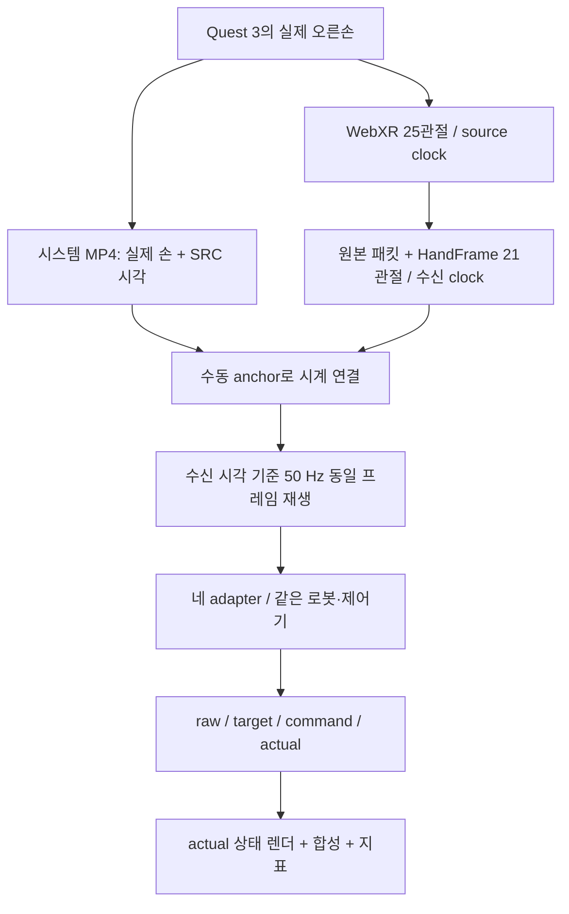

# 데이터 수집과 평가 절차

## 실제 손 영상과 입력을 동시에 기록한다

Quest 3의 passthrough MP4는 Quest 시스템 녹화로 저장한다. 같은 동안 Quest Browser의 WebXR가 출력한 손 위치·회전·추적 상태를 HTTPS/WSS로 PC에 기록한다. **MP4에서 손을 다시 추정한 데이터가 아니다.** WebXR 추정 골격이며 네이티브 SDK에 직접 접근한 출력이나 해부학적 정답으로 표시하지 않는다.

원본 관절은 이름으로 공통 21관절에 대응한다. 손목 0, 엄지 1–4, 검지 5–8, 중지 9–12, 약지 13–16, 새끼 17–20이며 각 끝점은 4·8·12·16·20이다. 좌우 손·좌표 규약·m 단위·유효 여부·source/수신 시각은 metadata와 함께 유지한다. 누락된 관절을 임의로 만들지 않는다. 네이티브 관측을 보존하므로 adapter 전후를 추적할 수 있다.

이번 take는 18개 안내 × 6초 = 108초다. 펼침·주먹·손가락 단독·네 핀치·벌림·손목·가림·자유 동작을 포함한다. **안내 이름은 수행 성공 정답이 아니다.** 유효 오른손 5,092개와 invalid 1개가 원본에 기록됐다. 비교 재생에서는 새 valid 입력 4,835개를 소비하고 5,400 제어 tick 중 5,398개가 TRACKING, 시작 2개가 HOLD다. 가림 안내가 실제 추적 상실을 보장하지 않는다.

## 시계 맞춤과 동일 입력 보장

영상의 SRC 숫자와 PTS를 7곳에서 읽어 다음 직선을 맞췄다.

$$t_{\mathrm{source,ms}}=1000.00300000014\,t_{\mathrm{video,s}}+9655.571395460143.$$

Anchor 최대 잔차는 0.789 ms지만 촬영 간격은 약 33 ms다. source–receiver clock 직선 적합의 최대 잔차는 26.30 ms다. 따라서 anchor residual을 실제 동기화 정확도나 통신 지연으로 해석하지 않는다. [원래 anchor와 fit](media/video_benchmark_002/alignment.json)을 남겼다.

동일한 타임라인으로 네 방법을 offline 재생하고 소비 입력 digest가 같은지 검사했다. 현재 MANUS는 엄지 입력 축 v2로 다시 계산했고 다른 세 방법은 이전 상태를 byte 단위로 유지했다. 기하 proxy를 실제 MANUS 센서 보정으로 표시하지 않는다. 물리·명령 주기와 접촉 비활성 조건도 공유한다. 실시간 창 네 개는 부하에 따라 서로 다른 최신 프레임을 소비할 수 있으므로 그 화면만으로 정량 비교하지 않는다.

## 데이터 용도와 분리의 한계

| 용도 | 기록 | 이번 실험에서의 사용 |
|---|---|---|
| 로봇 기하 보정 | `geort_train_session_001.jsonl` | 펼친 손 후보 226프레임으로 고정 프로파일 작성 |
| GeoRT 학습 | `quest_train_session_002.jsonl` | 유효 오른손 12,998프레임 export; 기본 full-range 모델 |
| 현재 비교 demonstration | `video_benchmark_002` | 같은 입력을 네 방법에 재생; 학습 데이터에 자동 병합하지 않음 |
| 과거 실패 진단 | `quest_eval_session_001.jsonl` 등 | 모델·범위 실험을 반복 분석한 자료, 외부 보관 |

세션 이름이 다르다는 사실만으로 참가자 독립성을 주장할 수 없다. 참가자 ID와 모집 절차가 없고, 같은 사용자가 보정·학습·촬영했을 수 있다. 과거 평가 자료는 반복해서 보고 원인을 분석했으므로 blind test가 아니다. 현재 영상도 단일 참가자의 qualitative demonstration이다. 논문 수준의 일반화 평가에는 별도 참가자·세션 분리, 고정된 평가 프로토콜과 독립 성공 라벨이 필요하다.

공개 데이터 연구 자료는 실패 이력과 함께 보관했다. 현재 비교 영상의 학습 모델은 공개 데이터 모델이 아니라 개인 Quest 모델이다. 각 export manifest의 출처·라이선스·추적 방식·좌표 변환·원본 hash를 유지하며 공개 추정 pose와 Quest 관측을 혼동하지 않는다.

## 지표를 어떻게 읽는가?

### 정규화 목표 손끝 차이

사람은 wrist, 로봇은 palm을 원점으로 삼는다. 중지 MCP 방향과 손바닥 좌우 방향으로 기준축을 만들고, 각각의 중지 MCP 기준 길이로 나눈다. 로봇 기준 길이는 중립 자세에서 고정한다. 정렬·정규화된 다섯 손끝을 $\tilde h_i,\tilde x_i$라 하면:

$$E_{\mathrm{tip}}=\frac15\sum_{i=1}^{5}\|\tilde x_i(q^{\mathrm{target}})-\tilde h_i\|_2.$$

이 값은 무차원이다. mm 오차나 정답 로봇 관절각 오차가 아니다. 사람과 로봇의 형태·기준점·축 선택의 차이를 포함한다. 유효 50 Hz tick 평균이므로 새 관측 프레임만 균등 가중한 평균과도 다를 수 있다.

### 제어 추종과 목표 변화

$$\mathrm{RMSE}_{\mathrm{cmd,actual}}=\sqrt{\frac1{20T}\sum_{t,j}(q^{\mathrm{cmd}}_{tj}-q^{\mathrm{actual}}_{tj})^2}.$$

명령–실제 오차가 작으면 시뮬레이터가 명령을 잘 따라간다는 뜻이다. 목표가 올바른 사람 손 모양이라는 뜻은 아니다. 별도의 target–command 오차에는 속도 제한 영향이 포함된다. 이를 지연 시간 초로 환산하지 않는다. 공통 clip 비율이 0이어도 넓은 허용 범위 안에서 잘못된 자세가 나올 수 있다.

### 핀치와 계산 시간

핀치 그래프는 엄지와 각 손끝의 실제 상태 거리를 손 기준 길이로 정규화한다. 접촉·물체·힘 센서가 없어 파지 성공률이 아니다. 손끝 위치도 접촉 패드 표면이 아닌 링크 원점이다.

시간은 새 valid 입력 4,835개에 대한 adapter 전처리·원본 solve/추론·기본 필터를 포함한다. 시뮬레이션과 렌더링·로그는 제외한다. 현재 MANUS v2 시간은 단독 재실행이고 다른 세 방법은 이전 동시 worker 실행 값이다. 독립적인 속도 순위를 정하지 않는다. 평균·P95 등 원자료는 [summaries](media/video_benchmark_002/summaries.json)에 있다.

## 재현성 자료

[파일별 hash manifest](media/video_benchmark_002/manifest.json), [입력 audit](media/video_benchmark_002/input_audit.json), [실행 설정](media/video_benchmark_002/run.json), [지표 CSV](media/video_benchmark_002/metrics.csv), [보정 프로파일](../configs/tesollo_calibrated/profile.json)을 함께 제공한다. 개인 원본 JSONL과 모델은 로컬 보존하며 새 clone에 포함되지 않는다. 코드만 clone했다고 개인 checkpoint를 자동 재현했다고 표시하지 않는다.

[실행·촬영 명령](RUNNING.md) · [알고리즘 원리](METHODS.md) · [GeoRT 실패 과정](GEORT_FAILURES.md)
