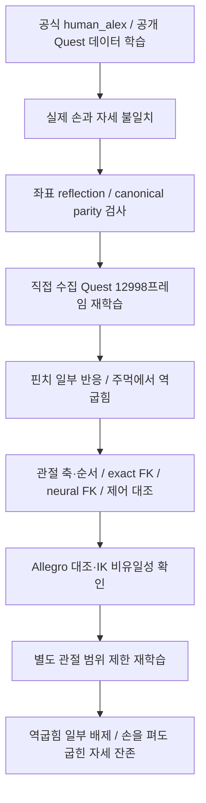

# GeoRT를 DG-5F에 연결하면서 실패한 과정

**이번 조건에서는 GeoRT가 핀치 일부에는 반응했지만, 손을 펴거나 주먹을 쥘 때 사람과 다른 관절 자세를 출력했다.** 공개 데이터에서 개인 Quest 데이터로 바꾸고, 좌표계·FK·관절 순서를 점검하고, 학습 범위를 제한했어도 안정적인 자세 대응을 얻지 못했다. 따라서 현재 DG-5F 비교의 신뢰할 수 있는 기본 모델로 채택하지 않는다. 이 결과를 모든 GeoRT 모델이나 모든 Tesollo 설정으로 일반화하지 않는다.

[현재 비교 영상](../README.md#실제-손과-네-알고리즘-비교) · [학습 원리와 손실](METHODS.md#3-geort-손끝-공간의-대응을-미리-학습한다)

## 어떤 시도를 했고 무엇이 남았나?

| 단계 | 시도와 관측 | 여기서 말할 수 있는 것 |
|---|---|---|
| 공식·공개 데이터 | GeoRT `human_alex.npy` 3,498프레임, 공개 Quest 1k·3,498·10k 학습 비교 | 프레임 수를 늘리는 것만으로 실제 Quest 자세 대응이 보장되지 않았다 |
| 좌표 정합 | 공개 입력의 반사·축과 실제 Quest canonical 경로를 대조 | 좌표 문제는 별도로 다뤘으나 이것만으로 자세 실패가 없어지지 않았다 |
| 직접 수집 | 개인 Quest session 002의 유효 오른손 12,998프레임으로 full-range 재학습 | 학습과 유사한 입력에서도 open/fist 실패가 남았다. 공개 데이터만의 문제로 단정할 수 없다 |
| 시뮬레이터 대조 | SAPIEN·MuJoCo·neural FK와 관절 축·순서 검사 | 단순한 관절 순서 오류나 정확 FK 불일치를 주원인으로 지목할 근거가 약해졌다 |
| 다른 로봇 대조 | 같은 개인 입력으로 원본 지원 Allegro 제어 모델 학습 | 주요 굽힘 대응이 DG-5F보다 나았으나 로봇 구조가 달라 공정한 성능 순위 실험은 아니다 |
| 학습 범위 제한 | 비엄지 distal 8개 0–90°, 이후 검증된 PIP/DIP 6개에 관측 상한 적용 | 일부 역굽힘을 금지해도 손을 펼 때 큰 굽힘이 남았다. 제한 모델을 성공 모델로 대체하지 않았다 |

## 1. MuJoCo에 손을 잘못 올린 것인가?

| 대조 | 측정 결과 | 해석의 범위 |
|---|---|---|
| SAPIEN exact FK ↔ MuJoCo FK | 1,045개 자세에서 손끝 최대 약 **0.001585 mm** | 검사한 링크·관절 자세에서는 기구학이 사실상 일치 |
| Neural FK ↔ exact FK | 평균 약 **2.15 mm** | 근사 오차는 있지만 수십 mm의 자세 차이 전체를 설명하지 못함 |
| 명령 ↔ 실제 손끝 | 과거 동적 진단 평균 약 **0.678 mm** | 시뮬레이션이 적용 명령을 대체로 따라감 |
| 목표 ↔ 실제 손끝 | 같은 진단 평균 약 **13.06 mm** | 공통 속도 제한 등 제어 추종 과정이 포함됨 |

이 숫자는 서로 다른 단계의 오차이며 현재 108초 영상의 성능 표와 섞어 쓰지 않는다. FK 대조는 모델의 관절각이 주어졌을 때 위치 계산을 검사한다. 네트워크가 사람 손에 맞는 관절각을 선택하는지는 별도 문제다.

## 2. 손끝 위치가 맞으면 손 모양도 맞는가?

동일한 중지 손끝을 만드는 두 관절 조합을 정확 FK에서 찾았다. 굽힘에 해당하는 3개 각도는 각각 다음과 같다.

| 예 | 각도 1 | 각도 2 | 각도 3 |
|---|---:|---:|---:|
| A | 28.65° | 40.11° | 22.92° |
| B | 80.04° | −53.68° | 50.29° |

두 손끝 차이는 수치 계산상 약 $2.3\times10^{-9}$ mm이지만 중간 마디 자세는 다르다. [정확 각도와 측정 원자료](media/video_benchmark_002/ik_ambiguity.json)를 보존했다.

GeoRT는 손가락마다 3D 손끝 위치에서 4개 로봇 관절각을 출력하며, 사람의 전체 관절각을 supervised 정답으로 학습하지 않는다. 넓은 범위에서 여러 자세가 같은 손끝을 만들 수 있다는 것은 **가능한 실패 기전**이다. 위 한 자세 예시가 두 전체 매핑의 Direction·Curvature loss까지 동일하다고 증명하는 것은 아니다. 이것만으로 최종 원인을 확정하지 않는다.

## 3. 범위를 사람처럼 줄이면 해결됐는가?

이 그림은 현재 비교 take가 아니라 **과거에 반복 진단한 2,000프레임 녹화**다. Open/fist는 기하 조건으로 고른 후보이며 정답 동작 라벨이 아니다.

| 제한 학습 | Open 후보: 검지 / 중지 / 약지 PIP | Fist 후보: 검지 / 중지 / 약지 PIP |
|---|---|---|
| 비엄지 distal 8개, 0–90° | 66.75° / 79.87° / 4.70° | 41.21° / 80.66° / 86.59° |
| 검증된 6개 축, 관측 상한 | 70.36° / 86.56° / 7.29° | 48.90° / 81.19° / 84.71° |

후자는 검지·중지·약지의 PIP와 DIP만 바꿨다. PIP 상한 90°, DIP 상한은 각각 71.29°·68.46°·74.63°다. **하한 0°는 실험 제약**이며 관측 데이터에서 측정한 해부학적 하한이 아니다. MCP·엄지·새끼까지 사람 각도를 대응시켰다고 주장하지 않는다.

관측 상한 실험은 동일 초기 가중치·seed 20261018·공유 FK 조건으로 full-range와 제한 학습을 대조하고 각각 200 epoch를 수행했다. Neural FK의 기존 정규화 범위와 제한 학습 범위는 별도의 affine adapter로 연결했다. 제한 모델을 단순히 full-range loader로 읽지 않았다. Open 869후보에서 검지·중지가 크게 굽혔고, Fist 433후보에서도 자연스러운 대응을 얻지 못했다. 사람 PIP와 로봇 MCP+PIP+DIP 합의 Spearman 상관은 검지 −0.933, 중지 −0.848, 약지 +0.919였다.

따라서 **범위가 넓다는 문제와 원하는 자세 대응을 학습하지 못한 문제는 구분된다.** 특정 관절의 음수 굽힘을 막았다는 사실만으로 retargeting이 성공한 것은 아니다.

## 4. 데이터가 부족해서인가, 학습이 잘못된 것인가?

현재 증거로 한 가지 원인을 확정할 수 없다.

- 프레임 수는 동작 다양성과 같지 않다. 공개 10k에서 엄지–새끼 15 mm 미만 후보는 없었고 엄지–약지는 5개뿐이었다. 이것은 기하 후보 수이며 정답 pinch 라벨이 아니다.
- 직접 수집 데이터에서도 실패가 남았으므로 공개 데이터 출처만 바꾸면 해결된다고 말할 수 없다.
- Neural FK loss가 작아지는 것은 로봇 FK 근사가 학습된다는 뜻이다. 사람과 로봇의 자세 대응이 올바르다는 증거가 아니다.
- 현재 목적은 손끝 공간 매핑이며 중간 마디의 정답 자세를 직접 제공하지 않는다. 넓은 범위·workspace 형태·초기화·표본 분포·손실 간 균형이 함께 영향을 줄 수 있다.
- 목표 변화가 크면 공통 속도 제한이 반응을 늦춘다. 하지만 속도 제한을 없애도 잘못된 목표 자세 자체가 고쳐지는 것은 아니다.

추가 데이터·긴 학습을 해결책으로 단정하거나 원본 loss를 조정해 성공 사례로 바꾸지 않았다. 현 단계의 결론은 **이 DG-5F 재현 조건에서 open/fist 대응에 실패했으며, 조사한 단순 원인과 범위 제한만으로 해결되지 않았다**는 것이다.

## 보존한 것

현재 README 영상은 개인 **full-range** 모델이다. 실패한 제한 모델을 기본 모델로 교체하지 않았다. 이전 공개 데이터·좌표 parity·Allegro·범위 실험의 코드·checkpoint·JSONL·상세 보고서는 삭제하지 않고 `stkim_ws/Hand_teleoperation_other`로 옮겼다. [정리 정책과 복구 목록](PROJECT_LAYOUT.md)을 참조한다. 공개 저장소에는 비교 영상·집계 그래프·위 측정 요약과 IK 예시 원자료를 남긴다.
