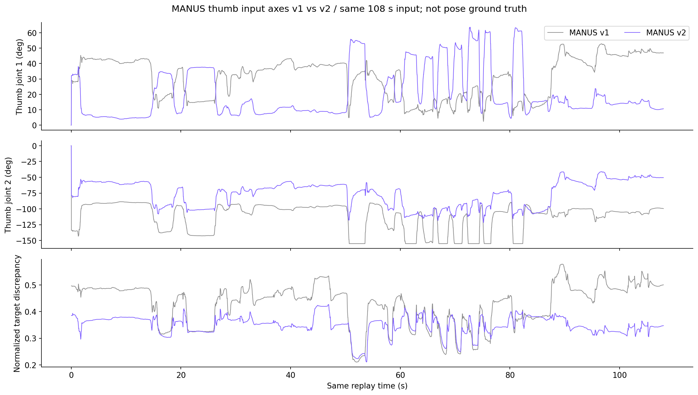

# MANUS-style 엄지 방향 검사와 입력 축 수정

**현재 README 영상은 `thumb_axes_v2`를 적용한 결과다.** 아래 최초 검사는 기존 `legacy_v1`의 문제를 설명한다. 제조사 수식·gain·offset·URDF는 유지하고 Quest 입력 축만 별도 버전으로 바꿨다.

**현재 Quest proxy를 그대로 제조사 MANUS 함수에 넣는 경로에서 엄지 뿌리의 축 대응 불일치와 반대 방향 반응을 재현했다.** 엄지 전체에 −1을 곱해야 한다는 결론은 아니다. 제조사 함수의 복사 오류도 발견되지 않았다. 이 검사는 현재 오른손 DG-5F에 한정한다.

## 어떤 각도가 어디로 들어가는가?

최초 v1 검사에서 프로젝트의 엄지 기하 특징은 다음과 같다. $u$는 사람 엄지의 1→2 뼈 방향이고, X는 손바닥 방향으로 정의한 축, Y는 새끼→검지, Z는 손목→중지 MCP 방향이다.

$$A=\mathrm{atan2}(u_Z,u_Y),\qquad E=\mathrm{atan2}(u_X,\sqrt{u_Y^2+u_Z^2}).$$

프로젝트 이름은 각각 `thumb_opposition`, `thumb_palmar_elevation`이다. 이 이름은 실제 MANUS 센서각과의 검증된 대응이 아니라 기하 proxy 규약이다.

| 제조사가 받는 슬롯 | 제조사 필드 | v1에서 넣은 값 |
|---|---|---|
| 0 | `ThumbMCPSpread` | $A$ |
| 1 | `ThumbMCPStretch` | $E$ |
| 2 | `ThumbPIPStretch` | 사람 엄지 1→2와 2→3의 부호 없는 굽힘 |
| 3 | `ThumbDIPStretch` | 사람 엄지 2→3과 3→4의 부호 없는 굽힘 |

제조사의 오른손 수식은 아래와 같다. 도 단위로 적었으며 제조사 후처리와 공통 URDF clip 전의 식이다.

$$q_1=58.5-E,\quad q_2=-1.6(A+20),\quad q_3=1.3B,\quad q_4=0.65(B+C).$$

따라서 $E$가 증가하면 $q_1$은 감소하고, $A$가 증가하면 $q_2$가 더 음수가 된다. **음수 자체가 오류는 아니다.** 공식 오른손 두 번째 엄지 관절의 허용 범위는 −155°~0°다. 방향 판단에는 FK가 필요하다.

## 정확 FK에서 반대 반응을 확인했다

다른 입력은 고정하고 엄지만 곧게 만든 합성 좌표를 사용했다. 실제 측정 데이터나 학습 데이터로 취급하지 않는다. 로봇에서는 움직이는 구간 `rl_dg_1_2`→`rl_dg_1_3`의 단위 방향을 관찰했다. 이 구간이 사람 엄지 뼈와 해부학적으로 정확히 대응한다고 인증하는 검사는 아니다.

| 입력 A / E | 출력 q1 / q2 | 로봇 구간 방향의 A / E |
|---|---|---|
| 10° / 20° | 38.5° / −48° | 38.5° / 48° |
| 20° / 20° | 38.5° / −64° | 38.5° / 64° |
| 10° / 30° | 28.5° / −48° | 28.5° / 48° |

이 영역에서는 로봇 구간의 기하 A는 $58.5-E$, 기하 E는 $1.6(A+20)$이다. 같은 이름의 각도가 같은 이름의 로봇 방향으로 전달되지 않는다.

더 직접적으로, A를 **10°→20°**로 바꾸면 사람 단위 방향의 Z는 **+0.1632→+0.3214**로 증가하지만 로봇 구간 Z는 **+0.4165→+0.2729**로 감소한다. E를 20°→30°로 올리면 사람의 X 방향은 증가하지만 로봇 구간 X는 변하지 않고 A 방향이 감소한다. 따라서 현재 proxy 정의를 기준으로 기대한 움직임과 반대이거나 다른 축으로 반응하는 사례가 있다.

A=40°→50°, E=20°에서는 q2가 −96°→−112°가 되고, 로봇 구간 Z는 **−0.0651→−0.2332**로 더 뒤쪽을 향한다. q2가 −90°를 넘으면 구간 방향의 투영 각도가 접히거나 wrap되는 현상도 있다. 이는 관절각이나 실제 로봇 상태가 갑자기 180° 점프했다는 뜻이 아니다.

## 기존 실제 녹화에서도 이 경로를 사용했는가?

`video_benchmark_002`의 새 유효 입력 **4,835개**에서 저장한 raw 출력과 제조사 원본 재계산이 모두 일치했다.

| 관측 | 값 |
|---|---:|
| A 중앙값 | 45.35° |
| E 중앙값 | 23.41° |
| q1 raw 중앙값 | 35.09° |
| q2 raw 중앙값 | −104.57° |
| q2 raw < −90° | 4,664 / 4,835 = **96.46%** |
| q2가 공식 −155° 하한으로 common clip된 입력 | 572 / 4,835 = **11.83%** |

−90° 미만이 공식 범위 위반은 아니다. 다만 입력 정의 불일치가 구간 방향의 반응에 영향을 주는 영역에 대부분의 입력이 들어간다는 진단이다. 정답 손 모양 실패율이나 사용자 관찰의 프레임별 검증 결과로 해석하지 않는다.

## 엄지 끝 관절까지 모두 반대인가?

q3·q4를 각각 +20°로 움직이는 FK 검사에서는 해당 지골 사이 부호 없는 굽힘이 각각 20°로 증가했다. 이 검사에서는 엄지 4관절 전체가 일괄 반전된 증거가 없다. 하지만 사람 쪽 굽힘도 부호 없는 각도이므로 과신전과 굽힘을 구분하지 못한다. 이 결과로 q3·q4의 해부학적 부호·0점까지 검증됐다고 주장하지 않는다.

## 결론과 수정 범위

- 제조사 원본 수식·오른손 선택·출력 순서가 잘못 복사된 문제는 확인되지 않았다.
- 현재 Quest의 엄지 기하 각도를 MANUS ergonomics로 간주하는 연결은 검증된 입력 대응이 아니다. 통제한 좌표 검사에서는 반대/교차 방향 반응이 실제로 나타났다.
- 수정한다면 먼저 **Quest→MANUS 엄지 입력 adapter의 의미·축·부호·0점**을 정의해야 한다. 네 관절의 부호를 일괄 반전하거나 원본 offset·gain을 임의 취소하는 방식은 근거가 없다.
- 최초 검사에서는 출력과 영상을 유지했다. 이후 사용자 요청으로 아래 v2 입력 축을 적용하고 MANUS만 재계산했으며, 이전 결과는 별도 보존했다.

## 적용한 v2: 제조사 파라미터를 유지하고 입력 기준축을 구분

기하 특징 A·E·B·C 자체는 그대로 기록한다. 제조사 입력 슬롯에 넣을 때만 다음과 같이 변환한다.

$$\mathrm{Spread}=E,\qquad\mathrm{Stretch}=\mathrm{atan2}(u_Y,u_Z).$$

관측 범위에서는 Stretch=$90^\circ-A$다. 90°는 +Y에서 재던 각도를 +Z에서 재도록 바꾸는 좌표 기준의 차이다. 제조사 offset 58.5°, 20°를 상쇄하거나 gain 1.6을 역산해 맞춘 값이 아니다. 기존 B·C와 다른 16개 입력은 그대로다. 현 방식도 실제 MANUS 센서의 해부학적 보정이라고 주장하지 않는다.

원래 제조사 함수를 통과하면 현재 범위에서 q1은 `max(0, A−31.5°)`, q2는 `min(0, −1.6(E+20°))`다. 이후 공통 URDF clip과 속도 제한은 기존과 같다. q3·q4의 원본 결합식도 유지한다.

| 통제 입력 A / E | v2 q1 / q2 | v2 로봇 구간의 A / E |
|---|---|---|
| 40° / 20° | 8.5° / −64° | 8.5° / 64° |
| 50° / 20° | 18.5° / −64° | 18.5° / 64° |
| 40° / 30° | 8.5° / −80° | 8.5° / 80° |

이 비포화 구간에서는 A 증가에 로봇 A가 증가하고, E 증가에 로봇 E가 증가한다. 작은 A에서는 원래 후처리의 q1=0 dead zone이 남고, E가 36.25°보다 크면 q2가 −90°를 넘어 방향 투영의 접힘이 남을 수 있다. **모든 입력에서 자연스러운 엄지 대응이 완성됐다는 결론은 아니다.**



| 동일 108초 입력 | v1 | v2 |
|---|---:|---:|
| 정규화 목표 손끝 차이 | 0.428341 | 0.349420 |
| q1 raw 중앙값 | 35.09° | 13.85° |
| q2 raw 중앙값 | −104.57° | −69.45° |
| raw q2 < −90° | 4,664 / 4,835 | 1,555 / 4,835 |
| q2 common clip | 572 / 4,835 | 0 / 4,835 |

원본 입력·공통 제어는 같다. 새 MANUS raw/target/command의 3~20번 관절은 이전과 동일하다. 다른 손가락 actual 차이는 최대 약 $4.44\times10^{-16}$ rad의 수치 반올림이다. AnyDex·Wuji·GeoRT 상태·수치는 기존 파일을 byte 단위로 재사용했다. MANUS 시간은 단독 재실행, 나머지는 과거 동시 worker 실행 값이라 속도 순위로 비교하지 않는다.

이전 영상은 `../Hand_teleoperation_other/archive_20261018/manus_thumb_v1_publication/`에 보관한다. 현재 모델이나 이전 평가값을 덮어써 성공 판정을 바꾸지 않고 버전별 원자료를 남긴다. [v2 수치·hash](media/video_benchmark_002/manus_thumb_check_v2.json)와 [재생 대조](media/video_benchmark_002/revision_verification.json)를 참조한다.

## 재현

```bash
.venv/bin/python scripts/inspect_manus_thumb.py \
  --log results/video_benchmark_002/manus_thumb_v2/replay/manus.jsonl \
  --output results/manus_thumb_check_new.json
```

기본은 v2이며 `--convention legacy_v1`로 이전 입력 방식을 검사할 수 있다. 새 출력 경로를 사용한다. 스크립트는 통제 좌표·원본 매핑·정확 FK·저장 로그를 읽고 assert로 확인한다. 무작위 학습이나 로봇 제어는 하지 않는다. [전체 수치와 소스 hash](media/video_benchmark_002/manus_thumb_check.json)에 실행 근거를 보존했다.

관련 소스: `benchmark/retargeting/quest_ergonomics.py`, `benchmark/retargeting/manus.py`, 제조사 `external/dg5f_ros2/dg5f_driver/script/manus_retarget/manus_retarget.py`의 입력 슬롯과 `_compute_mqd_from_q`, 공식 `dg5f_right.urdf`.
