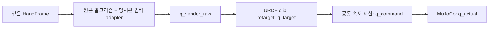

# 네 방법은 무엇을 맞추는가?

입력은 같은 오른손 21개 점 $H=(h_0,\ldots,h_{20})\in\mathbb R^{21\times3}$, 단위는 m다. 출력은 DG-5F 관절각 $q\in\mathbb R^{20}$, 단위는 rad다. 각 손가락은 4관절이다. MCP는 손가락 뿌리, PIP는 가운데 마디, DIP는 끝 마디를 뜻한다. 로봇의 각 관절이 사람의 해부학적 관절과 항상 일대일로 일치하지는 않는다.

| 방법 | 맞추는 대상 | 매 프레임 계산 | 사전 학습 | 현재 실험에서의 주의점 |
|---|---|---|---|---|
| MANUS-style | 사람 굽힘·벌림 각도의 proxy | 제조사 각도 매핑 | 없음 | 실제 MANUS 장갑이 아닌 Quest 기하 proxy |
| AnyDex | 손가락 위치 벡터·손끝 방향·핀치 | 범위 내 수치 최적화 | 없음 | 분절 길이·회전 보정 프로파일 적용 |
| Wuji | AnyDex와 유사한 adaptive 기하 목적 | 범위 내 수치 최적화 | 없음 | 공유 구조가 크며 scaling 의미가 다름 |
| GeoRT | 사람 손끝 공간과 로봇 손끝 공간의 매핑 | 학습된 신경망 추론 | 필요 | 전체 사람 관절각을 정답으로 학습하지 않음 |

**Analytical optimizer는 닫힌 형태의 역기구학 해를 뜻하지 않는다.** 목적함수의 미분을 계산해 수치 최적화기에 제공한다는 의미다. 아래 식은 고정된 원본 코드의 작동을 설명하는 요약이며 새 알고리즘을 제안하지 않는다.

## 1. MANUS-style: 각도를 계산하고 제조사 함수에 넣는다

연속한 두 지골 벡터 $a,b$의 굽힘 proxy는 다음과 같다.

$$\theta=\cos^{-1}\!\left(\mathrm{clip}\left(\frac{a\cdot b}{\|a\|\|b\|},-1,1\right)\right).$$

이 각도는 부호 없는 기하 각도다. 신전 방향을 포함한 실제 관절 encoder 값이 아니다. MCP는 손바닥 기준 축에서 방향의 `atan2`로 계산한다. 이 proxy를 도 단위로 변환한 다음 제조사의 `_compute_mqd_from_q` 함수 본문을 그대로 실행한다.

오른손 검지와 중지 PIP 출력의 예는 다음과 같다. 공통 관절 제한을 적용하기 전 값이다.

$$q_{\mathrm{index,PIP}}=\max(0,1.3(\theta_{\mathrm{index,PIP}}-40^\circ)),\qquad q_{\mathrm{middle,PIP}}=\max(0,1.3(\theta_{\mathrm{middle,PIP}}-30^\circ)).$$

각 관절에는 서로 다른 gain·offset·clamp·coupling이 있어 전체를 하나의 선형식으로 설명할 수 없다. 예를 들어 Quest proxy가 20°여도 제조사 PIP 출력은 0°일 수 있다. 이것은 proxy와 실제 MANUS ergonomics의 차이가 결과에 영향을 줄 수 있는 이유다. 이를 없애려고 원본 offset을 취소하지 않았다.

현재 공개 영상은 엄지 입력 축을 `thumb_axes_v2`로 명시한다. 기하 opposition A·palmar elevation E를 그대로 MANUS 슬롯 0·1에 넣던 v1 대신, spread=E, stretch=atan2(uY,uZ)를 전달한다. 관측 범위에서 stretch=90°−A다. 제조사 offset·gain은 유지했고, 다른 관절 입력은 바꾸지 않았다. 실제 MANUS 장갑 보정이 아닌 Quest adapter의 좌표 규약 수정이다. [변경 전후 검사·남은 한계](MANUS_THUMB_CHECK.md)를 함께 읽는다.

## 2. AnyDex와 Wuji: 손 모양의 기하 오차를 줄이는 각도를 찾는다

손끝이 멀리 떨어져 있으면 손 전체 모양을, 엄지와 손끝이 가까워지면 핀치 위치와 손끝 방향을 더 강조한다. 엄지–각 손끝 거리 $d_i$를 cm로 표시하면 현재 기본 가중치는 다음과 같다.

$$\alpha_i=\mathrm{clip}\!\left(\frac{4-d_i}{4-2+\epsilon},0,0.7\right),\qquad \alpha_{\mathrm{thumb}}=\max_i\alpha_i.$$

따라서 가까워져도 손 전체 항이 완전히 사라지지는 않는다. $r_{ij}(q)$는 로봇 손목에서 마디 $j$로 가는 벡터, $\hat r_{ij}$는 회전·길이 변환을 거친 사람 목표 벡터다. $v_i$는 손목에서 각 손끝으로 가는 벡터, $u_i$는 DIP→TIP 단위 방향이다. 목적함수 구조는 다음과 같다.

$$q^*=\arg\min_{q_{\min}\le q\le q_{\max}}\sum_i\left[\alpha_i\left(w_p\rho(\|v_i(q)-\hat v_i\|)+w_d\rho_d(\|u_i(q)-\hat u_i\|)\right)+(1-\alpha_i)\frac{w_f}{3}\sum_{j\in\{\mathrm{PIP,DIP,TIP}\}}\rho(\|r_{ij}(q)-\hat r_{ij}\|)\right]+\lambda\|q-q_{\mathrm{prev}}\|^2.$$

엄지–손끝 거리는 가중치 선택에 사용한다. 위 위치 항 자체는 각 손목→손끝 목표를 맞추는 항이며, 손끝 쌍 거리만 직접 최소화하는 식이 아니다. 마지막 항은 이전 해가 있을 때 적용된다. Huber 함수는 작은 오차에는 제곱, 큰 오차에는 선형으로 증가한다.

$$\rho_\delta(e)=\begin{cases}\tfrac12e^2,&|e|\le\delta,\\\delta(|e|-\tfrac12\delta),&|e|>\delta.\end{cases}$$

원본 내부 위치 단위는 **cm**, 방향은 단위 벡터다. 현재 기본값은 $w_p=1,w_d=10,w_f=1,\lambda=0.04$, 위치 Huber $\delta=2$ cm, 방향 $\delta_d=0.5$다. NLopt SLSQP가 로봇 FK와 Jacobian을 사용한다. 이전 결과를 초기값으로 재사용하고, 기본 LPFilter를 거친다. 초기에는 관절 범위 중간값을 사용한다. 필터 계수 0.2는 현재 해를 20%, 이전 필터 출력을 80% 반영한다.

### 두 구현의 차이를 어떻게 해석할까?

- **AnyDex:** 손목→MCP와 지골 3개를 각각 보정하는 손가락별 4개 길이 비율을 사용한다. 현재 `pinch_scaling=1.0844`와 원본 pinch target 보간 경로를 사용한다. 지원되는 접촉 확장 항은 현재 기본 가중치 0이므로 활성화된 접촉 모델로 설명하지 않는다.
- **Wuji:** 손목→PIP/DIP/TIP 도달 벡터에 손가락별 3개 비율을 사용한다. 전역 도달 scaling은 1.0844다. 구현에 존재하는 hyperextension penalty와 PIP–DIP coupling 항은 현재 가중치 0이다. 이 항들이 이번 결과를 개선했다고 주장하지 않는다.

두 방법은 같은 adaptive 목적함수 계열을 공유한다. 서로 무관한 두 원리를 검증하는 실험은 아니다. 또한 서로 다른 의미의 scaling 배열을 그대로 복사하지 않았다. 원본이 지원하는 필드에 DG-5F 기하 정보를 전달했다. AnyDex 공식 보정 함수는 수정 없이 호출했고, Wuji 연결은 프로젝트 adapter이며 공식 Quest 보정 절차가 아니다.

## 3. GeoRT: 손끝 공간의 대응을 미리 학습한다

GeoRT는 다섯 손가락에 각각 신경망을 둔다. 현재 로봇에서는 각 손가락의 입력은 손끝 위치 3개 값이고 출력은 관절각 4개 값이다.

$$z_i=N_{\theta_i}(h_{\mathrm{tip},i})\in[-1,1]^4,\qquad q_i=q_{\min,i}+\frac{z_i+1}{2}(q_{\max,i}-q_{\min,i}).$$

입력은 원본 GeoRT canonical 좌표계다. wrist를 원점으로 하고 0→9 방향을 Z축으로, 13→5 방향을 보조축으로 사용한다. 이 정의는 다른 benchmark palm 정렬과 구분한다. 학습·추론에 동일한 변환을 적용한다. 추론 때는 학습된 네트워크를 실행하며 매 프레임 역기구학 최적화를 풀지 않는다.

학습에서는 먼저 로봇의 정확 FK 표본으로 미분 가능한 neural FK $F_\psi$를 학습한다. 그다음 $g(H)=F_\psi(N_\theta(\mathrm{tips}(H)))$를 이용해 아래 손실로 IK 네트워크를 학습한다. 이번 기본 학습은 로봇 FK 표본 100k, 원본 FK/IK 각 200 epoch, AdamW·학습률 $10^{-4}$·batch 2048 조건을 사용했다.

$$L=L_{\mathrm{direction}}+80L_{\mathrm{chamfer}}+0.1L_{\mathrm{curvature}}+L_{\mathrm{pinch}}.$$

| 항 | 무엇을 유도하나? | 보장하지 않는 것 |
|---|---|---|
| Direction | 사람 손끝을 조금 움직이면 대응 로봇 손끝도 비슷한 방향으로 움직이도록 함 | 전체 관절각의 해부학적 일치 |
| Chamfer | 변환된 점 분포와 로봇의 도달 가능한 점 분포가 가까워지도록 함 | 특정 사람 프레임에 대한 정답 로봇 관절각 |
| Curvature | 작은 입력 변화에 매핑이 급격히 휘지 않도록 함 | 반드시 자연스러운 중간 마디 자세 |
| Pinch | 사람 손끝 쌍이 가까우면 대응 로봇 손끝 쌍도 모이도록 함 | 접촉 힘·자기충돌·물체 파지 성공 |

방향 항은 작은 변화 $\Delta h$와 대응 출력 변화의 cosine을 크게 만든다.

$$L_{\mathrm{direction}}=-\mathrm{mean}\cos\big(\Delta h,g(H+\Delta h)-g(H)\big).$$

Chamfer는 같은 손가락의 두 점 집합 $A,B$ 사이 최근접 **제곱거리**의 양방향 평균이다. 프레임별 정답 대응 없이 분포를 맞춘다.

$$\mathrm{CD}(A,B)=\frac1{|A|}\sum_{a\in A}\min_{b\in B}\|a-b\|^2+\frac1{|B|}\sum_{b\in B}\min_{a\in A}\|b-a\|^2.$$

곡률 항은 중앙 차분이다.

$$L_{\mathrm{curvature}}=\mathrm{mean}\|g(H+\Delta h)+g(H-\Delta h)-2g(H)\|^2.$$

핀치 항은 사람 손끝 거리 15 mm 미만인 표본에서 대응 로봇 손끝 쌍의 제곱거리를 줄인다. 원본 코드의 반복문은 엄지 쌍만이 아니라 **모든 손끝 쌍 $i<j$**을 순회한다. collision 가중치는 현재 0이다. 따라서 이 네 손실은 전체 사람 관절 자세를 supervised 정답으로 삼는 손실과 다르다.

원본 데이터 로더의 손가락별 재표본화는 원래 프레임의 손가락 간 동시 관계를 일부 버린다. 원본 절차를 유지했으며, 이를 새로운 21관절 관측 프레임을 확보한 것으로 세지 않는다. 데이터 프레임 수가 늘었다고 동작 다양성이나 드문 핀치가 같은 비율로 늘지는 않는다.

## 4. 알고리즘 이후에 적용하는 공통 제어

$$q_t^{\mathrm{cmd}}=q_{t-1}^{\mathrm{cmd}}+\mathrm{clip}(q_t^{\mathrm{target}}-q_{t-1}^{\mathrm{cmd}},-\pi\Delta t,\pi\Delta t),\quad\Delta t=0.02\ \mathrm{s}.$$

50 Hz마다 최대 약 3.6°씩 명령이 변한다. 실제 물리는 0.002초 간격이다. 무효 입력이나 0.25초 timeout이면 마지막 명령을 유지한다. 속도 제한으로 생기는 목표–명령 차이와 알고리즘이 잘못된 목표를 출력하는 문제를 구분해야 한다. 모든 단계의 값을 별도로 저장한다.

## 원본 코드와 adapter 위치

정확한 commit은 [lock 파일](../external_repositories.lock.json)에 고정되어 있다. 이 설명은 해당 로컬 소스를 읽어 작성했다.

| 구성 | 원본 저장소 | 프로젝트 연결 |
|---|---|---|
| MANUS 매핑 | [Tesollo dg5f_ros2](https://github.com/tesollodelto/dg5f_ros2/tree/0cb45ae9474c) | `benchmark/retargeting/manus*.py` |
| AnyDex optimizer·filter | [AnyDexRetarget](https://github.com/qqsq12321/AnyDexRetarget/tree/ee68a0234ccd) | `benchmark/retargeting/anydex*.py` |
| Wuji optimizer | [wuji-retargeting](https://github.com/wuji-technology/wuji-retargeting/tree/531f6ed4250b) | `benchmark/retargeting/wuji*.py` |
| GeoRT model·trainer·loss·dataset | [GeoRT](https://github.com/facebookresearch/GeoRT/tree/fb2075e2a327/geort) | `benchmark/geort_support/`, `benchmark/retargeting/geort*.py` |

외부 소스는 수정하지 않는다. [데이터·평가 절차](DATA_AND_EVALUATION.md) · [GeoRT 실패 기록](GEORT_FAILURES.md) · [결과 영상](../README.md)
